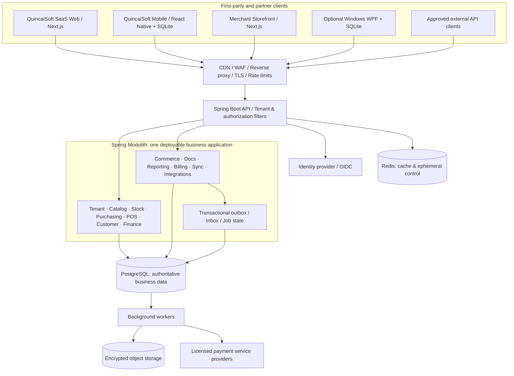
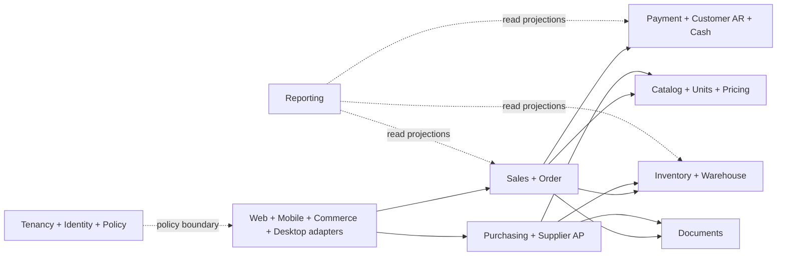
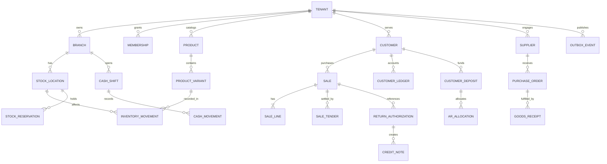
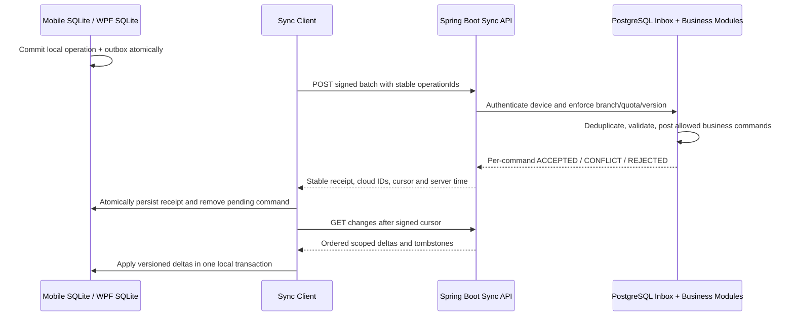
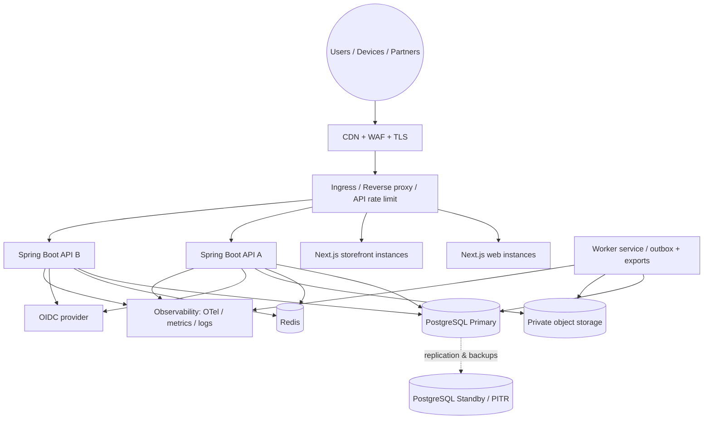

# QuincaiSoft — Complete SaaS, Mobile, Commerce & Desktop Integration Architecture

**Engineering master specification | Version 2.0 | 17 November 2026**  
**Product:** QuincaiSoft — Retail • Trade • Distribution  
**Developer:** Opesware Technologies  
**Status:** Revised design and build contract with all fourteen reviewed gaps specified; implementation, benchmarks, legal/fiscal approval and production certification remain unverified. See §§31–46 and the preservation ledger in Appendix F.  
**Primary market:** Cameroon and CEMAC hardware shops, construction-material retailers, wholesalers and distributors; architecture supports extension to general merchandise, electronics, supermarkets and other retail industries.  
**Primary deployment:** Multi-tenant SaaS, dedicated hosted perpetual or subscription deployments, customer-hosted perpetual server, standalone Windows perpetual with mobile companion, and optional cloud-connected Windows; see §35 for authority and mobile capabilities.  
**Baseline references:** Existing OPES Quincalerie Windows master specification v2 and its canonical 88-screen contract CSV; R02 cumulative Windows code is an *uncertified source candidate*.  
**Document language:** English; customer-facing software bilingual English/French from inception.  
**Design principle:** If a business-critical operation cannot be proved correct under retries, outages, duplicates, concurrent users and branch boundaries, it is not complete.

---

## 0. How to use this specification

This is the single source of truth for architectural decisions, required business modules, persistence rules, API contracts, workflows, security, offline behavior, release operations, web/mobile/Desktop integration, testing and acceptance gates. Engineering tasks must reference section IDs and acceptance criteria. No team should substitute mockups for handlers, source files for executed tests, or a successful build for real operating certification.

**Notation:**
- **MUST** = mandatory release requirement; **SHOULD** = default unless recorded exception; **MAY** = explicitly optional.
- **Cloud** = centralized authoritative PostgreSQL system; **site** = an individual physical store/warehouse/device with possible offline commitments.
- **Posted** = immutable business transaction acknowledged by the authority designated for that workflow.
- **Provisional/offline** = locally durable but not necessarily accepted by cloud.
- **Tenant** = security/subscription organization containing one or more legal companies; **company** = accounting and inventory-ownership boundary; **branch** = location belonging to exactly one company (§36).
- Proposed targets, capacities and policies in this document are **engineering acceptance defaults**, not benchmark evidence or regulatory determinations.

### 0.1 Non-negotiable business outcomes

1. One reliable transactional system for sales, customer debt, supplier debt, stock, cash, returns, tax snapshots and documents; no conflicting ledgers among web/mobile/storefront/desktop.
2. Supports a one-person shop or many branches under one tenant, with branch- and role-scoped permissions.
3. Supports online operations and carefully bounded offline operations without duplicate sale/stock/payment postings.
4. Supports multiple selling units, fractional stock in fixed base units, barcodes, wholesale/retail prices, mixed tenders, credit, customer deposits, procurement and fulfillment.
5. Includes a mobile application in **every commercial package**; capabilities are restricted by permissions, not withheld behind a separate app purchase.
6. E-commerce is an optional/dedicated-cloud entitlement and must use the same authoritative inventory and order system.
7. Supports subscription SaaS, annual/perpetual-use licensed deployments and separately contracted defined-IP-transfer projects; no accidental transfer of Opesware background IP.
8. Keeps existing standalone Windows software viable without internet or forced subscription; cloud-connected Windows operation is a distinct optional mode.
9. Bilingual English/French UI, XAF/FCFA support, configurable country/fiscal rules and no unsupported claims of approved DGI fiscal invoicing.
10. All screens, actions, server endpoints, printables, background jobs, events and business invariants require acceptance evidence.
11. Operates under service loss, process restarts, payment-provider timeouts, duplicate requests, delayed synchronization, schema upgrades and disaster recovery.
12. Expands into other retail sectors by configuration and bounded extension modules, not by duplicating the ERP codebase.

### 0.2 Included and excluded

**Included in target architecture:** tenant lifecycle; identity and permissions; organizations/branches/warehouses; product/category/units/prices/barcodes; stock and counts; purchasing and suppliers; POS and payments; customer accounts and deposits; quotations; returns/refunds; fulfillment; expenses and cash shifts; operational accounting and reconciliation; fiscal rule configuration; reports; print/document engine; subscriptions and entitlements; web UX; offline mobile; optional e-commerce; sync and optional desktop bridge; notices; integrations; platform operations; support; imports/exports; observability; security, recovery and pilots.

**Not included without separate approval:** licensed payment wallet/custody/escrow services, direct banking, statutory professional accounting audit opinion, automatic government fiscal accreditation, financial lending, biometric workforce monitoring, autonomous AI transaction posting, uncontrolled marketplace sharing of merchant data, direct access from SaaS to desktop SQLite, and instant cross-branch offline stock guarantees without partitioned inventory authority.

### 0.3 Explicit fundamental decisions (ADRs)

| ADR | Decision | Rationale / guardrail |
|---|---|---|
| 001 | **Java 25 LTS + Spring Boot 4.x** | Enterprise backend; compatible with Spring Modulith; pin exact tested patch versions in dependency lock/BOM |
| 002 | **DDD modular monolith + Clean Architecture** | Business invariants remain transactional; avoid premature distributed consistency |
| 003 | **Spring Modulith for boundaries and testing** | Custom PostgreSQL outbox/inbox is the sole durable domain-event publisher; do not duplicate with Modulith persistent publication (§38) |
| 004 | **PostgreSQL 18** | Source of truth for tenant business data, ACID transactions, RLS, PITR |
| 005 | **Shared database tenant isolation** with optional dedicated DB | Tenant ID + RLS + composite keys + authorization; dedicated migration path for enterprise |
| 006 | **Next.js 16 + React + TypeScript** | Browser SaaS and storefront as separate apps; typed clients |
| 007 | **React Native + Expo (currently SDK 56 baseline)** | Android/iOS mobile clients with local SQLite and controlled offline commands |
| 008 | **REST JSON, OpenAPI 3.1, explicit versioning** | Stable language-neutral API for Java, TypeScript and .NET WPF |
| 009 | **OAuth2/OIDC, PKCE, MFA, device enrollment** | Identity and resource authorization independent of UI clients |
| 010 | **Transactions + outbox/inbox + idempotency** | Reliable cross-module side effects and retry processing |
| 011 | **Financial ledger and stock ledger are append-only** | Corrections/reversals preserve evidence, do not rewrite history |
| 012 | **Redis only for derived/ephemeral state** | Never authoritative for stock, balances, billing, approvals or cash |
| 013 | **S3-compatible private object store** | Signed access to images, exports, immutable documents and encrypted backups |
| 014 | **Linux containers on one production region initially** | Simpler operations; HA managed PostgreSQL, separate worker processes |
| 015 | **Outbox initially via PostgreSQL** | No Kafka requirement in v1; broker added only with measurable need |
| 016 | **Windows retains .NET 10 WPF + SQLite** | Existing standalone desktop is not rewritten; new opt-in .NET sync adapter |
| 017 | **Subscription + merchant payment separation** | Platform billing and merchants' customer collections are distinct ledgers and privileges |
| 018 | **Modular industry capabilities** | Hardware vertical first, support generic trade without forced global specialization |
| 019 | **One backend for all first-party clients** | Mobile, web, storefront, desktop cannot duplicate financial posting rules |
| 020 | **No unverified compliance designation** | Counsel/accountants approve DGI, OHADA, data protection and provider workflows |
| 021 | **Exclusive per-device stock allocation for offline selling** | Site is a grouping; disconnected devices never share spendable quota. Coordinating local authority is a separately gated future option (§33) |
| 022 | **Outbox event is informational, not a second source of truth** | Side effects consume committed facts; no second sale-posting listener |
| 023 | **Phased feature launch by evidence gates** | Each vertical capability must pass source, API, financial, security, UI, offline and field tests |

**Framework/version assurance:** Version numbers are inherited target candidates, not proof of current releases or compatibility. P01 must verify official supported releases, lock a compatible dependency matrix/BOM and test native modules before approval; §45 defines the fallback ADR and evidence gate. See source register §30.

---

## 1. System context and boundaries

### 1.1 Logical architecture



**Trust boundaries:** public internet never touches PostgreSQL/Redis directly; storefront sees public catalog only; tenant administration cannot elevate itself to platform superadmin; support staff cannot silently impersonate cashiers; devices cannot use human passwords as long-lived API secrets. Every background job carries a tenant/branch and least-privilege identity.

### 1.2 Deployment modes

| Mode | Business authority | Database | Network | Customer experience |
|---|---|---|---|---|
| Standard SaaS | Cloud API | Tenant-partitioned PostgreSQL | Online web; bounded offline mobile | Monthly subscription |
| Dedicated cloud | Isolated cloud deployment | Dedicated PostgreSQL | Online + offline clients | Enterprise subscription |
| Customer-hosted enterprise | Contractual customer authority | Dedicated PostgreSQL | Private cloud/on-prem | Perpetual software-use licence + maintenance |
| Standalone Windows | Local WPF application | Local SQLite | None required | Perpetual-use desktop licence |
| Cloud-connected Windows | Site authority within assigned offline quotas, cloud global authority | SQLite local + PostgreSQL central | Async sync | Desktop and cloud subscription/connector entitlement |
| Defined-IP-transfer bespoke edition | Contract-specific | Contract-specific | Contract-specific | Explicit scope, background-IP carve-outs and third-party licences |

Never implement cloud-connection as a mandatory runtime dependency for previously sold standalone desktop licences. Cloud adoption, device linking, sync mapping and data migration require tenant-owner consent and a reversible onboarding plan.

### 1.3 Tenancy hierarchy

```text
Platform (Opesware operations only)
  Tenant / subscribing legal merchant
    Legal entity / company registration
      Branch / shop / sales site
        Warehouse / location / bin (if enabled)
        POS till / shift / clerk assignment
        Devices (desktop, mobile, scanners)
      Central organization roles / finance / administration
      Sales channels (in-store, assisted, website, mobile)
      Stores / storefront branding and domain configuration
```

All tenant-owned records carry `tenant_id`; economic records also carry `company_id` and the applicable branch/location scope. Branch belongs to one company. Cross-company trade uses paired sale/purchase and intercompany accounting, not ordinary branch transfer (§36). Same-company transfers preserve transit custody rather than making goods available at both ends.

---

## 2. Source tree, development conventions and module boundaries

### 2.1 Monorepo layout

```text
quincaisoft/
  README.md
  ARCHITECTURE.md                         # This canonical document
  apps/
    web-admin/                            # Next.js app router, business SaaS UI
    platform-admin/                       # Separate OPES control plane UI
    merchant-storefront/                  # Next.js public commerce storefront
    mobile/                               # Expo RN app (Android/iOS)
    mobile-e2e/                           # Device E2E and sync chaos tests
  backend/
    pom.xml                               # Maven multi-module BOM and checkers
    api-server/                           # Spring Boot composition root
    business-modules/
      tenant/ identity/ subscriptions/ company/ branch/
      catalog/ pricing/ inventory/ purchasing/ suppliers/
      sales/ tenders/ customer-accounts/ expenses/ cash/
      quotations/ returns/ fulfillment/ documents/
      reporting/ commerce/ sync/ integrations/ notifications/
      audit/ fiscal/ import-export/ support/
    workers/                              # Same domain application, worker profile
    platform-control/                     # Narrow platform operations boundary
    db-migrations/                        # Versioned Flyway scripts; expand-contract
    shared-kernel/                         # Money, Quantity, IDs, time; no god-module
    architecture-tests/                   # Modulith and dependency rules
  packages/
    api-contracts/                        # OpenAPI 3.1 + JSON Schemas
    generated-ts-sdk/                     # Generated; never edited directly
    shared-ui-tokens/                     # Palette, type, icon keys, spacing
    sync-protocol/                        # Versioned command and delta schemas
    localization/                         # en, fr ICU dictionaries
    design-system/                        # React UI primitives, not domain code
    test-fixtures/                        # Synthetic, no production data
  desktop-integration/
    contracts/                            # Language-neutral bridges and mappings
    dotnet-sync-adapter/                  # Separate opt-in WPF integration project
    migration-tools/                      # Explicit import/cutover tooling
  infrastructure/
    local/                                # Docker compose dev dependencies
    environments/dev/ staging/ prod/
    terraform/                            # Secrets references, networks, DB, storage
    observability/                        # Grafana/Prometheus/OTel config
    security/                             # WAF, key rotation, secret policies
  scripts/ build/ docs/ adr/ runbooks/
  tests/
    contracts/ e2e/ concurrency/ tenant-isolation/
    finance-reconciliation/ offline-chaos/ load/ security/ disaster-recovery/
  .github/workflows/                     # Signed provenance, build, test, promote
```

### 2.2 Backend package contract

Every bounded module has `api/` (public Java interface and event contracts), `domain/` (entities, value objects, invariants, pure rules), `application/` (commands, queries, authorization, transactions), `infrastructure/` (repositories, adapters) and `web/` (REST adapters when applicable). Only module public APIs are imported cross-module. Modules do not expose JPA entities or repository objects to other modules. `shared-kernel` only contains genuinely generic immutable value types and primitives.

**Architectural tests:** `ApplicationModules.of(QuincaiSoft.class).verify()` with explicit allowed dependencies, no dependency cycles, integration tests per module, Pact/consumer contract compatibility, no direct read/write of another module's table except versioned read projection APIs. Avoid generic `CommonService`, static tenant globals, mutable `Money` or an unbounded `SharedUtils` package.

### 2.3 Technical standards

- Java 25, Spring Boot 4.x, Spring Modulith-compatible BOM, Maven wrapper, Gradle not mixed into backend.
- Spring Web MVC for REST; virtual threads may be considered after benchmark, not an assumption; WebFlux only for a justified dedicated I/O workload.
- Hibernate/JPA for transactional aggregates; **jOOQ** for demanding report/read SQL; never mix two writers for one aggregate.
- Flyway repeatable/versioned migrations, `validateOnMigrate`, prohibited destructive migration on startup.
- Jakarta Bean Validation at boundary, domain validation within aggregates; MapStruct for mappings where tested.
- Spring Security resource server for bearer tokens; external OIDC provider; Spring Authorization Server only if OPES explicitly accepts identity-provider operating responsibility.
- Testcontainers with real PostgreSQL and Redis; JUnit 5, AssertJ, ArchUnit/Modulith tests.
- OpenAPI generated as contract or contract-first YAML, API linting, backwards-compatibility diff in CI.
- TypeScript strict mode; pnpm workspace; ESLint + Prettier + TypeScript checks run explicitly in CI.
- Next.js App Router with clear client/server boundaries; TanStack Query for read cache; React Hook Form + Zod for forms, no secret tokens in browser localStorage.
- Tailwind and shadcn/ui as source-owned components, Lucide icons; React Native Expo Router; SQLite with SQLCipher or OS-protected encrypted fields where compatible and verified on target devices.
- Mobile offline mutations route through a single durable sync queue, not scattered fetch calls.
- Conventional commits, protected branches, CODEOWNERS, signed release tags, reproducible builds and SBOM.

### 2.4 Code-quality gates

All merging into `main` requires compile, unit tests, module dependency verification, schema migration on fresh and upgraded DB, integration tests, vulnerability scan, software composition analysis, static secret scan, API contract check, UX lint, finance invariants where relevant, and required human review. All releases are promotion of the **same artifact digest** from staging, never rebuilding a different production binary.

---

## 3. Domain-level common rules and business invariants

**Revision 2.0 contract:** Binding elaboration: §§32–37 define recognition, custody, offline evidence, company scope and balanced journals; abbreviated rules here must be implemented using those contracts.

### 3.1 Identifiers and time

- UUIDv7 or UUIDv4 for tenant-visible object IDs; no sequential global ID exposing tenant volume. All command IDs globally unique UUIDs.
- Human-facing numbers (sale/receipt/quotation/credit note) allocated atomically per `tenant + branch + document_type + fiscal_series`; never determined by `MAX(number)+1`.
- Persist UTC instants with `timestamptz`, local business-date boundaries using the branch's IANA timezone (`Africa/Douala` by default). Store original offset in immutable fiscal snapshots if required.
- Financial periods use explicit `business_date` and cutoff; a close is not equivalent to midnight UTC.
- Every auditable command records actor, tenant, branch, device, request ID, correlation ID, occurrence time, acceptance time and source channel.

### 3.2 Money, tax and exchange rates

- XAF amounts stored in **signed BIGINT minor units of one FCFA**, with overflow-checked arithmetic. Java `long` for stored XAF integer with `Math.addExact`/`multiplyExact` as needed and `BigDecimal` for intermediate calculations.
- If future currencies are enabled, `Money{currency, decimal amount}` plus ISO 4217 currency exponent per currency; no implicit XAF conversion or mixed-currency sums.
- Tax percentages are `NUMERIC`/BigDecimal, effective dated, with per-line taxable base, tax code, rate, inclusive/exclusive rule, rounding mode and result frozen at posting.
- Discounts/promotions rounded with deterministic documented algorithm; pennies/FCFA remainder allocated deterministically by line IDs.
- Monetary negative balances are not silently capped to zero; returns, deposits and cash receivables have distinct semantic accounts.
- Payment-provider fees are merchant expenses or settlement deductions under explicit accounting treatment, **never subtracted from customer sale amount** silently.

### 3.3 Quantities, units and inventory costing

- Persist stock quantity as `NUMERIC(24,3)` **base units**, or integer thousandths via `BIGINT` with checked transforms; choose a single representation per bounded context and document it. **Baseline choice: BIGINT milli-base-units** for exact arithmetic.
- Unit conversions use positive integer **rational numerator/denominator** to base units, with a required exact representability check; reject invalid fractional results rather than rounding stocked quantities unpredictably.
- Item, box, bag, roll, metre, kilogram, litre, bundle, carton, square metre and other industry units are configurable. Each SKU has one base stock unit and effective-dated alternate pack rules.
- Valuation baseline = weighted-average acquisition cost (WAC), stored with sufficient precision and frozen per posted sale/issue; FIFO/serial/batch valuation is a separate configurable capability, not mixed per posting arbitrarily.
- Physical on-hand = approved physical custody movements, including separately identified third-party-owned goods. Merchant-owned serviceable custody excludes customer/supplier-owned and unavailable goods. Central available-to-promise subtracts live central reservations and exclusive offline allocations from that merchant-owned serviceable quantity (§32). In-transit and customer custody are explicit positions.
- Negative available stock prohibited except controlled and auditable emergency policy, disabled by default. No stock mutation from editing product metadata.

### 3.4 Business posting invariants

- **Sale**: one atomic recognition transaction posts header/lines, pricing/tax/cost snapshots, applicable verified tenders/advance allocations/AR, inventory ownership movements and immediate handover custody movements where applicable, cash, balanced journal, immutable document snapshot/number and outbox. HANDOVER is default; paid unfulfilled orders remain advances/reservations until recognition. SALE_WITH_CUSTOMER_CUSTODY requires approved policy (§32). Printing follows commit.
- **Customer credit**: debit by sale, credit by verified collection/credit note; deposits are liabilities until allocated; no collection recognized twice.
- **Customer deposit refund**: remaining unallocated deposit must cover refund; cashier till debit and customer liability decrease in same transaction; double refund impossible.
- **Purchasing**: ordering does not increase stock; goods receiving does; supplier invoice creates payable; payments reduce payable through linked allocations.
- **Return**: cannot exceed eligible previously sold/received quantity; stock re-entry depends on actual inspected condition and physical custody; refund eligibility never exceeds available credit balance.
- **Cash close**: expected amount derived from authoritative till ledger; variance = counted cash minus expected; manager override with reason, immutable result and corrective movement, not direct edits.
- **Offline**: local acceptance is labeled provisional/locally posted according to approved site authority; never misrepresent provider payment as verified, nor global stock as guaranteed while disconnected.
- **Audit**: financial and inventory posted facts corrected via reversal/adjustment with original links, not deleted or overwritten.

### 3.5 Transaction states

| Concept | States | Illegal behavior |
|---|---|---|
| Sale | DRAFT, HELD, POSTED, PARTIALLY_RETURNED, FULLY_RETURNED, VOIDED_BEFORE_POST | Delete POSTED or repurpose it as editable draft |
| Customer payment | INITIATED, PROVIDER_PENDING, CONFIRMED, REJECTED, REVERSED, UNKNOWN | Count PENDING or UNKNOWN as confirmed funds |
| Purchase | DRAFT, APPROVED, ORDERED, PARTIALLY_RECEIVED, RECEIVED, CLOSED, CANCELLED | Receiving before authorized order where required |
| Stock transfer | DRAFT, APPROVED, DISPATCHED, IN_TRANSIT, PARTIALLY_RECEIVED, RECEIVED, EXCEPTION, CANCELLED_PRE_DISPATCH | Make same goods available at origin and destination |
| Return | REQUESTED, INSPECTED, APPROVED, CREDIT_ISSUED, REFUNDED/PARTIALLY_REFUNDED, REJECTED, CLOSED | Refund before approved eligible credit |
| Cash shift | OPEN, CLOSING, CLOSED, RECONCILED, CORRECTED_BY_ADJUSTMENT | Post new movement into closed shift |
| Sync operation | QUEUED, SENDING, ACCEPTED, REJECTED, CONFLICT, QUARANTINED | Drop queued command after timeout without result lookup |
| Subscription | TRIAL, ACTIVE, GRACE, PAST_DUE, SUSPENDED, CANCELLED, EXPIRED | Destroy tenant business data immediately on billing failure |
| Fulfillment | PENDING, PICKING, READY, PARTIAL, DISPATCHED, DELIVERED, FAILED, RETURNED | Deduct inventory twice at handover |

Every transition has role policies, preconditions, allowed commands, idempotency behavior, emitted event, audit fields, prohibited bypasses, and direct state-machine tests.

---
## 4. Complete module inventory and boundaries

Every module owns its write model and database tables; all public cross-module interactions occur through approved application services, domain events, or read projections. **No module may create a second sale, stock or cash ledger.**

| ID | Module / owner | Primary aggregates and responsibilities | Required APIs, events and outputs |
|---|---|---|---|
| M01 | Tenant & provisioning | Tenant lifecycle, plan region, isolation tier, data ownership, migrations | Create/verify/suspend/restore tenant; `TenantProvisioned` |
| M02 | Organization & branches | Legal entity, business registration, branches, locations, store hours, business dates | Company/branch CRUD, active policy checks, `BranchCreated` |
| M03 | Identity & staff | Invitations, staff, memberships, MFA, session/device revocation | OIDC integration, invites, session validation, `MembershipChanged` |
| M04 | RBAC / ABAC policy | Roles, permission bundles, branch scoping, maker-checker, separation of duties | Effective capabilities API, authorization decisions, audit |
| M05 | Subscriptions & billing | Plan, features, seats, branch allowances, invoices to merchant, payment collection | Billing portal/webhooks, grace/suspension, `EntitlementChanged` |
| M06 | Catalog / PIM | SKU, product variants, brand, category, barcodes, media, lifecycle | Products, variants, search, imports, `ProductChanged` |
| M07 | Units & measurement | Base UoM, conversion ratios, pack definitions, tare, precision | Conversion tests and preview, UoM APIs |
| M08 | Pricing & promotions | Retail/wholesale tiers, effective dates, customer/branch prices, discounts | Price quote API, price approval, `PricePublished` |
| M09 | Inventory authority | Custody, ownership/valuation positions, immutable movements, central reservations, exclusive offline stock grants | Sole inventory writer; physical/owned/available balances and §32/§33 contracts |
| M10 | Stock count & replenishment | Cycle count, blind counts, approval, reorder points, transfer suggestions | Count sessions, discrepancies, reorder reports |
| M11 | Warehousing & transfers | Bins, receiving, dispatch, in-transit, cross-branch transfer acknowledgements | Transfer commands, scans, delivery and loss records |
| M12 | Supplier master | Supplier identity, purchasing terms, contact, documents, tax data | Supplier APIs, statement, duplicate screening |
| M13 | Procurement | Requisitions, RFQ, purchase orders, approvals, partial receipt, returns | PO/GRN APIs, `GoodsReceived`, landed costs |
| M14 | Supplier accounts | Payables, credit notes, deposits, payment allocation, ageing | AP ledger, statements, `SupplierPaymentConfirmed` |
| M15 | Customer master | Customer identity, optional business KYC, consent, terms, contacts | Directory, merge with audit, branch visibility |
| M16 | Customer credit/deposits | AR ledger, credit limits, deposit liability, invoice allocations, refunds | Statements, allocations, overdue reports |
| M17 | POS & sales | Cart/held sale, price and tax snapshot, receipt, sale approval, stock issue | Sale POST API, `SalePosted`, sales register |
| M18 | Payments and settlement | Tender types, provider adapters, settlement events, refunds, chargebacks | Payment intent, webhooks, reconciliation |
| M19 | Cash management | Cash registers, shifts, movements, count, closing and differences | Till APIs, daily close, `CashShiftClosed` |
| M20 | Expenses | Expense categories, payees, receipts, approvals, posted cash/bank impact | Expense API, voucher, expense analysis |
| M21 | Quotations & offers | Draft/issued quotes, expiry, revisions, approval, customer acceptance | Quote APIs, document and POS staging |
| M22 | Returns & credit notes | Original sale eligibility, inspection, restocking, credits, customer refund | Return API, credit note, refund voucher |
| M23 | Fulfillment & delivery | Pickup, packing, shipping, drivers, proof of delivery, partial fulfillment | Handover API, delivery note, `OrderDelivered` |
| M24 | Document & print engine | Atomic document issuance, number series, immutable economic snapshots, template versions and print attempts | issueSnapshot in source transaction; rendering/download/print after commit (§38) |
| M25 | Fiscal configuration & operational journal | Balanced control journal, company account mappings, periods, tax rules, finance export and fiscal adapter policy | postBatch, reversal, control reconciliation, tax preview and accountant exports (§37) |
| M26 | Operational reporting | Sales KPIs, margin estimates, stock, AR/AP, expenses, cash, audit | Bounded aggregate views, exports, report jobs |
| M27 | Commerce storefront | Storefront products, prices, checkout, customer cart and delivery choices | SEO catalogue, cart/order/payment API |
| M28 | Orders & reservation orchestration | Multi-channel orders and reservation workflow; M09 alone owns reservation quantities/tables | Order API; invoke inventory reserve/release/consume; order expiry and compensation coordination |
| M29 | Offline mobile/sync | Device grant, local outbox, batch push, deltas, conflicts, high-watermarks | `/sync/*`, sync logs, quota allocation |
| M30 | Windows bridge & standalone companion | WPF adapter, source mappings, encrypted companion snapshots/drafts and native reconciliation | Reuse M29 sync protocol; no alternate cloud sync engine or direct DB copying (§35/§38) |
| M31 | Notifications & alerts | Event-driven email/SMS/push/WhatsApp templates, preferences, delivery receipts | Notification queue, receipts, user opt-outs |
| M32 | Integrations & webhooks | Provider configuration, secrets, signed webhooks, retries, sandbox/test mode | Connectors and integration health |
| M33 | Import / export / migration | CSV/XLSX templates, dry-run diff, duplicate handling, mapping, job audit | Import jobs, scoped exports, failure manifest |
| M34 | Audit & compliance | Immutable event trail, retention policy, access logs, legal hold, export | Audits, access review, retention execution |
| M35 | Platform administration | Tenant support, service health, billing support, capacity, feature rollout | Separate admin API/control plane, break-glass |
| M36 | Industry capabilities | Per-vertical attributes, templates, sector rules and optional module packages | Feature and schema configuration, not tenant code forks |
| M37 | Device and print management | Registered printers/scanners, locale/templates, device status and troubleshooting | Printer profile and capability checks |
| M38 | Data lifecycle & backup | Tenant export, deletion workflows, PITR runbooks, restore verification | Export/restore evidence and retention jobs |
| M39 | Search and indexing | Product/customer/supplier search, autocomplete, bounded reindexing | PostgreSQL full text initially; external index only if needed |
| M40 | Support & diagnostics | Ticket, diagnostic bundle, consented remote support session, incident linking | Support UI and auditable access grant |

### 4.1 Dependency direction



**Approved synchronous collaborators:** posting a sale can invoke stock reservation consumption, cash payment recording and AR creation in one transaction through narrow module service interfaces. **Approved asynchronous collaborations:** printing, email, search projections, analytics aggregates, payment notification messages. An asynchronous listener must not be used to make the sale eventually debit stock; that must happen in the sale posting transaction.

### 4.2 Full business screen and task contracts per module

Each main module must implement: a scoped listing, search/filter/pagination/export, create/edit with save-draft where legal, detail/timeline, role-specific actions, validation errors, conflict state, posting confirmation, audit history, and mobile-compatible read/write contracts where authorized. Exceptions: pure engines (unit conversion, report job, indexing) expose configuration and diagnostics instead of full CRUD.

| Module group | Required workflow | Core forms | Mandatory printables / reports |
|---|---|---|---|
| Company, tenant and branches | Register tenant → verify owner → create company → configure branches → assign staff → set fiscal/printer policies | Company legal profile, branch, warehouse, operating calendar, language and fiscal setup | Company profile, branch inventory, staff/permissions audit |
| Catalog and pricing | Add SKU → units → barcodes → costs/prices → publish → archive with history | SKU/variant, category, UoM, alternative pack, price approval, import preview | Product labels, price list, catalogue, margin by product |
| Inventory | Receive/adjust → reserve → dispatch → transfer → count → reconcile | Movement, adjustment reason, count grid, discrepancy, transfer dispatch/receipt | Stock card, count sheet, variance report, transfer note |
| Procurement | Requisition → PO → approval → partial goods receipt → vendor invoice → payment → return | Requisition, PO, GRN, supplier invoice, landed cost, settlement allocation | PO, GRN, supplier return, AP statement |
| POS and sale | Scan/search → quote cart → apply pricing → select customer → authorize tender/credit → post → print | Cart, tender split, cash discount authorization, credit terms | Receipt, sale document, reprint watermark, sales register |
| Customer credit | Set limit → sell on credit → collect payment/deposit → allocate → overdue follow-up → corrective note/refund | Customer account, credit terms, deposit, allocation, refund | Customer statement, payment receipt, aging report |
| Returns and fulfillment | Locate posted sale → inspect eligible qty → approve return → physically receive/grade → credit/refund → audit | Return inspection, credit note, refund, pickup and POD | Return receipt, credit note, refund voucher, delivery note |
| Cash and expenses | Open till → sell/collect/expense → count → close → record variance → owner reconciliation | Till open, cash movement, expense, approval, counted denominations | Cash-close report, expense voucher, discrepancy report |
| Quotes and documents | Draft quote → issue → accept/revise/expire → stage POS → print and version | Quote editor, template editor, fiscal document settings | Quote/proforma, tax invoice when approved, duplicate mark |
| Commerce | Browse → cart → address/fulfillment → reserve → payment confirmation → allocate stock → fulfillment → return | Cart, checkout, address, promo, order help | Online order, order confirmation, delivery note |
| Reporting | Date range/branch → apply filters → query → drill down → export | Filter controls, report builder presets | Sales, gross margin estimate, stock, AR/AP, cash, audit |
| Subscriptions | Trial → activation → invoice → renewal → grace/suspension → reactivate/cancel/export | Plan, billing detail, payment method, data export | Merchant subscription invoice/receipt and usage history |
| Administration | Invite, role, fiscal, printer, backup, connected app, support, retention | Role editor, policy, templates, provider credentials, export approval | Security audit, backup attestation, diagnostics |

### 4.3 Industry expansion without forked apps

Baseline capabilities shared by all industries: tenant, branches, products/variants, price lists, barcodes, stock, suppliers, POS, customer accounts, finance, documents and reports. **Industry profiles** provide extra attributes, specialized measurements, workflows and UI views but cannot rewrite core posting semantics.

| Profile | Optional domain extensions | Distinct constraints |
|---|---|---|
| Hardware / construction | Bags/length/area, cut-to-size estimates, bulk deliveries, contractor price lists | Unit-ratio exactness, partial delivery |
| Timber / wholesaling | Species/grade, bundles, cubic-meter calculation, procurement lots | Source provenance and lot measurement |
| Electronics / appliances | IMEI/serial, accessories, manufacturer warranty, repair intake | Unique serial ownership, warranty lifecycle |
| Automotive spare parts | Vehicle fitment, OEM/equivalent references, serial/batch | Fitment is advisory; compatibility disclaimer |
| Supermarket / food retail | Lot, expiry, promotions, weighing scales, shelf labels | First-expiry-first-out when enabled, recall traceability |
| Fashion/general retail | Size/color variants, matrix inventory, returns policies | Variant-level stock |
| Furniture | Bundles, deposits, delivery schedules, assembly service | Partial fulfillment/service items |
| Industrial distribution | Contract pricing, purchase approval tiers, cross-warehouse transfers | Multi-stage approvals |
| Pharmacy / regulated goods (future) | Batch/expiry, cold chain, restricted SKU controls | Requires separate sector legal and professional workflow approvals before launch |

Industry modules are enabled through signed configuration/feature entitlements and validated migrations. No arbitrary tenant-written SQL, custom Java class loading or executable scripts in the shared SaaS process.

---

## 5. Tenancy, identity, entitlements and authorization

### 5.1 Tenant provisioning

`CREATE_REQUESTED → IDENTITY_VERIFIED → PAYMENT_OR_TRIAL_CONFIRMED → PROVISIONING → READY → ACTIVE`. Provisioning must be idempotent with a ledger of steps: tenant row, business namespace, owner invite, default roles/policies, default chart mappings, language pack, document series, stock location, feature entitlements, storage prefix, secrets references and backfill outbox. A failed step resumes or compensates; it does not produce a half-active tenant.

Hard tenant deletion is a separate audited, retention-approved workflow after statutory hold checks and export request handling. Tenant suspension blocks new customer-originated mutations but preserves regulated/accounting data and allows owner data-export pathways per contract.

### 5.2 Identity architecture

Use an OIDC provider (managed provider or independently operated Keycloak), Authorization Code + PKCE for web and mobile, HttpOnly Secure SameSite cookies for server-side web session where appropriate, short-lived access tokens, rotating refresh tokens, MFA for owners/admins and sensitive operations, revocation and suspicious-login policies. Do not store OAuth tokens or provider secrets in browser localStorage. Password reset via IdP; no password copied to tenant data model.

Identity federation and membership are separate: one human identity may belong to multiple companies without granting cross-tenant access. An explicit **active tenant switch** obtains a fresh scope; client-supplied tenant headers are only hints and must match server-verified membership/context.

### 5.3 RBAC + ABAC and approval controls

Default roles (customizable): Platform Operator (separate control plane), Tenant Owner, Company Administrator, Finance Manager, Branch Manager, Inventory Manager, Purchasing Officer, Cashier, Sales Clerk, Delivery Agent, Auditor Read-Only, E-commerce Operator, Support Access Temporary. Fine-grained capabilities follow `module.resource.action` (e.g. `sales.refund.approve`, `cash.shift.close_other`, `inventory.adjust.post`, `documents.reprint`, `billing.plan.change`). ABAC conditions include tenant, branch, location, cost centre, own-till, max discount, credit-limit threshold, amount approval tier, device trust, shift state, and time-bound support approval.

**Mandatory two-person approval:** configurable thresholds for cash refunds, major stock write-offs, high discount overrides, period reopening, supplier-bank detail changes, bulk exports, pricing changes above threshold. Initiator may not approve own transaction under maker-checker policy. Owner emergency overrides require step-up auth, reason and immutable audit.

All service entry points enforce permissions **again** even if the UI hides buttons; IDOR negative tests are mandatory. Report exports and background workers also enforce effective scope. Access reviews and termination must revoke sessions, devices and refresh tokens promptly.

### 5.4 Subscriptions / feature entitlements

Plans configure limits for staff seats, branches, warehouse count, order volume, storage, export bandwidth, integrations, support and dedicated deployment. **All packages contain mobile-app access**, although role policies and modules differ. No plan hardcodes a separate codebase. A plan change is an audited, effective-dated entitlement event.

Grace-period policy: reads, exports, reconciliation, backups and statutory access persist; new business posting may be limited only after an explicitly communicated grace period and contract review. Never alter historical financial records because of billing. Rate limit abuse by tenant and device, not just account.

**Commercial separation:** merchant's customer money belongs to the merchant and its licensed processor; Opesware SaaS subscription receipts are separate. Opesware is not a custodian of merchant cash or settlement without proper licensing and agreement.

### 5.5 Shared DB isolation implementation

- Every tenant-owned table has `tenant_id UUID NOT NULL` and tenant-aware foreign keys `(tenant_id, referenced_id)` where practical.
- Enable and `FORCE ROW LEVEL SECURITY` for tenant-owned tables; app DB role is not owner, superuser or `BYPASSRLS`; migration role isolated from app role.
- Every DB transaction sets verified tenant via `SELECT set_config('app.tenant_id', :verifiedTenant, true)` **inside that transaction**. Missing context must fail closed.
- RLS policies apply `tenant_id = NULLIF(current_setting('app.tenant_id', true), '')::uuid`. Avoid using unsafe `SECURITY DEFINER` functions with tenant data; audit any exceptions.
- PostgreSQL connection pooling must not leak session variables between tenants; transaction-scoped settings with PgBouncer transaction pooling are tested.
- Jobs, reporting, raw SQL, webhooks, indexing, imports and exports all carry trusted tenant context and authorization.
- Redis keys include `env:tenant:branch:resource:key`, and caches cannot return results until tenant/permission scope is checked.
- S3 keys include random tenant namespace with bucket policy, encryption, signed URL expiry, scoped document row ownership check and revocation strategy.
- Per-tenant keys/isolated DB are optional for enterprise, with a migration runbook and rollback/cutover verification.

**Mandatory isolation tests:** guess other tenant IDs; nested object relationship mismatch; pagination cursor reuse; cached response cross-tenant; SQL injection; platform impersonation; background jobs with missing context; RLS disabled on newly added table; migration role misuse; object URL reuse.

Example policy pattern (illustrative only; production migrations generated and tested):

```sql
ALTER TABLE product ENABLE ROW LEVEL SECURITY;
ALTER TABLE product FORCE ROW LEVEL SECURITY;
CREATE POLICY product_tenant_isolation ON product
  USING (tenant_id = NULLIF(current_setting('app.tenant_id', true), '')::uuid)
  WITH CHECK (tenant_id = NULLIF(current_setting('app.tenant_id', true), '')::uuid);
-- Runtime user must be non-owner and cannot BYPASSRLS.
```

---

## 6. Persistence and data model

**Revision 2.0 contract:** Binding model extension: economic records carry company_id; §32 supplies custody/ownership position keys; §34 supplies canonical idempotency/change-feed tables; §37 supplies journal tables. The original entity map remains mandatory, with these additional fields/families.

### 6.1 Storage assignments

**PostgreSQL authoritative:** all master data, stock journal, sale/tender ledger, AR/AP, cash ledger, quotes, orders, documents metadata, audit, device grants, sync inbox/outbox, entitlements, approvals. **Redis ephemeral:** bounded caches, rate counters, temporary session/cache, non-authoritative job coordination. **Object store:** privately encrypted product images, signed document snapshots, scanned evidence, immutable export artifacts, backup archives and release evidence. **Mobile SQLite:** scoped offline catalogue and commands, never a second authoritative cloud ledger. **Desktop SQLite:** standalone authority or bounded site-level authority, explicitly upgraded to sync mode only through approved migration.

### 6.2 Core entity map

| Entity family | Mandatory columns / relationships | Critical constraints |
|---|---|---|
| tenant | `id`, status, region, isolation tier, plan ref, created_at | unique canonical slug, active eligibility |
| company, branch, warehouse, stock_location | tenant_id, parent ID, timezone, currency, active | tenant-aware composite FK, branch belongs to same tenant |
| membership, role, permission, grant | tenant_id, identity subject, scoped branch, role | cannot approve own scoped request where prohibited |
| device, device_grant, sync_cursor | tenant_id, branch_id, public-key fingerprint, platform, revocation | unique scoped device, anti-replay |
| product, variant, barcode, category, unit_conversion | tenant_id, SKU, base UoM, status, price group | unique active SKU/barcode per tenant and appropriate scope |
| price_list, price_rule, promotion | tenant_id, effective interval, priority, customer tiers | overlap/stacking policy, deterministic resolution |
| inventory_movement, stock_reservation, stock_balance | tenant_id, location, SKU, source/ref, quantity base | append-only movement, reconciled materialized balance, no unauthorized negative stock |
| stock_count_session, count_line, adjustment | tenant_id, counted/expected, operator, freeze strategy | one approved posting per count line/revision |
| purchase_order, po_line, goods_receipt, receipt_line | tenant_id, supplier, branch, unit/cost snapshot | partial receipt cannot exceed approved quantity without override |
| supplier_ledger, supplier_payment, ap_allocation | tenant_id, supplier, invoice, amount, status | no over-allocation, immutable confirmed payments |
| customer, customer_credit_policy | tenant_id, credit limit, terms, consent | branch access and privacy retention |
| sale, sale_line, sale_tender, sale_tax_snapshot | tenant_id, branch, actor, totals, cost, customer | immutable posted lines and tax snapshot; idempotency uniqueness |
| customer_ledger, customer_deposit, ar_allocation | tenant_id, source, debit/credit, effective date | no allocation above open amount or deposit available |
| payment_intent, payment_event, settlement | tenant_id, provider, external ID, state, hash | external ID dedup; settlement reconciled separately |
| cash_shift, cash_movement, cash_close | tenant_id, till, actor, counted/expected, state | one active shift per register, no writes after close |
| quotation, quotation_version, quote_line | tenant_id, customer, prices, expiry, status | issued versions immutable; accepted quote is not sale |
| return_authorization, return_line, credit_note, refund | tenant_id, original sale/ref, eligible qty, amount | no over-return, no over-refund |
| order, order_line, fulfillment, handover | tenant_id, sales channel, status, reservation | cannot dispatch more than authorized quantity |
| document_snapshot, print_job, doc_template | tenant_id, source, template version, renderer hash | immutable original, reprint audit |
| subscription, platform_invoice, entitlement | control-plane tenant ID, plan, cycle | no mixing merchant/customer payments with SaaS billing |
| outbox_event, inbox_receipt, idempotency_result | tenant_id, canonical operation ID, request hash, source/result, consumer ID for inbox | business dedup unique tenant+operation; consumer receipt unique tenant+consumer+event; device/epoch are provenance and authority (§34) |
| audit_event, security_event, approval_request | tenant_id, actor, object/ref, reason, old/new hashes | append-only, retention/legal hold |

Index baseline: `(tenant_id, branch_id, created_at DESC, id DESC)` for registers; `(tenant_id, sku)` for product; `(tenant_id, location_id, variant_id)` for stock; `(tenant_id, reference_id, operation_type)` for idempotency; exact date partitioning on large immutable journals after measured need. Use covering indexes only with examined `EXPLAIN ANALYZE`, not blindly.

### 6.3 Relational model (simplified but authoritative cardinalities)



### 6.4 Ledger and balance semantics

Define **four distinct** monetary dimensions: (1) sale consideration/revenue snapshot; (2) customer receivable; (3) customer advance/deposit liability; (4) verified cash/provider settlement. A customer paying 10,000 XAF in advance increases cash or verified payment receivable and customer liability, **not revenue**. When allocated against a 7,000 XAF issued invoice, liability decreases 7,000 and AR decreases 7,000, and remaining 3,000 is refundable subject to method rules. Refund 1,000 consumes 1,000 of remaining liability and lowers the correct cash/provider account. All posting is auditable, reversible through compensating entries, never a destructive update.

Stock availability derives from merchant-owned serviceable custody minus central reservations and exclusive outstanding offline grants; physical stock includes separately tracked customer/supplier custody. Reporting balances reconcile to the appropriate custody, ownership, reservation and valuation journals (§32); drift triggers an incident and controlled hold.

### 6.5 Financial reconciliation equations

```text
Sale gross = sum(line price × sold quantity - permitted discount + tax) [rounding policy applied]
Immediate confirmed tender applied + existing advance/credit applied + newly outstanding AR = recognized invoice gross
Customer AR closing = opening AR + posted credit sales + debit adjustments
                      - confirmed collections allocated - approved credit notes - valid credit adjustments
Deposit available = confirmed deposits + permitted credit transfers
                    - AR allocations - approved deposit refunds - reversals
Till expected = opening float + posted cash sales + posted cash collections
                + cash inflows - posted cash expenses - posted cash refunds
                - cash withdrawals / safe drops + authorized correcting movements
Physical custody closing = opening custody + physical receipts + physical returns + transfers-in
                           - physical handovers - physical losses - transfers-out ± approved count corrections
Merchant-owned quantity/value has its separate ownership and valuation rollforward (§32).
Central available = merchant-owned serviceable custody - central reservations - exclusive offline allocations.
Customer-owned custody, damaged, in-transit, reservations and grants remain separately reconciled.
```

Above equations are conceptual reconciliations; implementation uses paired immutable postings and handles reversals and sign conventions explicitly. Never calculate supplier balance, customer debt or gross margin by adding unrelated ledger categories.

### 6.6 Database migration and evolution

- Flyway versioned migrations (`Vyyyymmddhhmm__...sql`) checked against fresh schema and real anonymized legacy fixtures.
- Production migrations **expand → dual-read/write where safe → backfill → verify → switch → contract**. Backfills are resumable and monitored.
- Never drop/rename a field in the same release that older desktop/mobile clients still depend on.
- Desktop and mobile command schema compatibility must cover a documented minimum supported client range; reject obsolete clients with actionable upgrade instructions without deleting pending local transactions.
- Failed migration prevents service promotion, preserves prior binary and DB snapshots; restore rehearsals demonstrate recovery.
- Schema types, indexes, RLS policies, grants and triggers are verified by automated schema-diff tests and migration linting.

---
## 7. API contracts, request semantics and integration boundaries

### 7.1 Resource and route conventions

Canonical base: `/api/v1`. Authenticated human endpoints infer tenant from token + active membership (route tenant IDs only where the user is allowed to administer that tenant). Device endpoints infer tenant/branch from cryptographically registered device grant. Public storefront endpoints reference an approved storefront slug/domain mapped server-side to its tenant; do not trust a user-supplied tenant ID.

**API domain register** (each entry requires OpenAPI schema, examples, error matrix, permission, rate limit, idempotency rules and contract tests):

| Area | Required endpoint families |
|---|---|
| Identity | `/me`, `/sessions`, `/memberships`, `/security/mfa`, `/devices`, `/devices/{id}/revoke` |
| Tenant/company | `/company`, `/branches`, `/warehouses`, `/locations`, `/config`, `/feature-entitlements` |
| Catalog | `/products`, `/variants`, `/categories`, `/barcodes`, `/units`, `/price-lists`, `/price-quotes`, `/imports` |
| Inventory | `/inventory/availability`, `/movements`, `/reservations`, `/adjustments`, `/counts`, `/transfers`, `/replenishment` |
| Suppliers | `/suppliers`, `/purchase-orders`, `/goods-receipts`, `/supplier-returns`, `/payables`, `/supplier-payments` |
| Customers | `/customers`, `/customer-accounts`, `/receivables`, `/deposits`, `/collections`, `/allocations`, `/statements` |
| POS | `/pos/carts`, `/pos/held`, `/pos/price-quote`, `/sales`, `/sales/{id}`, `/sales/{id}/returns` |
| Payments | `/payment-intents`, `/payments`, `/payment-webhooks/{provider}`, `/settlements`, `/refund-requests` |
| Cash | `/cash-registers`, `/shifts`, `/cash-movements`, `/cash-closures`, `/cash-variances` |
| Expenses | `/expenses`, `/expense-approvals`, `/expense-categories`, `/payees`, `/expense-vouchers` |
| Quotes | `/quotations`, `/quotations/{id}/versions`, `/quotations/{id}/issue`, `/quotations/{id}/accept` |
| Fulfillment | `/fulfillments`, `/picklists`, `/dispatches`, `/proofs-of-delivery`, `/handover` |
| Documents | `/documents`, `/documents/{id}/render`, `/print-jobs`, `/document-templates` |
| Reports | `/reports/catalog`, `/reports/{code}`, `/report-jobs`, `/exports`, `/audit-events` |
| Storefront | `/public/stores/{slug}`, `/public/catalog`, `/public/cart-quotes`, `/commerce/orders`, `/commerce/checkout` |
| Platform billing | `/subscription`, `/subscription/invoices`, `/subscription/usage`, `/subscription/portal` |
| Integration | `/integrations`, `/integrations/{id}/health`, `/integration-webhooks`, `/api-keys` |
| Sync | `/devices/enroll`, `/sync/handshake`, `/sync/operations:push`, `/sync/changes`, `/sync/status`, `/sync/conflicts` |
| Admin | `/admin/tenants`, `/admin/tenant-health`, `/admin/rollouts`, `/admin/incidents` (distinct platform auth scope) |

### 7.2 Command contract and idempotency

Every business POST/PATCH mutation that can commit money, stock or external side effects uses `Idempotency-Key: UUID`, `X-Request-ID` and, if required, `If-Match` or expected version. Operation identity is `tenant_id + operation_id` (device identity included in authority checks). The server persists request hash, state, response status/JSON, actor and expiry horizon in the same transaction as committed business changes. Replaying identical operation returns original final result; same key with different payload returns `409 IDEMPOTENCY_KEY_REUSED`. A request timeout triggers status lookup; the client must not generate a new operation ID for the same intended sale.

Example:

```http
POST /api/v1/sales HTTP/1.1
Authorization: Bearer <opaque-example>
Content-Type: application/json
Idempotency-Key: 019b1a7c-9dc4-7c9b-a622-412e7f2a814c
X-Request-ID: 019b1a7c-e772-7fed-b999-1d2a99dd2091
```

```json
{
  "branchId": "<branch-uuid>",
  "registerShiftId": "<shift-uuid>",
  "operationId": "<operation-uuid>",
  "customerId": "<customer-uuid-or-null>",
  "currency": "XAF",
  "expectedPriceQuoteId": "<server-issued-quote-id>",
  "cartRevision": 4,
  "lines": [
    {"variantId":"<uuid>","sellingUnitCode":"BAG","quantity":"2.000","priceRuleId":"<uuid>"}
  ],
  "tenders": [
    {"type":"CASH","amountFcfa":"5000","cashShiftId":"<shift-uuid>"}
  ],
  "allowCustomerCredit": false,
  "fulfillment": {"method":"PICKUP"}
}
```

Response `201` only when authoritative posting succeeded; include generated sale ID, sale number, immutable totals, stock movement refs, tender states and receipt URI/print job. A provider pending authorization returns a distinct workflow state and must **not** call it confirmed settlement. Use `202` for accepted asynchronous job with status URL, not to pretend a sale was already posted.

### 7.3 Standard response and errors

```json
{
  "code": "INSUFFICIENT_OFFLINE_ALLOCATION",
  "message": "The requested quantity exceeds this device's available stock allocation.",
  "correlationId": "<uuid>",
  "fields": [{"path":"lines[0].quantity","reason":"EXCEEDS_AVAILABLE"}],
  "retryable": false,
  "currentVersion": 13,
  "helpKey": "stock.offlineQuota"
}
```

HTTP errors: `400` malformed; `401` unauthenticated; `403` unauthorized; `404` not found **or concealed cross-tenant**; `409` conflict/idempotency; `412` revision mismatch; `422` valid JSON but invalid business state; `423` frozen period/shift; `429` throttled; `500` unexpected with correlation ID; `503` temporary unavailable with retry hint. Validate payload length/array cardinality, content type, locale, UTF-8 and money precision before any mutation. Logging MUST redact credentials, card data, personal identifiers and sensitive payment provider payloads.

### 7.4 Pagination, filtering and exports

List endpoints default to keyset pagination using stable `(created_at, id)` or domain sort key with signed opaque cursor including tenant/filter/sort hash and expiry; cursors from another tenant or filter are rejected. `limit` max policy (e.g. 100 ordinary, 500 internal) enforced server-side. Complex full exports run asynchronously with authorization snapshot, row caps, S3 short-lived signed link and CSV injection protection. Report APIs declare time zone and period boundaries; no silent mixing of live and cached totals.

### 7.5 API lifecycle

- Backward-compatible additive changes within `/v1`; deprecation notices and telemetry on obsolete fields.
- Breaking changes require `/v2` or explicit versioned command schema and coexistence period; no silently repurposed JSON fields.
- `OpenAPI` generates TypeScript and C# clients; Java server remains contract-tested against published spec.
- All APIs publish required auth scopes, field ownership, idempotency, privacy labels, deprecation policy and examples.
- Contract diff CI fails removals/required-field additions without versioned migration plan.
- Developer portal and partner API keys use least scopes, tenant consent, rate limiting and mandatory audit.

### 7.6 Events and outbox/inbox

Event envelope:

```json
{
  "eventId": "<uuid>",
  "eventType": "SalePosted.v1",
  "schemaVersion": 1,
  "tenantId": "<uuid>",
  "branchId": "<uuid>",
  "aggregateId": "<sale-uuid>",
  "aggregateVersion": 1,
  "occurredAt": "2026-11-17T10:00:00Z",
  "correlationId": "<uuid>",
  "causationId": "<operation-uuid>",
  "payload": {"saleId":"<uuid>","documentNumber":"DOU-S-000031"}
}
```

Publish `SalePosted`, `PaymentConfirmed`, `PaymentReversed`, `GoodsReceived`, `CustomerDepositRecorded`, `ARAllocated`, `RefundPosted`, `InventoryAdjusted`, `OrderReserved`, `OrderCancelled`, `FulfillmentCompleted`, `SubscriptionStatusChanged`, `DeviceRevoked`, `DocumentIssued`, `CashShiftClosed`, `SyncRejected` and `AuditAlertRaised` as versioned events with PII minimization. Commit outbox with source transaction, then dispatcher claims batches using `FOR UPDATE SKIP LOCKED`, records attempts, exponential backoff and DLQ after max attempts. Consumers keep durable inbox receipts and are idempotent. Preserve ordering within `(tenant, aggregateId)` where needed; do not assume global ordering. Reconcile stuck outbox, inbox and provider settlement at intervals; alert owners and operators appropriately.

### 7.7 Eventual consistency boundaries

**Strong consistency required:** sale + stock issue + tender/AR; deposit allocation; customer refund + cash; stock transfer state changes; cash close; payment capture state; idempotency record; permission-sensitive posting. **Eventual consistency allowed:** notification, printed PDF caching, search index, dashboards, warehouse pick suggestions, analytics exports, catalog image transformations, webhook delivery. UI must label projection freshness where relevant; a lagging dashboard never controls whether a sale can post.

---

## 8. Critical end-to-end workflow specifications

**Revision 2.0 contract:** Recognition policy in §32 governs all sales/fulfillment steps below. Immediate POS handover performs sale recognition and physical issue atomically; prepayment is not automatically recognized revenue.

### 8.1 Owner onboarding and tenant activation

1. Verify owner contact through IdP; collect company profile, legal identity and preferred region.
2. Provision tenant as `PROVISIONING`, record consent/privacy acknowledgement and contract terms.
3. Create default branch, stock location, price list, numbering series, chart mapping, fiscal settings (provisional pending local accountant), staff roles and plan entitlements.
4. Owner selects **import opening data** (no data, CSV, or supervised migration); display dry-run totals and business date.
5. Post opening inventory/AR/AP with audited opening balance references; do not create duplicate sales from historical stock.
6. Configure taxes, currency XAF, receipt language and shift policy; test printer/profile where available.
7. Confirm onboarding only after tenant isolation, permissions, document numbering and data checks pass.
8. Gracefully resume failed provisioning; no tenant becomes `ACTIVE` with half-created reference data.

### 8.2 Product to sale to print

1. Cashier authenticates and opens an assigned cash shift; branch/location and device scope verified.
2. Scan barcode or search product, select unit, quantity, discounts and customer. Server returns quote ID, expiry, line tax and warnings.
3. On checkout, server reloads effective prices, unit ratios, available stock/assigned quota, discount rights, tax series and customer credit limit.
4. For cash tender, accept counted cash and calculate change; for external payment, do not confirm until verified provider response or explicit operator-confirmed manual tender policy.
5. Execute one PostgreSQL transaction with row locks / optimistic concurrency for touched stock and account records; persist sale+lines+pricing snapshots, immutable stock movement, tender/AR, cash, document number, idempotency result, audit and outbox.
6. Commit; return sale reference; printing and notifications happen after commit. Printer failure creates retryable print job, never a second sale.
7. Customer may collect later: under HANDOVER, payment is an advance and the order remains reserved until actual handover/recognition; under approved SALE_WITH_CUSTOMER_CUSTODY, recognition transfers ownership into customer custody and later pickup changes custody only. No second ownership issue/COGS is posted (§32).
8. Failed validation or DB transaction rolls back **all** related financial and stock effects.

**Concurrency test:** two branches attempt final stock unit simultaneously; at most one online transaction succeeds without authorized offline allocation. Same POST after timeout returns same sale ID and totals. Price changed between cart and checkout returns `PRICE_QUOTE_EXPIRED` for explicit review.

### 8.3 Customer credit and deposit example

- Customer receives posted invoice **12,000 XAF** on credit: AR debit 12,000, tax/cost and stock snapshots posted.
- Customer pays **5,000 XAF** in confirmed cash: cash +5,000, receipt 5,000; allocation to invoice credit 5,000, AR open 7,000.
- Customer later deposits **10,000 XAF**: cash +10,000, deposit liability +10,000, AR stays 7,000 until allocation.
- Allocate 7,000 against invoice: AR falls to zero; deposit liability available becomes 3,000. **No additional cash is created by allocation.**
- Refund 2,000 unallocated deposit with owner approval: cash -2,000, liability -2,000; available deposit 1,000. Double refund rejected.
- A credit note of 1,500 applies only to outstanding eligible invoice debt; if the invoice is already cleared, excess credit becomes a refund-eligible customer credit under explicit policy and cannot silently become cash.

**No overpayments:** if customer overpays an invoice, surplus is either returned immediately or converted to a transparent customer advance; never hidden as negative receivable. Credit-limit computation uses pending authorized exposure and open invoices with row locks or serializable constraints. Aging uses individual invoice due dates and allocation history, not only net account balance.

### 8.4 Purchasing, landed costs and AP

Requisition (optional) → approve PO → supplier confirms → receive quantities into quarantine/available states → capture landed costs (transport, customs, handling) → validate supplier invoice → create payable → allocate bank/provider/cash payments → reconcile statements. An unapproved PO cannot create stock, a stock receipt cannot exceed authorized outstanding quantity without override, supplier credits reference original PO/receipt, and costs allocate deterministically to received units. Overpayments become supplier advances, not negative expenses. Purchase price changes never rewrite existing cost snapshots.

### 8.5 Physical count and branch transfers

Count scope defined by location/products and snapshot strategy; count session locks or tags concurrent movements for reconciliation. Blind counts are supported. Approved variance posts a linked adjustment with reason and owner approval above threshold. Two count sessions cannot post same frozen stock snapshot twice. Transfers reserve origin, dispatch into in-transit, track partial receipt, losses and destination acceptance; only destination acknowledgement increases destination available. Reversal after dispatch is a physical return movement, not a deleted transfer.

### 8.6 Returns, refunds and warranties

Sale line eligibility = sold - previous approved returns - pending accepted return quantities. Inspection captures restock, defective/quarantine or scrap destination and physical evidence. Credit note reduces AR or creates refundable balance. Refund method follows original verified tender where required; provider refund callbacks reconcile against approved refund intent; cash refund debits authorized open till. Failed provider refund stays `PENDING`/`UNKNOWN`, not confirmed. Partial returns, split tenders, deposit-funded sales and price/discount allocation require deterministic proportional calculations and rounding residual rules. Warranty service is an optional later module and must not bypass return constraints.

### 8.7 Cash closing and financial periods

Till open records float and operator; all cash actions attach shift ID and own-till policy. Close computes expected from append-only cash movement ledger, accepts counted denominations and records variance with explicit approval/exception. Close and report issue in one transaction; closed shift cannot receive new cash movement. Late external payment confirmations post to designated settlement clearing, **not retroactively into a closed cash till**. Financial periods may soft-lock dates; reversing closed-period postings uses separately dated correction documents and accountant review.

### 8.8 Quotation to sale

Draft quote → versioned approval → issue immutable quotation number, prices/tax assumptions/expiry → customer accepts → current inventory and applicable pricing revalidated → POS sales draft → distinct sale posting. A quotation is not an invoice, stock deduction, payment, credit ledger entry or completed order. Reservation is a distinct explicit action with expiry and quota.

### 8.9 Storefront cart → paid order → fulfillment

1. Public catalog reads tenant storefront index and public price list, with per-branch availability as qualified estimate.
2. Checkout checks allowed delivery geography, customer identity/privacy, delivery fee/tax, branch fulfillment policy, promotions and quantity.
3. Create order and **short-expiry reservation** with stock authority; online reservation uses row-level serializable-safe atomic stock constraints.
4. External payment provider creates intent. On timeout or unknown status, poll/reconcile instead of creating another order or marking paid.
5. Verified payment event updates settlement evidence; order capture/posting occurs according to merchant policy (prepaid sale or paid-order posting) without double stock deduction.
6. Warehouse pick/dispatch/partial fulfillment recorded; proof of delivery accepted. Cancellation releases unconsumed reservation; refund follows provider policy and immutable credit.
7. Customer receives tracking, notices and support, but cannot access internal ERP endpoints.
8. Payment confirmation and stock reservation are **not one distributed transaction**: implement reservation TTL, webhook idempotency and a compensation/refund workflow if payment succeeds after reservation expiry.

Public storefront must support abuse controls, SSRF-safe image storage, inventory enumeration throttling, SEO metadata, canonical URLs, language-specific sitemap/structured data, accessible checkout, cookie consent and fraud signals. Different storefront merchant themes are configuration, not arbitrary user-supplied JavaScript executed under the admin origin.

### 8.10 Billing and service restrictions

Platform sends merchant billing notices and accepts subscription payment through separate integration; merchant cash in POS never pays Opesware subscription automatically. Expiration/grace policies must explicitly document which functions remain read-only and allow data export and backup. Unpaid subscription does not authorize immediate customer-data deletion or unauthorized data monetization.

### 8.11 Exceptions and controls matrix

| Failure | Required behavior | Test proof |
|---|---|---|
| Sale double-click or retry | Same operation ID → one posted sale | Parallel replay integration test |
| Mobile offline and depleted quota | Reject/highlight or hold unposted draft | Offline depletion scenario |
| Payment provider timeout | UNKNOWN/PENDING, status query and provider reconciliation | Mock delayed webhook |
| Printer disconnected | Sale stays posted, print job retry | Printer unplug/driver simulation |
| PostgreSQL failover | In-flight ambiguous command uses idempotency status, no repost | Kill primary during commit |
| Duplicate webhook | Inbox dedupe and compare provider signature/ref | Replay webhook 100x |
| Stock count while POS posting | Snapshot/cursor reconciliation, no lost movement | Concurrent count+sale test |
| Credit-limit race | Serialized exposure check, at most authorized total | Parallel credit-sale test |
| Cash shift closed mid-request | Transaction abort/valid shift check | Parallel close+sale test |
| Invalid cross-tenant reference | Concealed error, zero side effects, security log | Tenant isolation corpus |
| Object upload infected | Quarantine and scan, no public serving | Malware test attachment |
| Offline customer info stale | Reject an uncompleted draft if invalid; completed facts use prior delegated authority or evidence-based exception accounting (§33) | Revoked account plus completed-sale recovery test |
| Import malformed CSV | Dry-run precise errors, rollback atomic batch/partition | Fuzz files; duplicates |
| Backfill interrupted | Resumable cursor, no duplicate rows | Kill/restart migration task |
| Duplicate document numbering | Unique tenant/branch/series keys and atomic sequence | High-concurrency issuance |
| Clock/timezone skew | Server acceptance time authoritative; timezone business date explicit | Device ±48-hour skew test |
| Lost remote device | Revoke; local encrypted data expiry/wipe policy; queued data handled | Device revoke + sync denial |
| Support operator attempts data view | Explicit customer grant or break-glass audit | Access policy negative test |

---

## 9. Offline mobile architecture

**Revision 2.0 contract:** Sections 33–34 are the normative offline authority, economic exception, deduplication and commit-safe feed contracts. REJECTED applies to an uncompleted draft; completed facts are accepted under valid delegation or preserved for reviewed economic resolution.

### 9.1 Capability matrix

| Mobile function | Online | Offline supported | Offline restriction |
|---|---:|---:|---|
| Owner KPI dashboard | Yes | Last synced view | Mark stale timestamp clearly |
| Catalog & price lookup | Yes | Yes | Effective-dated cached prices; warn expiry |
| Barcode scan / item search | Yes | Yes | Registered active SKU subset only |
| Stock count capture | Yes | Yes | Count draft; approval/post after sync or authorized site authority |
| Quotation draft | Yes | Yes | Locally issued only under delegated numbering policy; otherwise pending |
| POS cash sale | Yes | Controlled | Within site/device stock quota, signed offline policy, limits |
| Customer credit sale | Yes | Restricted | Explicit cached credit allowance/token, cap, expiration and risk policy |
| Customer payment recording | Yes | Controlled | Cash can be recorded locally; manual external tender never called provider-verified |
| MoMo/Orange Money provider verification | Yes | No | Pending until online provider confirmation |
| Delivery handover | Yes | Yes | Evidence stored locally; sync status visible |
| Refund or sensitive cash adjustment | Yes | Restricted | Step-up auth and online authority by default |
| Product/catalog edits | Yes | Draft only | Require conflict-aware server acceptance |
| Tenant billing, user-role management | Yes | No | Online and MFA mandatory |

### 9.2 Mobile local data and protection

Use SQLite with migrations and OS-supported encrypted local storage strategy verified for Android/iOS. Store only scoped branch product subset, assignments and minimal PII needed offline. Secrets and device private keys stay in OS Keychain/Keystore, not raw SQLite or JS bundles. Local drafts and outbox operations are encrypted, checkpointed and durable. Disable unbounded customer-data caching and set configurable offline TTL. Screen lock and biometric unlock may protect access but **do not substitute for server-side authorization**.

### 9.3 Device enrollment

Admin authorizes device for tenant, branch, user/role and local stock quota. Device creates hardware-backed asymmetric key where available; challenge-response enrollment binds device key, short-lived access token and certificate/pin policy. Server records fingerprint, app build, schema version, branch, owner and expiry. Revoke immediately on cloud; cached offline access has short signed policy expiry and maximum risk exposure. No embedded API secrets in mobile binary.

### 9.4 Durable synchronization algorithm



**Push:** max bounded batch size (default 100 operations / 1 MB), operation UUID, schema, device sequence, original local ID, entity version, business timestamp, local authoritative state proof, payload hash, signature. Encrypt transport TLS, per-device replay checks and minimum client versions. Independent commands may succeed/fail separately; a multi-command batch requiring atomicity declares a bounded group and is validated accordingly. Persist server response until client acknowledgment; retry after lost responses returns identical receipt.

**Pull:** use the per-tenant transactional publication-clock and whole-batch cursor protocol in §34, not an ordinary sequence as commit order. Scope/authorization-epoch-filtered deltas and tombstones are applied atomically. Expired cursors use a consistent shadow resnapshot at H, preserving unsent commands and receipt history, then replay after H. Pull never overwrites unacknowledged local evidence.

**Conflict classes and policies:**

| Conflict | Resolution |
|---|---|
| Two edits to description | Compare version; preserve both versions for owner resolution |
| Price changed while offline | Draft revalidated; completed authorized sale uses its signed valid policy; unverifiable/out-of-policy completed fact enters economic exception resolution (§33) |
| Offline stock over site allocation | Block before local completion; already completed exception is preserved and reconciled through verified custody/cash evidence, not discarded or silently accepted as ordinary sale (§33) |
| Customer revoked/limit exceeded | Block invalid new credit; prior completed facts under valid grant accepted exactly once, disputed authority reviewed and economically reconciled (§33) |
| Duplicate local operation | Return original server acceptance receipt |
| Unknown local product ID | Resolve using stable external/local-to-cloud ID map or quarantine |
| Device sequence gap | Quarantine higher sequence until missing command reconciled (or explicitly skipped with attestation) |
| Server schema no longer supports client | Reject with compatible upgrade path, preserve local outbox |
| Record deleted upstream | Tombstone plus conflict on unsent edits; no silent resurrection |
| Payment marked complete locally but unverified | Remains manual/provisional, cannot become provider-verified automatically |

Never apply last-write-wins to posted sales, cash, stock movements, AR/AP, tax documents, permissions or payment status. Only non-financial editable metadata may use controlled merge policies.

### 9.5 Offline stock authority and business design

**Default risk model:** Cloud reserves exclusive per-device grants administered by site; no group of disconnected devices spends one shared quota. Outstanding allocation is excluded from central availability. Local consumption and cloud recognition reference the same grant/operation exactly once. Grant fields, epoch, pricing/exposure policy and recovery fencing are specified in §33. Expiry never releases uncertain stock; verified resync/physical reconciliation is required before recall or reassignment.

Online storefront uses central unallocated stock or explicitly delegated online availability. Disconnected sites are not promised absolute real-time consistency. A site may reject sales earlier than a globally connected shop, which is safer than overselling.

### 9.6 Offline risk controls

Signed device policy defines per-transaction cap, total un-synced exposure, allowed tender types, offline duration, outstanding quota, user shift, permitted documents and who may approve overrides. After policy expiry, only read/view, draft and explicitly permitted emergency operations remain. Any privileged emergency sale is separately labeled and cannot create a fictitious cloud-reconciled receipt before acknowledgement.

### 9.7 Mobile performance and UX

Fast scan-to-cart, queue progress, visible last sync, actionable retry reason, no blocking spinner for stale dashboard, low-end Android testing, background-task OS constraints, battery/network cost budgets, storage pressure handling, photo/document compression, accessible touch targets and bilingual labels. App store distribution/version support matrix and remote kill switch must not delete unsynced business data; instead disable new sensitive postings and preserve recoverable outbox.

---

## 10. Existing Windows WPF integration (C# ⇄ Java)

**Revision 2.0 contract:** Section 35 additionally defines standalone mobile companion and on-premises server operation. Existing C01–C06 desktop gates are external baseline inputs to be retrieved and executed, not invented or treated as already passed.

### 10.1 Desktop baseline and factual constraints

Existing OPES Quincalerie source uses .NET 10 WPF/MVVM + SQLite, one-PC offline posting, local customers, sales, inventory, cash, documents and recovery. Its latest cumulative R02 source was **not natively compiled/certified** when this architecture was written. Cloud sync is **not implemented in that existing product**. The desktop must first compile and pass the existing acceptance matrix before cloud connection is commercially enabled.

Language interoperability is through **versioned HTTPS APIs**. Java does not need to read C# objects or SQLite tables directly; .NET generated API client maps local immutable events to standard contracts. Do not add a localhost HTTP server to the WPF application; use a background task/service with secure outbound HTTPS and the existing local transaction coordinator.

### 10.2 Two supported desktop modes

- **Standalone:** WPF + SQLite remains sole business authority, fully offline. No cloud account or forced auto-sync.
- **Connected:** after explicit onboarding/cutover, desktop becomes registered site with its own offline authority/allocation under a SaaS tenant. Cloud captures acknowledged operations, exposes consolidated read side and coordinates other channels. The same sale is represented once globally, with origin IDs and posting mode.

### 10.3 Desktop adapter design

`Desktop Domain → Local Outbox Adapter → .NET 10 HttpClient + OIDC/device signing → Java Sync API → Inbox → Application Command → PostgreSQL`. Adapter supports connection settings, test connection, device pairing, initial historical import, ID map, unsynced queue, dead-letter/conflict viewer, quota/price refresh, credential expiry and reconciliation UI. Desktop locally commits sale/outbox in one SQLite transaction; crash between local commit and network send is safe. The sync adapter must not block cashier UI or start/login when cloud is unreachable.

### 10.4 Initial migration/cutover protocol

1. Owner explicitly selects tenant/branch, presents ownership proof and accepts connectivity/data-processing terms.
2. Desktop passes C01–C06 native gates; record WPF version, migration version, database health and restore-tested backup.
3. Create encrypted, verified backup; freeze master-data changes for mapped cutover interval or use dual-change journal.
4. Dry-run export of customers, suppliers, SKU/UoM, categories, stock snapshot, opening AR/AP, existing document references and immutable historical records; preview collisions.
5. Establish `legacy_id_map` for every entity and source-doc reference; never assume local numeric IDs globally unique.
6. Reconcile opening inventory, outstanding credits, deposits, payable, cash shift, unfulfilled orders and posted sales; reject mismatches until corrected.
7. Choose **historical import** as read-only archival data or **current-balance cutover**, never both as independent opening postings; avoid doubling stock/revenue.
8. Issue device quota and switch desktop to connected mode with explicit activation checkpoint and rollback procedure.
9. Sync an isolated synthetic sale then confirm cloud product/customer/stock/AR/cash and document numbers reconcile.
10. Monitor at least one closing cycle and three offline/online transitions before unassisted rollout; rollback only before live divergent postings or through a documented compensating cutover.

**Numbering:** Historical Windows document numbers remain as `original_number` and `origin_system`; new cloud references never rewrite originals. Offline series are explicitly delegated per company/branch/device with issued/void tracking. Canonical operation identity is `(tenant_id, operation_id)`; legacy aliases `(tenant_id, source_system, source_instance_id, local_operation_id)` map once to that ID, while device/epoch remain provenance (§34).

### 10.5 Cross-system reconciliation

Daily compare per branch/device: posted operation count, amounts by tender and currency, stock movements per variant, AR credits/debits, customer deposit liability, refund totals, unsynced queue, provider confirmed amounts and cloud accepted/rejected statuses. Differences become actionable incidents with references, not silently corrected snapshots. Do not treat the cloud dashboard as evidence of cash settlement without tender and provider reconciliation.

### 10.6 Desktop API compatibility and upgrade support

Pin supported desktop protocol versions. Sync handshake returns supported commands, minimum client version, server clock, tenant policies, quotas, batch/size bounds, schema compatibility and feature entitlements. Refuse unsupported write versions while allowing safe export and upgrade. Existing standalone customers can choose never to connect.

---
## 11. Web SaaS user experience and design system

### 11.1 Product identity and UI foundations

**Brand:** QuincaiSoft; white canvas, deep navy and sky-blue wordmark. Proposed design tokens (to be approved against exported final logo): `brand.navy #0A2354`, `brand.sky #1595E6`, `canvas #FFFFFF`, `surface #F7FAFD`, `text #162238`, `muted #667085`, `border #E3E8F0`. Use semantic red/amber/green only for actual states, accessible contrast, no glow, oversaturated gradients, glassmorphism or decorative shadows in operational surfaces. Type stack Inter/system sans with tested French accents. Lucide icons; consistent 8px spacing, 40–44px primary controls, 44px touch targets, keyboard shortcuts for POS and search. Do not mix decorative sky-blue with warnings or error states.

**Product language:** English/French switch available at signup/login and across tenant pages; every financial and document field has locale-aware number/date formatting without changing stored numeric values. Cameroon default time zone and FCFA; dark mode optional later only if contrast fully tested. Mobile-first navigation, quick actions before KPI cards, no giant dashboard obstructing POS.

### 11.2 Web application shells

- **Tenant Business Shell:** tenant/branch selector, global search, critical actions, sync health, notifications, support, localized side navigation, context header, breadcrumb, user menu and shift status. A common shell serves all business modules; no isolated module-specific UI frames.
- **Platform Admin Shell:** physically separated route/app and role realm; merchant staff cannot navigate to platform operations.
- **Storefront Shell:** SEO-accessible public commerce, brand/theme isolation, cart/checkout and order account, no ERP internals.
- **Onboarding Shell:** progressive wizard, resume state, setup completion checklist; English/French from first screen.

Common page states required: loading (skeleton), initial empty, zero search results, permission-denied, validation error, conflict, unsaved edits, blocked approval, offline/stale, retryable network error, posting pending, posted success, print failure, sync pending, archived state, read-only period, quota exceeded. Every empty state offers valid next action; every destructive button requires policy-appropriate confirmation.

### 11.3 Shared UI patterns

- Register: searchable, filterable, sortable, cursor-paginated, virtualized table with row selection, bulk action policy and export permissions.
- Detail: immutable summary, editable metadata (if legal), transaction timeline, attached document snapshot and permissions-sensitive quick actions.
- Forms: clear labels, input masks, decimal localization, server error mapping, draft recovery, unsaved-change protection and screen-reader descriptions.
- POS: barcode-first keyboard focus, cart on same page, till/shift status, discounts and customer selection, tender modal, retry-safe posting state and receipt recovery.
- Mobile: bottom navigation by role, scan quick action, offline badge and queue status, compressed forms with 44px touch controls.
- Print: WYSIWYG preview, printer profile, offline printer selection, bilingual content, stable business document ID and copy/reprint mark.
- Dashboard: action-first, date/branch filter, near-real-time freshness indicator, drilldown to original journal rather than inferred totals.
- Platform support: user consent banner, explicit temporary support grant, immutable session audit; no secret data on screenshots/support bundle by default.

### 11.4 Accessibility, responsiveness and internationalization

Target WCAG 2.2 AA for web and usable native mobile accessibility labels. Keyboard tab order, skip links, focus-visible, ARIA on dynamic dialogs, sufficient contrast, reduced motion, large-click targets, charts with data tables, validation error association, printable high-contrast documents, bidi-safe format primitives if adding Arabic later. Verify widths 360/390/768/1024/1440/1920, 200% browser zoom, landscape tablet, low-DPI laptop, high-DPI screens, offline low-bandwidth and French text expansion. POS must support keyboard-only cashier workflow and scanner-as-keyboard devices without accidental navigation.

### 11.5 Navigation ownership and deep links

Each route has stable route ID, permission, browser title, audit category and error boundary. Favor `/app/{module}/{resource}/[id]` routes under verified active tenant and branch context. Deep links store identifiers but never carry sensitive auth tokens. Permission changes invalidate cached route data. Screen-to-command coverage includes which specific button invokes which API and what database side effects are expected; all screens are assigned end-to-end tests.

### 11.6 Web performance model

Next.js server components for authenticated initial read views where appropriate; all business writes execute through Spring Boot APIs. Cache only non-sensitive public data at CDN. Tenant data uses private/no-store or permission-scoped server caching and invalidation. Code split large modules, virtualize long grids, debounce barcode non-scanner search without introducing scanner lag, use background reports and exports. Do not place business authority in Next.js Server Actions; those are client integration wrappers at most. Client/server typed SDK generated from OpenAPI.

---

## 12. Native mobile application architecture

### 12.1 Mobile roles and modules

The **same QuincaiSoft Mobile application** serves owners, managers, cashiers, inventory staff, delivery agents and field sales by server-issued capability set. Owner sees dashboard, branch summaries, approvals, AR/AP and activity alerts. Cashier sees POS, shifts, receipts, product lookup and collections. Inventory staff sees counts, receiving, transfers and barcode scanner. Delivery staff sees assigned pickups, manifests, scan handover, photos and digital signature. Every package includes this mobile app; feature flags and permissions constrain actual capabilities.

### 12.2 Expo/RN implementation

Use Expo Router, React Native, TypeScript strict, TanStack Query for online caching (not authority), local SQLite for offline store, keychain/keystore-backed secrets, background connectivity observer and a single sync coordinator. Android camera barcode scanning with deliberate permission flow and manual-keyboard fallback; no permanently active camera. Support expo-notifications with per-role preferences; never send customer PII in lock-screen notification payloads. Use development builds for native module testing rather than assuming Expo Go exercises all hardware integrations. Maintain Android-first optimization for local devices and iOS support where business case justifies.

### 12.3 Offline UX and feature release

Always show `ONLINE`, `OFFLINE`, `SYNCING`, `CONFLICT`, `STALE`, and `BLOCKED` with meaningful timestamps. The sales success UI distinguishes `LOCALLY_POSTED` from `CLOUD_CONFIRMED`. Provide pending action list, retry and resolution, local receipt with provenance, export of unsent operations to owner-approved encrypted support bundle. The first mobile launch can be **online-first with read-only cached catalog**, then offline stock count, then controlled offline cash POS only after quota authority tests pass.

### 12.4 Notifications and device security

Device lost/stolen flow: revoke server grant, expire local policy, require new enrollment, invalidate refresh token, preserve audit. Local SQLite encrypted at rest where platform-compatible, encrypted snapshots, no business data in shared device storage or crash log. Avoid relying on remote wipe as guaranteed on an offline phone. Optional PIN timeout reauthentication and biometric unlock; screen lock does not authorize high-value refunds without online server policy.

### 12.5 Mobile distribution

Android Play Store or enterprise-managed APK where permitted, iOS App Store/TestFlight, semantic app version + DB schema + sync protocol version, forced upgrade only with unsynced queue-safe procedure, staged rollout by tenant/device cohort, crash-free monitoring, platform OS minimum review. Maintain a feature-compatibility matrix for camera, printer/Bluetooth, GPS, file storage and background sync across supported OS versions.

---

## 13. E-commerce architecture

### 13.1 Storefront tenancy and merchandising

Storefront maps a verified domain to one tenant/branch policy. Support `store-name.quincaisoft.example` pattern for reference only (final company domain must be registered) and merchant-owned custom domain via DNS ownership verification, certificate automation, domain hijack prevention and explicit disable. Search-engine public pages and sitemap use merchant SEO fields, SKU URL slugs, hreflang EN/FR, structured data and canonical product URLs. Storefront owners manage public visibility, selected stock locations, price lists, photos, product details, delivery regions, public taxes, shipping methods, legal policy text and customer support. Private supplier costs, customer AR and back-office reports never enter public API payloads.

### 13.2 Checkout and customer account

Support anonymous browse and optional guest checkout (subject to merchant policy), verified customer account, delivery/pickup address, phone, consent, privacy notice, tax/shipping calculation, cart reservation, promo rules, contact preferences and order history. Checkout computes all server-side totals and validates provider callback independently. Price snapshots carry expiry; cart cannot infer final price by modifying client JSON.

### 13.3 Inventory, payment and fulfillment

Online checkout uses dedicated reservation ID and TTL. Scheduled expiry frees unused reservations; provider capture before expired reservation confirmation triggers reconciliation/compensation, not forced negative stock. Partial shipping and pickup, delivery fees, customer notifications, return eligibility, exchange and refund follow centralized domain services. Merchant may accept inquiry/quote-only catalog without online payment. No direct settlement through Opesware unless lawful processor arrangements are established.

### 13.4 Security and abuse

Public endpoints have distinct low-privilege auth, rate limits, checkout bot controls, verified webhook signatures, CSRF/session policies, data minimization, merchant-configured privacy policies and payment redirection via licensed provider. Storefront templates are sandboxed and preapproved; tenant HTML scripts prohibited except vetted integrations with CSP. Payment card data never lands on QuincaiSoft servers unless an explicitly approved PCI scope and architecture are implemented.

### 13.5 Commerce tenant configuration and lifecycle

Provision storefront only when entitlement allows, and keep its release independent of ERP core. Domain renewal, certificate expiry, suspended tenant display, catalogue index lag, robots/sitemap refresh, broken links, legal pages and merchant data exports have monitors. Merchant must preview and approve public product visibility before publication.

---

## 14. Payment processing and financial integrations

### 14.1 Supported payments

Cash; manual bank transfer; manual MTN Mobile Money and Orange Money reference recording when provider authorization is not integrated; verified provider API payments through authorized aggregators/providers; split tender; customer credit; deposits and staged payments. Future card/wallet implementations require provider contract, security review and settlement reconciliation. Never call manually entered transaction references **verified** merely because they look valid.

### 14.2 Adapter contract

`PaymentProvider` interface: `createIntent`, `queryStatus`, `verifyWebhook`, `requestRefund`, `queryRefund`, `getSettlementBatch`, `health`. Provider-specific modules do not write sale tables. Webhook handlers first verify signature, timestamp, replay nonce, expected merchant account, currency, amount and provider reference. Provider credentials encrypted via secrets manager; rotate and support test/live environments. Record raw encrypted provider payload where legally permitted with retention limits and hash; business events are normalized and PII-minimized.

### 14.3 Payment reconciliation

Reconcile (A) QuincaiSoft internal confirmed tender ledger, (B) provider transactions/settlements, (C) merchant bank statement where available. Flag unmatched, duplicate, reversed, delayed, underpaid, overpaid and provider-fee differences; assign to finance review. A provider refund should not be marked `REFUNDED` until provider confirms; retry with original refund operation ID. No automatic retry for ambiguous irreversible provider actions without status query.

### 14.4 Chargebacks and reversals

Disputed/chargeback provider events create a ledger adjustment workflow linked to original sale, not deletion of original sale. Merchant support and inventory policy decide hold/recovery; fraud/high-risk sales can require manual fulfillment clearance. Capture/POD/reporting preserve evidence and compliance with merchant-provider terms.

---

## 15. Documents, fiscal interfaces and operational accounting

### 15.1 Document taxonomy

Every canonical document has source aggregate, issue event, immutable snapshot schema, legal number policy, language, template version, original hash, intended printer profile, copy/reprint marker, authorized download scope and lifecycle. Required baseline document types:

1. Sales receipt (thermal 58/80-mm profile)
2. Sales invoice / commercial invoice (A4; fiscal approval subject to configuration)
3. Quotation
4. Proforma invoice
5. Purchase order
6. Goods received note
7. Supplier return note
8. Customer account statement
9. Customer payment/deposit receipt
10. Credit note
11. Refund voucher
12. Delivery/handover note
13. Stock count/adjustment sheet
14. Expense voucher
15. End-of-day closing report (additional to legacy baseline if required)
16. Transfer dispatch/receiving note (multi-branch SaaS extension)
17. Subscription invoice/receipt (platform billing, distinct number series)

Legacy Windows contract enumerated **14 document families**; this SaaS taxonomy expands types to cover multi-branch and platform billing. A mapping of old/new document identities is mandatory before desktop migration.

### 15.2 Rendering and printers

Server renders deterministic HTML/PDF (with tested font embedding and locale templates). Print agent/client can render thermal commands after explicit printer profile and size. Server must not automatically communicate with a shop's local printer via unsecured browser hacks. Native Windows app uses local Windows printer drivers. Browser may use print-optimized PDF or authorized local connector, not assume silent printing. Every failure is a retryable print job; original posting remains committed. Reprints watermark `DUPLICATE / COPIE`, record actor, reason and timestamp. QR verification uses signed reference and a privacy-minimal status page, not embedded secrets/customer personal data.

### 15.3 Accounting architecture boundaries

Baseline is **operational finance with a balanced immutable control journal and subledgers**, fully specified in §37, not full certified statutory accounting. M25 owns journal posting/mappings; debits equal credits per company/currency/batch. Full statutory accounting later adds jurisdiction-approved accounts/statements and audit requirements; never fabricate SYSCOHADA statements from POS totals. Versioned accountant exports preserve immutable references. Fiscal/period rules require actual qualified approval.

### 15.4 Fiscal configurations

Tenant selects jurisdiction/establishment, legal identity, taxpayer identifiers, invoice numbering series, tax inclusivity, exemptions and effective date rates. Country adapters implement *only proven* legislation. For Cameroon, fiscal-document issuance status begins `OPERATIONAL_NOT_DGI_CERTIFIED` until counsel/DGI requirements and printer/integration certification are verified. The interface must never claim a government electronic invoice has been accepted without a real government receipt/acknowledgment. Audit every fiscal profile change and test branch tax mappings separately.

---

## 16. Reporting, analytics and audit

### 16.1 Reporting catalogue

- Executive: today/week/month sales, tender collections, returns, estimated gross profit/margin, activity, issues and branch comparison.
- Sales: gross/net, discounts, tax breakdown, by SKU, category, cashier, branch, day, price tier, sales channel, returns.
- Stock: opening/closing, available/reserved/in-transit/damaged, stock card, ageing, dead stock, below reorder, count variances, multi-warehouse valuation.
- Purchasing: PO lead time, partial receipts, supplier costs and discrepancies, supplier performance.
- Customer: AR ageing invoice-by-invoice, collections, deposit liability, credit exposure and limit exceptions.
- Supplier: AP ageing, advances, payment history and supplier credit notes.
- Finance: expected/counted cash, shift variance, expenses by category, refunds, provider settlement, outstanding unknown payment status.
- Commerce: cart conversion, order fulfillment, delivery performance, refund rate, checkout errors, storefront SKU performance.
- Operations: device sync lag, rejected operations, stock quota depletion, failed print jobs, backup age, provider incidents, support tickets.
- Compliance: access histories, role changes, approvals, fiscal number sequence gaps, exports, retention actions, support access and migration audits.

### 16.2 Query rules

Read models derive from immutable business ledger and effective-dated dimensions. Every metric has formula, grain, date/timezone, inclusion/exclusion, refund treatment, currency, freshness SLA and drilldown query; a metric dictionary is versioned. Materialized projections and analytics cache may lag, and UI shows last-updated timestamp. Use permission-scoped, tenant-aware jOOQ SQL or report-query interface. Unbounded reports become background jobs, with file expiration, encryption and audit. Exports escape formula injection, preserve significant zeros and numeric precision.

### 16.3 Alerts and monitoring

Tenant alerts: low stock, overdue debt, AP due, cash variance, unusual refund, backdated price change, unsynced devices, expired stock allocation, failed fulfillment, suspicious logins and backup verification. Platform alerts: API error rates, DB saturation, payments outage, import storm, RLS policy regression, deployment rollback, stuck outbox and data restore failure. Delivery channels are tenant-configurable and rate-limited; never expose other merchant data or sensitive financial records in push subject lines.

---

## 17. Security architecture and threat model

### 17.1 Defense layers

1. TLS 1.3 preferred, strict TLS policy, HSTS, certificate rotation, WAF/CDN and request size/rate limits.
2. OIDC/MFA, strong device registration, step-up for financial approvals, token rotation and revocation.
3. Policy enforcement at endpoint/service/query/object store + PostgreSQL RLS; no trust in frontend role checks.
4. Parameterized SQL; JPA/jOOQ safe query binding; no arbitrary SQL report builder; SSRF-safe URL fetch restrictions.
5. Structured input validation, output escaping, CSP, CSRF prevention for cookies, sandboxed document templates and secure uploads.
6. Secrets manager/KMS for DB credentials, provider keys, signing keys, object storage; environment variables only as secret references where possible; never commit secrets.
7. Least privilege networks: API only via edge; PostgreSQL/Redis private; egress allowlists to providers; segregated platform and merchant controls.
8. Audit immutable critical events, central SIEM/alerting, tamper-evident hashes for exported records, privileged action reviews.
9. Secure build chain: pin dependencies, SBOM, SAST, SCA, image scan, secret scan, signed artifacts and release provenance.
10. Incident response with revocation, isolation, forensics, customer notification policy, restore testing and accountability.

### 17.2 Threat cases and required defenses

| Attack / failure | Required control |
|---|---|
| IDOR / tenant boundary bypass | Server policy, tenant composite FKs, RLS, negative corpus |
| Cross-branch data disclosure | Branch ABAC + query scoping + cache-key tenancy |
| Session theft / phishing | MFA, short token TTL, anomaly detection, revocation |
| Device duplication / offline fraud | Hardware-backed key, signed quota, sequence IDs, max offline exposure |
| Replayed provider webhook | HMAC/certificate verification, timestamps, nonce, inbox dedupe |
| Duplicate cash/refund API | Idempotency + immutable till & customer ledger pairing |
| SQL injection / filter bypass | Bound params, validated sort fields, restrictive DB roles |
| Malicious file / invoice upload | File type sniffing, AV scan, quarantine, size caps, tenant isolated bucket |
| Ransomware/data loss | PITR, immutable offsite backups, credential separation, restore drills |
| Supply-chain compromise | Lockfile/BOM, signed image, dependency policy, reproducible provenance |
| Support insider abuse | Consent-based temporary support scope, break glass, immutable review |
| Payment credential exposure | KMS, strict scope, rotation, no logs, provider audit |
| Public storefront denial of service | WAF, public rate limits, caching, checkout admission controls |
| Accidental data export | Permission-scoped jobs, row caps, export audit, short signed links |

### 17.3 Secure operational administration

Platform employees cannot casually query merchant data using production DBA accounts. Use separate read-only operational telemetry; access to tenant data requires approved temporary support grant, justification, short TTL, customer notice/approval where applicable and independent review. DBA break-glass is separate, recorded and periodically reviewed. Production data never copied into developer machines; synthetic or consented de-identified fixtures only. Audit event storage is append-only with retention/legal-hold rules.

### 17.4 Cryptography and key lifecycle

Encryption at rest via managed disk/object encryption and optional per-tenant envelope keys for sensitive data; TLS transport; backups encrypted with KMS-managed keys and escrowed recovery arrangements. Define key ownership, rotation, revoked key behavior, backup key retention, disaster recovery, and test old-backup decryptability after rotation. Passwords managed by OIDC provider using modern password hashing; no application reversible password storage.

### 17.5 Abuse and anti-fraud monitoring

Monitor unusual discounts, refunds, repeated voids, SKU price edits before sales, excessive stock write-offs, out-of-hours high-value collections and suspicious provider status changes. Automatic action initially should alert or require step-up, not silently reverse legitimate financial postings. Merchant administrators can inspect explanations and contest flags. No unreviewed AI system may post financial transactions.

---

## 18. Privacy, legal, licensing and sector compliance

### 18.1 Cameroon and regional compliance workflow

Cameroon adopted **Law No. 2024/017 of 23 December 2024** concerning personal data protection. Before live processing, engage Cameroon-qualified legal counsel for controller/processor roles, notices, lawful bases, data subject rights, cross-border hosting/transfer, breach notification, retention, required notifications/authorizations and implementation decrees/regulator status. Do not assume that hosting in France, Germany or Cameroon alone makes a deployment compliant. Keep law/regulator implementation status under legal review; avoid claiming official certification. Source pointers in §30.

For SYSCOHADA/OHADA, agree which transaction mappings and statutory records are required and whether QuincaiSoft will merely export accounting data or operate a full regulated/accountant-audited ledger. For Cameroon DGI invoice, electronic invoicing, printer and tax regimes, obtain written compliance mapping and evidence by business category before using certified wording. For CEMAC expansion, re-check local fiscal, consumer, privacy, payment and localization requirements by jurisdiction rather than assuming one rule applies universally.

### 18.2 Data governance and commercial contracts

Standard SaaS contract specifies merchant as business-data controller where applicable, Opesware as processor/service provider where applicable, subprocessors, hosting region, data retention, response/uptime boundaries, incident notification, export procedure, secure deletion, regulator access and termination. **No sale, analytics monetization or external AI training use of identifiable merchant/customer records by default.** Anonymized analytics require a separate lawful basis, safe aggregation thresholds and contract review, not only removal of names.

Licensing distinctions:

- SaaS subscription: right to access hosted product while subscribed; Opesware retains software IP.
- Perpetual-use software licence: perpetual right to use the agreed delivered version(s) within scope; Opesware retains IP. Annual maintenance is 20% of the one-time licence/deployment price. Hosting/hardware are separate. Maintenance expiry does not terminate delivered-version use (§35).
- Customer-hosted/dedicated cloud: hosting/data rights and maintenance terms explicitly specified; code transfer is not implied.
- Bespoke defined-IP transfer: contract lists transferred source modules, repository scope, deliverables, third-party dependencies, reserved background know-how and trademarks. Annual maintenance is 20% of the one-time custom IP-transfer contract price; third-party/background IP is not implicitly transferred (§35).
- Third-party open-source: retain notices, copyleft/license duties and SBOM; no promise to transfer vendor-owned IP.

### 18.3 Privacy-by-design details

Minimize personal data, separate operational consent from optional marketing consent, support access/rectification/export/retention requests, pseudonymize nonessential logs, classify sensitive fields, limit support diagnostics, implement tenant-specific deletion/hold workflows and track request deadlines. A customer-deletion request must not silently delete legally retained accounting invoices; apply lawful retention and restrict access. Mobile offline caches and old database backups must be considered in deletion guarantees; document technical limitations and retention period.

---
## 19. Infrastructure, cloud deployment and environment topology

**Revision 2.0 contract:** Sections 41 and 43 add single-tenant restore, post-PITR receipt recovery, benchmark workload, capacity admission and cost worksheets. Targets below are not achieved capacity or zero-loss guarantees.

### 19.1 Environments

**Local:** Docker Compose PostgreSQL/Redis/object-store emulator/IdP/test PSP/webhook simulator, seeded synthetic tenants. **Development:** isolated cloud DB; test-only personal data. **Staging:** production-like, dedicated VPC, scrubbed/reproducible datasets, payment sandboxes and external security tests. **Production:** dedicated VPC/accounts/projects, separately provisioned backups and key policy; staging secrets never reused. **Disaster recovery:** independently restorable backup infrastructure in a separate failure domain/region consistent with legal transfer approvals.

### 19.2 Production topology



Kubernetes is **not required for initial release**. Start with managed container services or a small orchestrated Docker deployment with redundancy, health probes, automated rollout and real restart/recovery semantics. Move to Kubernetes when deployment scale, platform team and workloads justify it. Avoid assuming app instances are sticky-session dependent. Redis failure must degrade cache/rate-limiting safely, not corrupt business records.

### 19.3 Regional placement and latency

Choose initial hosting region by measured Cameroon network latency, reliability, provider compliance and data-transfer law assessment. France is a candidate, **not a default legal approval**. Record fallback region and data-transfer constraints. Measure mobile carrier latency from Douala, Yaoundé and smaller towns. Avoid single-region active-active writes to the same ledger until transaction consistency design is independently proven; initial architecture is one authoritative write region with standby and backup.

### 19.4 Compute and capacity baseline

Initial **nonbinding** starting topology: two API containers, one worker replica, two web app replicas, one storefront replica, managed PostgreSQL primary+standby, small Redis and object store; adjust from load tests, not customer-count slogans. API autoscaling based on CPU, latency, queue depth and DB connection headroom; cap connection pools across all replicas. Dedicated enterprise tenants may receive isolated DB and, optionally, dedicated runtime. Partition largest journal tables only once index/bloat and archival measurements justify it.

Capacity workloads to benchmark: 100, 1,000 and 10,000 tenants; high-volume tenants with 100 staff, 20 branches, 100k SKUs, multi-year transaction history and 20 concurrently scanning cashiers; no claim those are proven capacities. Record hardware, dataset shape, network and test workload with benchmark outputs.

### 19.5 Observability

Use OpenTelemetry traces, Prometheus-compatible metrics, structured JSON logs, Grafana dashboards and a log backend with restricted PII. Every request has correlation ID and tenant pseudonym (avoid raw personal data in logs); trace spans by module and DB operation; audit logs are separate from application diagnostic logs. Required telemetry:

- API requests/errors/latency per route, region, tenant tier and version; error-budget burn.
- PostgreSQL CPU, disk, replication lag, WAL retention, transaction conflicts, slow queries, connection pool and RLS policy drift checks.
- Outbox age, retries, DLQ, inbox replay, sync queue depth/lag, device offline age, quota recall backlog.
- Payment provider requests/status unknown, webhooks rejected, reconciliation mismatches, refund pending and settlement age.
- Stock ledger reconciliation drift, balance mismatch, cash close variance, orphaned credit note, expired stock reservation.
- Object store failures, backup verification, recovery drills, signing key expiry, document/print retry failures.
- Mobile crashes, offline queue size, sync success, app version fragmentation, battery/network usage.
- Storefront checkout conversion and payment failure funnel with privacy-preserving aggregation.

Alerts must identify runbook and owner, severity and escalation; avoid alert storms and leaking tenant data in PagerDuty/email content. Observability is part of acceptance, not a post-launch enhancement.

### 19.6 SLOs and RTO/RPO (proposed targets)

| Service indicator | Target / interpretation | Caveat |
|---|---|---|
| SaaS availability | 99.9% monthly for published eligible production region | Excludes clearly disclosed customer connectivity; contractual SLA separately negotiated |
| Online POS commit API | p95 <= 500 ms at tested regional network+server conditions; p99 <= 1.5 s | Target must specify workload and latency decomposition |
| Product search API | p95 <= 300 ms at tested search corpus | No cache-only fabricated pass |
| Mobile sync accepted operations | 95% within 60 s after stable connectivity, backlog below threshold | Provider/authorization rejections excluded and surfaced |
| Provider payment status | Provider-dependent; unknown result never treated as success | PSP SLA applies |
| Outbox event propagation | p95 <= 10 s for internal asynchronous consumers | Does not block financial post |
| Postgres backup RPO | <= 15 minutes through continuous WAL archiving/PITR | Restore drills must prove it |
| Major region recovery RTO | <= 4 hours initial release target | Requires staged tested infrastructure and keys |
| Mobile local data recovery | Unsynced commands preserved after force close and OS restart | Cannot guarantee recovery from physically destroyed unbacked-up device |
| UI response | Cashier scan/cart update perceived <= 150 ms under local UI budget | Measure on low-cost Android and commodity Windows PC |

SLOs are objective test thresholds, not achieved figures. Launch requires baselines, incident game days, costed architecture and signed operational owner.

### 19.7 Backup, restore and disaster recovery

- PostgreSQL managed backups + continuous WAL/PITR; at least daily restore verification in staging-like isolated environment and quarterly full disaster exercise.
- Backup copies encrypted and stored with cross-account permission separation; immutable retention where available. KMS keys preserved and recoverable under documented escrow.
- Object store versioning, lifecycle, backups for irreproducible uploaded documents and signed originals. **DB backup alone is insufficient** for document integrity.
- Restore requires tenant data ownership and consistency across PostgreSQL, document objects, audit chain and outbox/inbox; background integrations remain paused until reconciliation.
- Site-level export and restore runs under tenant authorization, no direct uploading of arbitrary SQLite DB to production.
- Document recovery procedure for partial PITR with provider payments accepted after point-in-time: import/reconcile signed provider events using idempotent inbox, never repeat external refunds/captures blindly.
- Periodically test operator credentials, DNS cutover, RLS policies, per-tenant keys and expired devices in recovery environment.

### 19.8 Operational maintenance

Routine tasks: analyze/vacuum/index statistics, monitor DB bloat, review outbox DLQ, expire stale reservations/cursors, partition/archive journals, test backup, rotate secrets, audit user access, review SLO/error budgets, inspect failed document jobs, patch Spring/Node/container dependencies, update mobile device OS support. Maintenance windows do not remove liability for data correctness or safe queue replay.

---

## 20. CI/CD, release governance and incident response

### 20.1 Pipeline stages

```text
Commit/PR
  → code format + lint + TypeScript strict + Maven compile
  → architecture/Modulith dependency tests
  → unit + property-based + finance invariant tests
  → Flyway fresh+upgrade migration + RLS/permission negative tests
  → Testcontainers cross-module + OpenAPI contract compatibility
  → frontend component & accessibility tests
  → mobile device build + sync protocol tests
  → SAST/SCA/secret scan/SBOM/image scan
  → signed artifact + provenance
  → deploy dev + seeded smoke
  → deploy staging + E2E + chaos + migration rehearsal + load
  → manual risk-based approval
  → promote identical digest to production via canary/blue-green
  → smoke + reconciliation monitors + rollback guard
```

Never auto-promote a build that breaks financial reconciliation, RLS policies, client compatibility or DB migration rollback guarantees. Migration release has its own operational approval and shadow-read checks; application rollback may require a backward-compatible schema until contract phase. Feature flags affect UI/behavior, not core database integrity, and all feature changes are audited.

### 20.2 Release units

Backend, web, storefront and mobile are separately deployable but contract-compatible. Schema-first incompatible changes require server dual compatibility before mobile/client rollout. Each production artifact has immutable version, changelog, SBOM, hash, CI test manifest, environment config manifest and linked migration ID. Progressive rollout by internal tenants, controlled pilot tenants, then general availability. Mobile rollout staged via app stores or signed enterprise builds; never require immediate upgrade while an offline outbox is unsent.

### 20.3 Severity and incident protocol

- **SEV1**: confirmed cross-tenant data exposure, material ledger corruption, major payment duplication or persistent full outage. Suspend affected mutating path, preserve evidence, trigger incident commander, customer/regulator assessment and reconciliation before reopening.
- **SEV2**: degradation of critical sale flow, delayed settlement, recurring sync conflict or backup failure. Activate runbook and controlled failover; do not bypass stock or cash integrity.
- **SEV3**: limited feature or performance issue with safe workaround.

Record incident timeline, scope, data impact, actions, customer communications and root cause. Require postmortem with preventive test and control owner. Avoid restoring backups onto active writers without a globally coordinated change freeze and external provider reconciliation.

### 20.4 Support and customer operations

Product help center (EN/FR), audit-friendly support ticket, environment fingerprint, in-app diagnostics with redaction, consent-based remote assistance, maintenance notices and status page. Ticket priority linked to business impact, not only subscription level. New feature requests map to product module and test coverage, not arbitrary tenant-specific forks.

---

## 21. Test strategy, evidence and certification gates

### 21.1 Mandatory test pyramid

1. **Unit/domain:** Money/Quantity arithmetic, tax rounding, UoM conversion, stock availability, discount limits, state transitions, ledger allocation, date/period logic, serialization version compatibility.
2. **Module boundary:** Spring Modulith dependency verification; module-only integration; unauthorized cross-module calls denied.
3. **Database integration:** Testcontainers PostgreSQL 18 with real RLS roles, Flyway migrations, unique constraints, lock order, triggers and deadlock retry.
4. **API contracts:** OpenAPI lint, generated Java/TS/.NET SDK compatibility, negative auth/IDOR, idempotency replay, input fuzzing and rate limits.
5. **Concurrency:** simultaneous cashier sales, inventory reservations, credit limit, cash close, refund, count posting, transfer and subscription changes.
6. **UI:** all actions/views, keyboard-only, French text, responsive breakpoints, permission states, print recovery, empty/error and double-click protections.
7. **Mobile:** Android/iOS on-device, airplane mode, clock skew, app kill, OS updates, low storage, camera failure, 1000 queued ops, resnapshot, device revocation.
8. **Desktop bridge:** WPF native compile and tests, SQLite journaling, offline quota, id mapping, historical import, provider reference handling, no duplicated sales.
9. **Commerce:** concurrent checkout/reservation expiry, PSP retries/chargebacks, tax/delivery roundings, partial fulfillment, abuse and SEO/private data boundaries.
10. **Security:** penetration test, RLS bypass attempts, privilege escalation, stale tokens, forged webhooks, malicious files, SAST/SCA and exposed secrets.
11. **Performance/load:** realistic multi-tenant mixed workloads and backfill under load, DB connection limits, recovery point and rate limit stress.
12. **Recovery:** PITR restore, cold region recovery, provider settlement replay, outbox processing after downtime, document/object consistency.
13. **Field/pilot:** real shops with signed checklists, accountant-approved cash and stock reconciliation, support response and rollback drill.

### 21.2 Coverage requirements

- Every **money/stock command** must have happy path, validation, duplicate/retry, unauthorized, concurrency, transaction failure and reversal tests.
- Every **tenant-owned table/API** has cross-tenant isolation coverage and branch-level ABAC coverage.
- Every **mobile offline command** has signed quota, retry, conflict, expiry, revocation and resnapshot cases.
- Every **web route** has navigation, loading, empty, error, permission, keyboard/accessibility and responsive tests.
- Every **printable** has bilingual snapshots, pagination, QR verification scope, copy marker, old-template version and failure recovery.
- Every **integration** has sandbox/timeout/duplicate/reorder/reversal/malformed-signature and live certification evidence.
- Report totals must reconcile exactly against underlying posted transaction fixtures; decimal calculations use property tests for extreme values.

### 21.3 Measurable finance and stock acceptance

Example property-based invariants after arbitrary valid sequences:

```text
For each tenant+branch+SKU:
  ledger_movement_sum == materialized_on_hand
  sellable_available >= 0 unless a recorded emergency exception exists
  allocated_offline + centrally_reserved <= merchant_owned_serviceable_custody
For each sale:
  initial_sale_posting_count == 1
  recognized_invoice_gross == immediate_tender_applied + existing_advance_or_credit_applied + new_outstanding_AR
  return_quantity <= eligible_sold_quantity
For each customer invoice:
  allocations + credit_notes <= original_due + valid adjustments
For each customer advance:
  allocations + refunds <= recorded_confirmed_advance + permitted transfers
For each till:
  expected_close == opening + signed_movement_sum
For each tenant:
  forbidden_cross_tenant_rows == 0
  every critical posting has exactly one business operation receipt and relevant audit event
```

Ensure the formal tests define precise sign conventions and any exception scopes; the above are shorthand for the detailed accounting reconciliation model.

### 21.4 Release-gate plan

| Gate | Name | Required passing evidence |
|---|---|---|
| G00 | Architecture approval | This spec accepted, ADRs locked, data ownership, fiscal/privacy review tasks assigned |
| G01 | Foundations | Java build, Modulith architecture tests, tenant provisioning, OIDC, RLS isolation tests |
| G02 | Master data | Company/branch, catalog, UoM and pricing workflows, import dry-run and UI signoff |
| G03 | Stock & supply | Stock journal, count, transfer, procurement/AP tests, no negative stock races |
| G04 | POS & finance | Sale/tender/credit/deposit/refund/cash/expenses invariants; provider adapter sandbox |
| G05 | Mobile online | App distribution, login, role-based UI, product/stock/sale online E2E, low-end device benchmarks |
| G06 | Offline sync | Durable queue, server idempotency, quota partitions, resnapshot, conflict/no-duplicate chaos suite |
| G07 | Commerce | Public catalog, checkout, reservation/provider reconciliation, fulfillment and storefront SEO/security |
| G08 | Desktop bridge | Native WPF baseline passed, device linking, historical cutover, sync reconciliation and forced-outage test |
| G09 | Documents & reports | All document templates, billing, reconciliation, bilingual print and fiscal review |
| G10 | Security & resilience | Pen test, load thresholds, restore drill, RLS independent review, SLO monitors and incident exercise |
| G11 | Commercial pilot | Real multi-branch and standalone pilots, signed daily closes, accepted defect register |
| G12 | GA certification | Release board approval, all critical defects closed, artifacts signed, production runbook verified |

No gate can be `PASSED` on document existence, mocked preview or a source-level assertion alone. If a gate is blocked by unavailable hardware/authority, status remains `BLOCKED` and build work may continue only under an explicit risk authorization—not a fictional certificate.

### 21.5 Pilot acceptance protocol

- Pilots: one single-location hardware shop, one multi-branch merchant, and one mixed desktop/web/mobile merchant. Add a retailer from a second industry to validate extensibility before claiming multi-industry readiness.
- Duration: >=10 actual trading days after stable build; capture baseline/closing stock and balances, daily cashier shifts, sales by tender, returns, deposits, purchasing, counted cash, printer output and sync backlog.
- Minimum synthetic rehearsal: 100 completed sales, 20 returns/refund attempts, 20 customer collections, 20 procurement receipts, at least 3 disconnected periods, concurrent reservations, restore drill and intentionally failed provider webhooks.
- Pilot signoffs: merchant owner/manager, cashier lead, Opesware QA, finance reconciliation reviewer, security/operations owner and legal/regulatory reviewer for applicable obligations.
- Exit: no unresolved SEV1 or critical finance/tenant-isolation defects; zero unexplained financial/stock reconciliation variance, documented user training, successful backup restore and stable support SLA.

---

## 22. Implementation execution sequence and team ownership

**Revision 2.0 contract:** Use §42 P01–P14 for execution order and mandatory cumulative releases. W00–W11 remain traceable original workstream identifiers; their table does not override revised journal/document foundations or early offline feasibility gates.

**Goal:** construct verified vertical slices, not generate 40 modules simultaneously. Each iteration includes API + service + schema + UI + tests + observability + rollback notes. The W00–W11 table below is retained as the original workstream map; the authoritative revised ordering, fourteen cumulative phases, efforts, dependency corrections and package gates are in §42. Essential journals/documents now precede POS and early offline feasibility is validated in P01.

| Wave | Priority | Workstreams / build order | Acceptance |
|---|---|---|---|
| W00 | Foundation | Repo/BOM, diagrams, contracts, dev env, identity, RLS, tenant/branch provisioning, CI and controls | G00–G01 |
| W01 | Merchandising | Catalog, UoM, variants, pricing, SKU/barcode, import, product UI | G02 |
| W02 | Inventory & supply | Movement journal, opening stock, counts, reorder, supplier, PO, goods receiving, AP | G03 |
| W03 | Store business | Cash shifts, POS, payments, customers, AR, deposits, credit, returns/refunds, expense posting | G04 |
| W04 | Mobile online | Expo app shell, role menus, scan, POS, counts, approvals, online E2E | G05 |
| W05 | Offline authority | Device enrollment, quotas, outbox, pull feed, replay/conflict UI, chaos | G06 |
| W06 | Documents & analytics | Quotes, invoice/receipt snapshots, templates, reports, exports, retention, alerts | G09 prerequisites |
| W07 | Commerce | Tenant storefront, checkout, reservations, PSP reconciliation, delivery and return | G07 |
| W08 | Windows integration | Compile/certify WPF R02 independently, map IDs, cutover, local outbox, device sync | G08 |
| W09 | Multi-industry | Profiles, plug-in attrs, serial/batch/expiry capabilities, vertical-specific tests | Extension readiness |
| W10 | Hardening | Pen test, load, financial reconciliations, regional restore, legal/fiscal mapping, operational runbooks | G09–G10 |
| W11 | Pilots & GA | Progressive tenant rollout, signed real-world pilot, training, incident drill, launch | G11–G12 |

**Suggested ownership:** platform/architecture lead, Java module owners (finance, stock, commerce), web lead, React Native lead, integration/desktop lead, database/infra lead, security/QA lead, UX/accessibility, compliance/accounting reviewer, support/pilot owner. One engineer may fill multiple roles early, but the **approval** for financial and security gates should remain independent. A code-generation agent may own a bounded module only with contract and test ownership; no direct autonomous merging of unreviewed financial code into production.

### 22.1 Definition of done for each module

- Architecture dependency verified, module contract published and compatibility tested.
- All required source plus migration/rollback/rebuild path and normalized audit events.
- Every specified form/action/printable with real handler and E2E path.
- Domain invariants and counterexample tests including concurrent and duplicate requests.
- Tenant/branch authorization, PII classification and negative isolation tests.
- Responsive accessibility and English/French coverage.
- Metrics/logs/errors/alerts/runbook and recovery/backup implications documented.
- No critical SAST/SCA findings, performance baseline recorded, feature flag and migration plan.
- QA evidence (executed, not hypothetical), reviewer signoff and preview/regression register updated.

---

## 23. Data migrations from prior Windows solution

### 23.1 Legacy coverage strategy

The earlier Windows specification has 88 canonical screens and requirements for 253 tab/section entries and 435 actions. The SaaS **must not pretend** all those screens are automatically implemented by importing design artifacts. Use Appendix A as a requirements traceability register: each existing screen is marked `MIGRATE_REQUIREMENT`, adapted to cloud shell/API workflows; actual implementation starts `NOT_IMPLEMENTED` until code/test evidence. Additional SaaS-only screens are in Appendix B.

### 23.2 Compatibility tiers

1. **Preserve semantics:** stock, sales, credit, deposit, cash and document origin/history must retain meaning.
2. **Replace technical implementation:** EF Core SQLite tables become PostgreSQL aggregates/migrations; WPF view becomes Next.js route; in-process commands become secured Spring API handlers.
3. **Extend business scope:** tenants, branches, multi-warehouse, checkout settlement, mobile sync, e-commerce, subscription billing and dedicated hosting are new cloud capabilities.
4. **Defer unsupported functionality:** certified fiscal issuance, provider-controlled refunds, pharmacy regulated workflows and AI auto-posting until independent legal/technical gates.

### 23.3 Reuse risk

The desktop cumulative source, including R02, remained uncompiled and uncertified as of the source baseline. It may contain compilation or runtime issues. **Do not port its code mechanically or claim business parity by copying table names.** Reference canonical forms, business constraints, identified defects and independently verified regression fixtures. Recreate business invariants in Java with formal proof-oriented tests, validate financial equivalence against executable desktop builds when available, and require signed migration reconciliation before connecting a merchant's live site.

---

## 24. Product packaging, billing, scale and support tiers

### 24.1 Commercial packages

- **Starter:** one or few branches, inventory/POS, customer records, reports, mobile app, baseline support.
- **Growth:** multi-branch, purchasing/AP, credit/deposits, role approvals, offline controlled mobile, advanced reports and integrations.
- **Enterprise/Dedicated:** tenant-isolated DB/runtime, advanced API scope, contractual SLO, dedicated onboarding/support, higher scaling and custom industry entitlements.
- **Commerce:** optional tenant storefront/e-commerce feature; dedicated-cloud bundle where contracted, separate merchant payment-provider charges.
- **Desktop Perpetual:** local offline edition with included encrypted mobile companion snapshots/drafts; live multi-device operation uses the on-premises server edition. Optional cloud connector requires explicit activation and data terms (§35).
- **Hosted Perpetual:** dedicated hosted delivered-version software licence; recurring hosting/backup fees separate; mobile included (§35).
- **On-premises Server Perpetual:** customer-owned server, local API/identity, live LAN mobile, signed offline installation and independent backups (§35).
- **IP licence/transfer:** controlled bespoke commercial agreements as §18.2.

All packages include mobile access to subscribed functions; price is based on scale and entitlements, not denial of a separate companion app. Exact FCFA price points, monthly volume and support commitments are commercial config—not hardcoded architectural assumptions. Tenant billing must support invoices, proration, trials, discounts, grace, refund of SaaS subscription fees and tax by billing jurisdiction.

### 24.2 Metering and abuse controls

Usage events have tenant ID, feature, timestamp, quantity, signed correlation, replay dedupe and plan meter version. Billing aggregation reconciles against raw meter events and does not consume merchant sale revenue totals as subscription liability. Hard limits should refuse new resource allocations with clear escalation and preserve existing business data. Track storage costs for images, exports, documents and backups. Offer tenant storage visibility and export before data-retention enforcement.

### 24.3 Customer data portability

Owner can request machine-readable export of master data, posted sale/stock/customer/supplier journals, document snapshots and audit under legal/contract rights. Use asynchronous export with checksum manifest, schema versions, decryption procedure and short-lived authenticated link. Exports must preserve original historical references, not just CSV totals. At termination apply retention/legal hold then cryptographic/key deletion and provider deletion attestations where lawful and technically applicable.

---

## 25. Architecture decision validation, uncertainties and change control

This architecture aims to cover the full defined product scope, but **no engineering specification can guarantee there are no unknown requirements or defects**. Unresolved matters below are **gated decisions with chosen safe defaults**, not invisible omissions.

| Decision / issue | Default design | Required approval before production |
|---|---|---|
| SaaS hosting region | One managed EU region after latency/legal feasibility | Cameroon-qualified counsel + merchant contract + privacy/data transfer review |
| Payment gateway | Adapter framework with sandbox; provider integration only after contract | Licensed PSP contracts, API sandbox/live verification, finance reviewer |
| Tax/fiscal invoices | Operational documents, unverified fiscal badge | DGI/legal/accountant approval for actual issuing regime |
| Statutory general ledger | Operational journal and GL export | Separate GL specification and audit before claiming full statutory accounting |
| Offline cash POS | Signed delegated stock/amount cap; no provider-verified claim | Risk policy, merchant signoff, device/field testing |
| Desktop-connected mode | Opt-in adapter after WPF native certification | C01–C06 evidence, migration recon, site pilot |
| Commercial prices | Configurable subscription/plan and licence terms | Business management approval |
| Multi-country currencies | XAF primary, currency-aware types reserved | Local tax/payments/accounting approval per jurisdiction |
| PCI card-handling | Redirect/tokenized PSP checkout, no raw card data | Formal PCI scoping if payment approach changes |
| Dedicated tenancy | Shared DB default, dedicated DB per enterprise | Restore/cutover isolation proof and SLA approval |
| Sensitive regulated sector | Disabled by default | Sector legal and specialized workflow review |
| AI features | Advisory-only, no financial posting | Separate safety, bias, accountability and tenant-data agreement |
| Retail price and stock conflict | Fail-closed/explicit exception | Pilot feedback and financial risk review |
| E-commerce availability | Configurable inventory reservation and return policies | Merchant owner + processor + logistics pilot |
| Data retention | Policy classes with owner/legal overrides and hold | Jurisdiction retention map and DPA |

Every change to these defaults creates an Architecture Decision Record (ADR) with date, context, consequences, migration plan, updated tests and cross-module impact analysis. No design decision can be changed solely by modifying a frontend checkbox or direct production DB row.

---

## 26. Platform acceptance criteria by stakeholder

**Shop owner:** accurate sales, inventory, credit, expenses and cash totals; mobile visibility with status/freshness; easy branch switch; invoices/reports; restore/export; no surprise subscription lockout of own history.  
**Cashier:** scan and sell rapidly; double-tap never duplicates sale; offline allowed only with visible quota; shift balances reconcile; failed print can be reprinted.  
**Warehouse staff:** exact unit conversions, credible availability, receiving/counting with partial progress, no phantom transfer stock.  
**Finance manager:** customer/supplier allocations, confirmed vs pending tenders, bank/provider reconciliation, immutable audit and period correction.  
**Merchant customer (storefront):** safe order/checkout, accurate price and delivery, reliable refund tracking, accessible mobile web.  
**Mobile delivery agent:** assigned manifests, offline proof-of-delivery and conflict resolution without visibility into unrelated customer accounts.  
**OPES platform operator:** tenant and billing status without casual merchant-data access; actionable alerts and safe release/restore controls.  
**Developer:** versioned OpenAPI, stable modular boundaries, test fixtures, local environment and no undisclosed tenant-global tables.  
**Security/compliance reviewer:** independent tenant isolation, audited elevated access, retained invoices and documented processing/legal basis.  
**Pilot merchant:** reconciles stock/cash each day and can restore or export own data if cloud is unavailable.

---

## 27. Prioritized design and engineering risk register

| Risk | Severity | Preventive design | Verification / owner |
|---|---|---|---|
| Cross-tenant data leakage | Critical | RLS + composite keys + independent security tests | Security engineer, every release |
| Duplicate POS postings | Critical | Durable idempotency + atomic financial transaction | Finance module, parallel replay tests |
| Offline stock overselling | Critical | Site allocation partition + no automatic quota reclaim | Sync/stock teams, forced outage pilot |
| Mobile provider payment called confirmed when offline | Critical | Provider-only confirmation state and reconciliation | Payment team, mocked timeouts |
| Data loss/unencryptable backup | Critical | PITR + key escrow + restore drills | SRE, quarterly |
| Unsupported fiscal invoice claims | Critical | Document certification flag + legal release gate | Compliance/accounting reviewer |
| Desktop cloud migration duplicates opening balances | Critical | Reconciliation cutover with historical/import mode | Desktop bridge + finance owner |
| Device credential compromise | High | Hardware key, revocation, short-lived offline limits | Security/mobility teams |
| Outbox backlog/duplicate side effects | High | Inbox dedupe, DLQ, lag alert | API/worker owner |
| Provider refund double execution | Critical | Stable refund id, state polling and provider refs | Payments owner |
| Currency/quantity rounding drift | High | Exact arithmetic, rational conversion, property tests | Domain finance/stock owners |
| Tenant cache contamination | Critical | Scope-aware cache keys, no shared authorization cache | API security owner |
| Heavy reports overload POS DB | High | Bounded async reports, replicas/projections as needed | Database/analytics owners |
| Platform admin unauthorized impersonation | Critical | Separate control plane and consent grants | Platform security owner |
| Dependency update breaks mobile sync | High | Protocol compatibility and canary cohorts | Release engineering |
| Rapid feature scope expansion | Medium | Industry modules with explicit acceptance | Product architecture board |

All risks have measurable acceptance evidence and a named engineering owner before pilot; unreconciled critical risks block release. Link to issue tracker and review monthly.

---

## 28. Recommended first implementation backlog (vertical slices)

**Slice A — Repository and executable foundation:** Boot Java 25/Spring Boot app with Spring Modulith; Next.js web; Expo mobile; PostgreSQL/Redis local; OpenAPI CI; tracing; default tenant isolation; 2 seed tenants; signed test pipeline.

**Slice B — First tenant onboarding:** OIDC signup, company and branch, role invitation, entitlement, automatic setup, EN/FR shell, audit/diagnostics.

**Slice C — First product:** create/validate SKU and base/alternate UoM, price and barcode, view in Next.js and RN, tenant isolation, product import dry-run.

**Slice D — First stock receipt:** supplier, PO, goods receipt, stock movement, available quantity, audit, transactional retry; mobile read.

**Slice E — First true sale:** cash shift, barcode POS, price quote, sale post, stock deduction, cash ledger, immutable receipt, idempotent retry, report reconciliation.

**Slice F — First customer debt:** credit sale, customer collection, deposit and allocation/refund, invoice aging, owner approval, immutable snapshot.

**Slice G — First mobile offline sale:** enroll device, assign stock quota, local SQLite outbox, airplane mode sale, sync, conflict and duplicate replay validation.

**Slice H — First storefront order:** publish SKU, reserve quota-safe stock, provider sandbox payment, accept order, delivery and refund.

**Slice I — First desktop connected sale:** compile/certify WPF, obtain owner consent, map opening data, assign site quota, sync without double posting, reconcile through close.

**Slice J — First pilot-ready release:** secured exports, backup restore, auditor signoff, French labels, low-end device tests, support runbook, signed production artifacts.

Each slice must be demonstrated with real source, real database, automated tests and synthetic data. Subsequent module elaboration does not begin with speculative 'complete' status on the prior slice.

---

## 29. Full delivery checklist and evidence artifacts

Each build milestone delivers and updates the same set of authoritative files:

```text
ARCHITECTURE.md                      This full specification
adr/ADR-xxxx-*.md                    Approved decision record
contracts/openapi-v1.yaml            Machine-readable source of API truth
contracts/event-catalog.yaml         Event envelope, schema, versions and ownership
contracts/sync-protocol-v1.yaml      Desktop/mobile batch/receipt/cursor schema
schema/data-dictionary.md            Field meaning, precision, privacy label, retention
schema/tenant-rls-inventory.csv      Every tenant-owned table and policy proof
schema/ledger-reconciliation.md      Exact equations with worked scenarios
ui/screen-register.csv               Route, control, permission and API mapping
ui/dialog-print-register.csv         Dialog/document template and source snapshot
security/threat-model.md             Threats, mitigations, executed negative tests
compliance/jurisdiction-matrix.md    Country-specific counsel signoff status
runbooks/operational-*.md            Incident, deployment, rollback, restore
runbooks/migration-*.md              Desktop migration and tenant cutover
quality/test-evidence.json           Executed test hashes, environment and verdict
quality/defect-register.csv          Known issues, severity, evidence and closure
quality/release-readiness.md         Gate status and signed approvals
README.md                            Setup, dependencies, local commands
```

**Compliance evidence file:** mark controls as `NOT_APPLICABLE`, `NOT_STARTED`, `IN_PROGRESS`, `BLOCKED`, `PASSED` or `FAILED` with justification, timestamps, evidence hash and reviewer. `PASS` cannot be imported from a mockup, architecture document or a generated xUnit source file. All build/test evidence is immutable per release digest.

---

## 30. Source register and version verification

**Revision 2.0 contract:** This is the original reference register preserved for provenance. Framework versions and legal status require the explicit verification gates in §45 before live commitments; references alone do not establish compatibility or compliance.

The following sources informed framework and compliance constraints. They are **references**, not automatic proof of QuincaiSoft implementation or compliance:

1. Spring Boot official system requirements and current 4.x platform compatibility: https://docs.spring.io/spring-boot/system-requirements.html
2. Spring Modulith reference and module-boundary testing: https://docs.spring.io/spring-modulith/reference/ and https://docs.spring.io/spring-modulith/reference/testing.html
3. Spring Modulith reliable application events: https://docs.spring.io/spring-modulith/reference/events.html
4. PostgreSQL 18 official RLS documentation: https://www.postgresql.org/docs/18/ddl-rowsecurity.html
5. PostgreSQL 18 policy semantics: https://www.postgresql.org/docs/18/sql-createpolicy.html
6. Next.js App Router installation and deployment: https://nextjs.org/docs/app/getting-started/installation and https://nextjs.org/docs/app/guides/deploying-to-platforms
7. Expo SDK reference and SDK 56 release: https://docs.expo.dev/versions/latest/ and https://expo.dev/changelog/sdk-56
8. Cameroon Law No. 2024/017 of 23 December 2024 (source text; qualified legal review required): https://dataprotection.africa/wp-content/uploads/Cameroon-data-protection-act.pdf
9. Cameroon privacy legal/practical commentary (not regulatory approval): https://www.enonchongchambers.com/practice/technology-and-data-protection/
10. Prior product sources within OPES Quincalerie project: Windows master architecture v2; canonical screen contract v2.1; R02 cumulative source candidate. These are project references and do not attest to successful native compilation.

---

## 31. Revision authority, completeness and design closure

### 31.1 Status and precedence

This version 2.0 is the complete revised architecture and delivery specification. Sections 0–30 and Appendices A–D retain the original scope. Sections 31–46 make the reviewed gaps actionable. Appendix E records the review findings and their resolution. Appendix F preserves exact replaced source passages for historical traceability; those passages are not active requirements. All untouched source content remains in its original order. Corrections in the active body and the detailed contracts in §§31–46 take precedence over abbreviated diagrams, illustrative examples and historical wave labels. No requirement is removed merely because its implementation is scheduled later.

**Evidence status:** DESIGN_SPECIFIED; software implementation, field operation, legal approvals, benchmarks and test execution remain NOT_VERIFIED unless an actual evidence artifact is supplied. Design closure is not execution certification. “Complete” means the supplied source scope and the 14 identified review findings are represented, not a guarantee against future discoveries. New findings enter the same controlled register and block their affected release when material.

**Requirement identity:** existing M01–M40, S01–S88, N01–N40, D01–D30, ADR001–ADR023, G00–G12 and W00–W11 are preserved. X01–X24 add business views; Q001–Q060 define revision acceptance controls. P01–P14 are the revised delivery phases and map to the historic waves. No previous desktop phase completion is inferred from the new map.

### 31.2 Decision defaults and accountable ownership

Defaults below are normative product decisions, effective for new development. A named individual must accept each role before the corresponding phase starts; the document does not invent staff assignments or external approvals. The architecture lead owns integration; the finance lead owns money and valuation; stock lead owns custody/availability; sync lead owns delegated authority; security lead owns access; release lead owns delivery; commercial lead owns packaging; operations lead owns restore and capacity. One person can perform multiple development roles, but the reviewer of money/security evidence must be independent of its author.

Q001: Every canonical source ID remains addressable, every changed paragraph has an archived original and replacement, and both output formats reconstruct the same complete active specification. A source-preservation check and JSON round-trip check are mandatory document gates.

## 32. Stock ownership, physical custody and fulfillment

### 32.1 Three ledgers with one inventory owner

M09 owns inventory position and all inventory mutations. It keeps (a) custody movements by physical location, (b) ownership/valuation movements by company, and (c) reservations and delegated availability claims. These are different dimensions, not alternative stock ledgers. M11 requests physical movements; M17 requests sale recognition; M23 requests handover; only M09 writes inventory tables through its public application service. Each coordinated posting records one source operation ID and one posting batch ID.

Inventory position key: tenant, company, variant, location, lot/serial when enabled, owner party, condition. `owner_party` is MERCHANT_COMPANY, CUSTOMER or SUPPLIER with a referenced party; external ownership must never be included in merchant asset value. `condition` is AVAILABLE, QUARANTINED, DAMAGED or SCRAP_PENDING. IN_TRANSIT is a custody location type, not a second copy of goods.

Quantities: physical custody is all quantities actually held at a location regardless of owner; merchant-owned serviceable custody excludes third-party-owned and unavailable goods. Central available-to-promise equals merchant-owned serviceable custody minus active central reservations minus outstanding offline allocations. A delegated reservation lives inside its exclusive allocation and is not subtracted twice. Customer-owned goods awaiting pickup are excluded from merchant-owned serviceable custody without an additional availability subtraction.

### 32.2 Recognition policy and transitions

Each company selects effective-dated `recognition_policy`: HANDOVER (default) or SALE_WITH_CUSTOMER_CUSTODY (enabled only after finance approval of the contract and issuing regime). All documents retain the selected policy snapshot. Existing posted transactions cannot be reinterpreted after policy changes.

| Event | Physical custody | Ownership/valuation | Financial result |
|---|---|---|---|
| Quote or draft | No change | No change | No revenue, AR or cash |
| Order reservation | No change | Merchant remains owner; central availability reserved | No revenue; payment intent may exist |
| Prepayment before handover under HANDOVER | No change | Merchant remains owner | Dr cash/provider clearing, Cr customer advance |
| Immediate POS sale with handover | Merchant custody decreases | Merchant ownership decreases; freeze cost | Recognize sale/tax/AR or tender and COGS atomically |
| Partial handover under HANDOVER | Only handed-over quantity leaves | Recognize only delivered quantity | Apply proportional advance; residual remains liability |
| Sale under SALE_WITH_CUSTOMER_CUSTODY | Physical quantity remains | Move merchant ownership to named customer custody; freeze COGS | Recognize approved invoice; exclude goods from sellable stock |
| Later customer collection | Customer-owned custody decreases | No second merchant ownership/valuation deduction | No second revenue, COGS or payment |
| Cancellation before recognition | No change unless physical return needed | Release reservation only | Refund/retain advance under approved terms |
| Return after recognition | Increase inspected custody if physically returned | Reacquire eligible stock at original issue cost subject to condition | Credit original sale and reverse eligible COGS; impairment separate |
| Company branch transfer | Origin to transit to destination | Same company ownership; no sale | Transfer value preserved, freight separately classified |

Q002: For 100 cement bags, sell and recognize 20 awaiting collection using customer custody: physical count is 100, merchant-owned stock is 80, customer-owned custody is 20, central availability is 80 before other claims. Collection changes physical count to 80 and customer custody to zero; merchant value and COGS do not change again. Under HANDOVER, prepayment leaves 100 merchant-owned, reserves 20, and records an advance until collection. Tests must cover both policies and partial collection.

### 32.3 Counts, losses and custody disputes

Counts capture owner and condition independently. A missing customer-owned bag is a custody loss claim, not a second sales deduction. Record responsible location, evidence, replacement/refund obligation and approval. Count adjustment must not consume reserved or delegated quantities silently; shortages enter an exception and block new allocations until reconciled. Serial movements require exact serial custody; lot goods require lot and quantity. Only authorized inspectors release quarantine. Every movement has origin/destination, occurred and accepted time, reason, unit snapshot and source operation.

Q003: Count, partial pickup, cancellation, transit loss and return tests must reconcile physical, merchant-owned, customer-owned, reserved, delegated and valued quantities independently.

## 33. Offline completed transactions, device authority and recovery

### 33.1 Exclusive authority model

The baseline uses **exclusive per-device allocations**. A site is an administrative grouping; a shared site pool cannot be spent by several disconnected devices. Every device receives disjoint SKU/location allocation lines and a disjoint credit-exposure allowance where offline credit is enabled. All permissions and monetary/quantity caps apply together. Connected devices may request additional allocation online, but there is no peer-to-peer lending of quota. A future coordinating branch authority requires a separate ADR and fencing protocol before shared allocations are enabled.

Allocation fields: allocation_id, tenant_id, company_id, branch_id, location_id, device_id, device_epoch, variant/lot scope, granted quantity, consumed quantity, price_policy_hash, credit_cap if applicable, maximum unsynced monetary exposure, currency, validity, server signing key ID, grant version, status and grant receipt. Consumption references the allocation line and stable operation ID. Cloud issuance removes the entire outstanding grant from central availability atomically.

### 33.2 Draft versus completed fact

| Local class | Cloud treatment | Required recovery |
|---|---|---|
| DRAFT, no money/goods exchanged | May reject on current validation | Preserve draft and show corrective actions |
| COMPLETED_AUTHORIZED with valid delegated grant | Accept economic fact exactly once under grant snapshot | Reconcile cash, stock, AR and original local documents; current price changes do not retroactively invalidate the grant |
| COMPLETED_EXCEPTION or unverifiable authority | Persist immutable exception evidence; do not call it ordinary approved sale | Freeze affected allocation, record physical/cash reconciliation exposure, manager investigation and authorized corrective batch |
| Forged/untrusted submission | Security quarantine only | No automatic accounting entry from untrusted payload; finance verifies physical and payment evidence before recognition |

A completed authorized transaction is not discarded because the operator was later disabled, the price changed, or the company closed a period before the device reconnected. A revocation prohibits subsequent authority use; it does not erase earlier real transactions. Unknown completion time, rolled-back clock or evidence of post-revocation activity becomes an exception. Document occurrence time and trusted acceptance time separately; do not claim an ordinary device clock proves an exact offline timestamp.

For verified exception facts, finance posts a balanced suspense/clearing batch reflecting actual custody/cash, linked to the exception, then resolves to an approved sale, customer refund, stock loss or other documented adjustment. Do not book the ordinary sale twice when clearing suspense. Rejected drafts never produce suspense entries. The merchant sees exception exposure in cash close and stock reports.

Q004: Change a price and revoke a user while a valid completed offline sale awaits upload: its evidence survives and the resolution accounts for the real cash/goods once. No transaction disappears into an unowned queue.

### 33.3 Device rollback, cloning and sequence rules

Each enrollment has a random epoch, hardware-backed key where supported, increasing local operation sequence and hash-linked operation receipts. The cloud stores accepted sequence/hash checkpoints and allocation consumption. These detect conflicting histories; they do not magically prevent a compromised device spending offline twice. Unsupported hardware-backed state and rollback protection require low exposure caps and documented residual risk. Offline selling may be disabled by the merchant for devices unable to meet that risk policy.

Restore/reinstall creates a new epoch with **no authority to spend old allocations**. Imported outbox records retain original epoch/signature/operation IDs for recovery upload only. The old device allocation remains quarantined until physical reconciliation and receipt comparison prove its residual amount. A new allocation cannot be granted against that same unverified inventory. A server-signed epoch fence prevents old-epoch online commands from starting new work; previously completed facts use the restricted recovery endpoint.

If two signed histories share sequence/epoch but differ in hash, freeze both, preserve evidence, and investigate. Sequence gaps block dependent commands, not unrelated tenants/devices. Skipping a missing sequence requires an attested gap record and reconciliation; it never automatically frees quota. Expiry alone never reclaims a grant.

### 33.4 Local operation durability and recovery upload

SQLite commits local sale, stock/quota consumption, cash/AR journal, document snapshot and outbox in one transaction. Device signing happens against a canonical payload digest; recovery treats a durable but not-yet-signed command as pending evidence, not a newly completed cloud sale. ENOSPC, IO failure or failed durable commit prevents success UI and receipt finalization. Unsent commands cannot be evicted under cache pressure.

Enrolled devices keep cloud acceptance receipts in a local recovery journal for at least 30 days; configurable retention must exceed cloud recovery, reconciliation and offline horizons. Outbox transmission state can be cleared after acceptance, but source facts and acceptance receipts remain. Optional encrypted local exports go to merchant-controlled storage; physical device destruction can still lose unbacked-up offline facts.

`POST /sync/recovery-submissions` accepts owner-approved recovered evidence with original signatures and IDs into a separate least-privilege ingest path. Revoked devices cannot use ordinary write tokens. Recovery approval verifies company, epoch, revocation timeline and known receipts; intake cannot reactivate an old grant. Evidence is acknowledged durably before device removal.

Q005: Two offline devices cannot spend the same allocation; Q006: restore/clone tests detect conflicting history and prevent automatic reissue; Q007: disk-full, crash-after-commit, stolen-device recovery and missing sequence tests preserve every recoverable fact and never fabricate provider verification.

## 34. Commit-safe change feed, resnapshot and deduplication

### 34.1 Transactional publication protocol

Do not use an ordinary PostgreSQL sequence as proof of committed change order. Baseline: every transaction producing device-visible changes locks one `tenant_change_clock` row **at its final publication stage**, increments its transactional counter, writes one immutable change batch containing all relevant deltas and outbox references, then commits while holding that lock. This row update rolls back with the transaction. All business locks are acquired before publication; no external calls or new business locks are permitted after acquiring the clock. This yields per-tenant committed publication order at the cost of a short serialized publication step. Measure hot-tenant contention; a commit-log/CDC replacement requires a new proven protocol before replacing this baseline.

`change_batch` includes tenant, transactional sequence, source operation, schema, company/branch scopes, entity versions, upserts/tombstones, and digest. Pagination boundaries are **whole batches**, not individual deltas within a transaction. Batch size is bounded; large imports commit explicit bounded partitions and publish each independently. The device cursor identifies the last fully applied batch, authorization epoch and schema.

Pull runs in a consistent read transaction: read committed high-watermark H and return scoped batches after cursor through H. Empty batches outside device scope can advance the cursor to a verified scanned boundary. Never infer an examined boundary from a skipped sequence allocation. Apply a complete batch and cursor atomically in local SQLite. Retry is safe by batch/entity version.

Q008: Hold transaction A before publication while B commits, then publish A: B and A receive commit-safe order and both reach the device. Also test A holding the clock, rollback, crash, empty scoped batches, oversized imports and reconnect during pagination.

### 34.2 Snapshot and permission boundaries

Full snapshot builds from one repeatable-read PostgreSQL snapshot containing both H and visible scoped data. Export chunk manifests from that same snapshot; for large exports monitor transaction age and cancel/restart before harming production. Snapshot contains schema/version, tenant, company, branch, device epoch, authorization epoch, H, row counts and checksums. Install into a shadow database, verify counts/hashes, preserve local outbox and receipts, then replay changes after H. Atomic pointer switch only follows successful integrity checks.

Membership/branch changes increment an authorization epoch. A stale epoch cannot continue ordinary pull/write. Re-enrollment or scope refresh supplies explicit removal instructions or a new restricted snapshot; cached rows no longer authorized are removed while unsent operation evidence moves into the protected recovery store. Offline revocation cannot guarantee instantaneous deletion on an unreachable device; signed TTL bounds new use and reconnect enforces scope purge.

Default feed retention 90 days, maximum ordinary offline grant 7 days, tombstone retention at least 90 days and at least the maximum supported cursor horizon. Paid deployment policy may shorten offline duration; extending it requires storage and risk review. Cursor expiry uses shadow resnapshot and never drops pending operations. Finance/stock source journals follow their longer retention class, not change-feed TTL.

Q009: Concurrent writes during snapshot yield complete state through H plus deltas after H with no missing/duplicate economic fact; scope removal and expired cursors preserve unsent evidence without exposing unrelated data.

### 34.3 Canonical business-operation identity

Unique business command key is `(tenant_id, operation_id)` across all clients. `operation_id` is a generated UUID stable for the intended action. Device, epoch, local ID, actor, channel and source system are provenance and authority checks, **not alternate namespaces that permit duplicate business posting**. Unique legacy aliases map `(tenant_id, source_system, source_instance_id, local_operation_id)` to the canonical ID. Re-enrollment does not change original operation IDs.

Canonical payload hashing excludes transport timestamps/retry counters but includes command schema, tenant/company, economic fields and authority grant reference. A repeated ID with a different hash is a conflict/security event. Header and body IDs must match. Concurrent claims use a durable unique row inside the business transaction; unsuccessful rollbacks cannot leave a false success receipt. Pending external work has its own durable intent state, not a database transaction held open across HTTP.

Critical operation identity, payload digest and source-result references remain as long as the financial/stock source record remains retained. Response bodies may expire after 90 days; reconstruct results from immutable source links. Do not accept a replay as new after response eviction. IDs for erased nonfinancial data retain minimal non-PII deduplication tombstones where lawful; otherwise reject obsolete replay horizons and require explicit reauthorization without reusing prior economic IDs.

Q010: Replay across web, mobile, restored device and bridge resolves to one business record; Q011: response expiry, idempotency contention, mismatched body/header, old-schema recovery and duplicate legacy aliases cannot create a second posting.

## 35. Deployment, mobile access, perpetual licences and service ownership

### 35.1 Supported deployment contracts

| Edition | Authority and database | Mobile capability included | Connectivity/identity | Ongoing charges and responsibility |
|---|---|---|---|---|
| Standalone Windows perpetual | One-PC WPF/SQLite | Same mobile app: encrypted read-only companion snapshots and local draft quotations/counts; no live posting to the PC | Owner transfers signed/encrypted snapshot package by file/QR key pairing; no cloud account required | Perpetual delivered-version use; customer PC/printers; maintenance 20% of one-time licence/deployment price annually |
| On-premises server perpetual | Java/PostgreSQL local server; WPF/mobile API clients where enabled | Online-on-LAN POS, stock, owner views and bounded offline capabilities | Local OIDC, TLS and local DNS; optional customer-controlled VPN for remote access | Customer purchases server, UPS, network, backup media and infrastructure; 20% annual maintenance on licence/deployment price |
| Hosted perpetual | Dedicated Java/PostgreSQL deployment | Full licensed mobile capabilities and optional offline allocation | Hosted OIDC and secured API | Perpetual agreed-version licence; recurring hosting/backup/connectivity separate; annual maintenance 20% of licence/deployment price |
| Standard SaaS | Shared tenant-isolated cloud service | Same app for subscribed capabilities | Cloud OIDC/API | Subscription and agreed usage/support; no software IP transfer |
| Dedicated cloud SaaS | Dedicated DB/runtime | Same app; commerce included when contracted | Dedicated hosted services | Subscription/hosting terms and processor charges explicit |
| Connected Windows | WPF local delegated authority with cloud coordination | Mobile uses same cloud tenant with separate quotas | Optional outbound connector | Standalone licence survives connector cancellation; live disconnect requires reconciliation/cutover |
| Defined-IP-transfer project | Contracted topology | Mobile deliverables expressly enumerated | Contracted identity/operations | Defined transferred modules only; background IP reserved; annual maintenance 20% of one-time custom IP-transfer contract price |

Mobile application inclusion never implies every deployment has identical networking or transaction authority. Standalone companion mode is a real feature contract: owner can view dated sales/stock/AR summaries, search a scoped catalogue, draft quotations and capture draft counts. The phone cannot claim live balances or completed sale/stock postings. Draft imports on the PC are validated against current records and explicitly approved. The snapshot is scoped, encrypted to the enrolled phone, expires, and excludes unnecessary customer details. Local QR transfers contain pairing/public-key data, never raw passwords. Repeated draft import uses canonical operation IDs. Standalone users needing live multi-device work upgrade to the on-premises server edition; they do not have to subscribe to cloud SaaS.

### 35.2 On-premises operational package

Installer provisions version-pinned application, PostgreSQL, local OIDC, worker, object storage, TLS and backup scheduler. Offline installer includes signed dependencies, SBOM and licence file. Installation health checks verify clock, disk, permissions, backup destination, certificate trust, database restore and mobile pairing. No mandatory external licence heartbeat for perpetual delivered-version operation. Activation supports signed offline challenge/response and documented hardware replacement; key loss is a support recovery process, not a remote kill switch.

Planning hardware profile for a small pilot: dedicated 4-core server, 16 GB RAM, 512 GB usable SSD plus independent backup capacity, UPS, wired LAN and reliable Wi-Fi. These are sizing assumptions, not tested minimums or an included hardware purchase. Set approved capacity only after the workload benchmark in §43. A multi-branch/high-volume deployment is sized separately. Never place a multiwriter SQLite file on a network share.

On-prem remote access defaults to VPN with device identity, not exposed database ports. Local CA trust must be installed on managed clients. Local business functions continue during WAN loss while LAN/IdP/server are available; push messages, PSP verification and remote users may be unavailable. Polling and in-app local notifications are the fallback. Backups include IdP configuration, signing keys, object data and restore scripts. Hardware and backup duties must be signed off by customer and implementation owner.

### 35.3 Maintenance and entitlement behavior

Maintenance expiry stops entitlement to new maintenance releases/support according to contract, not the perpetual right to run the delivered version. Security fixes, emergency assistance and major-version upgrades have explicit commercial terms. Hosted service expiry may end hosting after agreed notice/export, but must provide a runnable contracted-version export/migration package where licensed. Licence capacity changes cannot rewrite or delete posted data. Subscriptions and software-use licences are separate entitlement types.

Offline on-premises deployment normally carries greater installation/support responsibility; prices are established by scope and cost rather than a universal hardcoded online/offline multiplier. Maintenance is 20% as above; hosting, hardware, provider fees and implementation travel are separately itemized. No unapproved numerical customer quotation is embedded in this architecture.

Q012: Every marketed edition passes its own mobile acceptance demonstration; Q013: WAN outage and expired maintenance do not disable entitled perpetual local operation; Q014: server purchase responsibilities, restore ownership, hosted recurring charges and licence rights are present in every quotation template.

## 36. Legal companies, consolidation and intercompany transactions

Tenant is the security/subscription organization. It may contain one or more legal companies. Company is the accounting and inventory-ownership boundary; branch belongs to exactly one company. Most small tenants contain one company. Every economic aggregate, document series, period, journal account, receivable/payable, tax profile, allocation and stock owner carries `company_id` in addition to tenant scope. Compound foreign keys enforce company where the relationship is company-bound. Shared catalogue and identity master references may be tenant-level but their financial attributes are company-specific.

Customer identity may be shared within a tenant under privacy policy; customer accounts, balances, credit limits, price contracts and allocations are company-specific. Group credit exposure is an additional aggregate policy, not cross-company balance netting. One company's receipt cannot settle another company's invoice without an explicit intercompany payment/settlement workflow.

Same-company branch movement uses transfer custody and valuation rules. Different-company movement uses paired seller order/sale and buyer purchase/receipt with matching intercompany reference, price/tax policy, dispatch/receipt evidence and due-to/due-from accounts. Physical dispatch and acceptance may occur at different times. A coordinator tracks both documents and exceptions; no generic branch-transfer endpoint may bypass these requirements. Shared-database commands can coordinate internal state atomically where appropriate; actual custody/tax recognition remains policy-driven, not assumed simultaneous.

Consolidation reads company trial balances and operational totals with common currency/date policy, preserves company originals and records elimination adjustments in a **separate consolidation book**. Intercompany receivable/payable and internal revenue/cost eliminations require matched references and finance approval. No statutory consolidated statements are claimed by the operational reporting feature. Multi-currency consolidation remains disabled until the currency/FX module has its separate acceptance evidence.

Q015: A user with company A access cannot see B financial data despite common tenant membership; Q016: intercompany transfer cannot post as a tax-free same-company transfer by changing branch ID; Q017: consolidated totals expose unmatched intercompany balances and never mutate company source journals.

## 37. Procurement matching, valuation and operational journals

### 37.1 Procurement state and control

Requisition and RFQ do not create liabilities. Approved PO commits purchasing authority; receipt creates quantity/custody and an estimated received-not-invoiced accrual (GRNI). Supplier invoice matches PO lines, received quantities, tax, unit cost, currency and prior billing. Default quantity overreceipt tolerance is zero and default price/amount tolerance is zero; explicit company policy can allow bounded differences with reason and approval. Unauthorized differences stay `MATCH_EXCEPTION` and cannot silently change stock or payables.

Supplier invoice identity is unique on company, supplier, normalized supplier invoice number and invoice document type; preserve the original text. Missing numbers require a documented alternate source reference and duplicate review. Credit notes have separate identities linked to originals. States: DRAFT → MATCHING → MATCHED or MATCH_EXCEPTION → APPROVED → POSTED → PARTIALLY_PAID → PAID; correction uses linked credit/debit adjustment, never edit of posted amount. Supplier-bank detail changes require maker-checker and independent payment verification.

### 37.2 Weighted-average cost precision and late costs

Maintain integer quantity at the product's validated stock precision, monetary journal amounts in integer FCFA, and WAC intermediates as decimal with at least 12 fractional digits and checked range. Never reconstruct total inventory value solely by multiplying a rounded display WAC. The inventory value control balance is authoritative; issues allocate rounded value deterministically with final-unit residual clearing. Original issue-cost allocations remain attached to sale/return lines.

Default pool is company + variant + valuation location; transfers preserve issued value into destination, where that receipt affects destination WAC. Optional lot/serial pools require an effective-dated method and cannot switch while unresolved stock exists without a controlled valuation migration. Posted corrections follow acceptance order; backdated business dates do not retroactively reorder existing WAC computations. Report both economic date and posting sequence.

Receipt cost snapshot includes estimated landed costs when known. A late supplier cost/freight delta links to original receipt quantity and uses the maintained provenance allocation to split between remaining merchant inventory and already-issued goods. Positive sold-goods adjustments debit COGS adjustment; remaining-goods adjustments debit inventory; credit AP/accrual. Negative deltas reverse those directions. If reliable remaining-versus-issued provenance is unavailable, block automatic allocation and require a reviewed valuation adjustment. Never rewrite prior invoice, sale or tax snapshots.

Worked example, tax excluded: receive 100 units at 1,000 FCFA = 100,000; sell 40 at frozen cost 40,000; 60 remain worth 60,000. Later freight is 10,000. Allocation is 6,000 to remaining inventory and 4,000 to COGS adjustment, total payable/clearing 10,000. Remaining value becomes 66,000. The old sale cost snapshot remains 40,000 and reports display the linked 4,000 adjustment. Return of two original sold units uses original issue cost plus eligible linked cost adjustments (2,200 in this example), not an unrelated current WAC. Damaged-return impairment is a separate approved posting.

Closed-period late costs post in the current open period with original source date/reference and `prior_period_related` flag; reopening requires finance approval and does not overwrite historical entries. Supplier returns reverse original eligible acquisition cost and record commercial credit differences separately. Under no policy may an unapproved vendor invoice overwrite stock cost.

Q018: Three-way match handles partial receipts/invoices, duplicate invoices, overreceipt and under/overpricing; Q019: late costs after sale and period close reproduce the worked example; Q020: partial return, final-unit rounding and inter-location WAC transfer preserve total value exactly.

### 37.3 Balanced operational journal model

M25 owns the operational journal engine through a narrow public `postBatch` interface; M16/M14/M18/M19 retain their subledger workflows. This is an operational balancing/control book, not a claim of a statutory accounting product. Batch fields: canonical operation ID, company, currency, accounting date, occurred_at, source type/ID, rule/version, reversal_of, status, created_by and immutable digest. Lines include account, debit or credit (one positive side), amount FCFA, party, branch, source allocation and optional cost centre. Sum debits equals credits per company/currency/batch. Draft batches cannot affect balances. Posting inserts immutable lines, source links, control balances, audit and outbox in the coordinating transaction.

Minimum accounts: cash on hand by till; bank; verified provider clearing; unverified payment suspense; AR by customer; AP by supplier; customer advances; supplier advances; merchant inventory; GRNI; sales revenue; tax payable/recoverable where enabled; COGS; landed-cost/price variance; cash variance; stock loss; expense categories; intercompany due-to/due-from; verified offline exception suspense. Debit-normal and credit-normal semantics are explicit; display signs are derived, not stored as ambiguous negative payments.

| Business posting | Debit | Credit |
|---|---|---|
| Cash sale recognized | Cash net consideration | Revenue and applicable tax |
| Credit sale recognized | Customer AR | Revenue and applicable tax |
| Inventory ownership issue | COGS | Inventory |
| Customer advance | Cash or verified provider clearing | Customer advances |
| Apply advance to recognized invoice | Customer advances | Customer AR |
| Collect invoice | Cash/provider clearing | Customer AR |
| Refund unused advance | Customer advances | Cash/provider clearing |
| Goods receipt estimated value | Inventory | GRNI |
| Matched supplier invoice | GRNI and approved tax/variance accounts | Supplier AP |
| Supplier payment | AP; surplus to supplier advances | Cash/bank |
| Provider settlement net of fee | Bank net plus fee expense | Provider clearing gross |
| Credit note for paid sale | Revenue/tax reversal | Refund payable/customer credit |
| Refund approved credit | Refund payable/customer credit | Cash/provider clearing |
| Verified cash shortage | Cash variance expense | Cash |

Split-tender components sum to invoice settlement plus new AR less applied advances/credits under one explicit allocation equation. Example: invoice 10,000 settled by 3,000 cash, 2,000 provider payment, 4,000 advance and 1,000 credit creates AR 10,000 then credits AR 9,000 through three allocation sources, leaving 1,000 open. The advance application creates no additional cash. Cash received 12,000 on a 10,000 cash sale with 2,000 immediate change records cash-in 12,000 and cash-out change 2,000, linked to a net tender of 10,000. It does not create a 12,000 sale. Overpayment retained creates an explicit advance.

Chargeback reverses verified provider funds into a dispute/customer recovery account or approved loss according to finance decision; it does not erase the sale, restore goods automatically or create a duplicate customer collection. Settlement confirmation and sale recognition are separate state machines. Manual payment references remain unverified unless accepted under an explicit reconciliation policy; manual evidence is never relabeled PSP-verified.

### 37.4 Posting lock order and invariants

Coordinator locks stable resources in this order: canonical operation claim; company period/policy revision; affected shifts; ordered customer/supplier accounts; sorted inventory position keys; reservations/allocations; numbering row; journal control rows; final tenant publication clock. State-changing commands use the same order; no network calls occur while holding financial locks. Retry deadlock/serialization failures with the original operation ID and bounded exponential backoff; return retryable status after the configured limit. Company-wide rows must not serialize ordinary business unnecessarily; use narrow row keys and measure contention.

Q021: Every operational journal batch balances; subledger/control totals reconcile per company/currency; Q022: split tender, cash change, overpayment, deposit application, fee settlement and chargeback examples have exact expected entries; Q023: close/post/refund/stock races cannot leave partial batches or bypass periods.

## 38. Aggregate ownership and reliable execution

| Aggregate/table family | Sole writer | Synchronous callers | Asynchronous readers/effects |
|---|---|---|---|
| Inventory positions, custody/ownership movements, reservations, offline stock grants | M09 | M11, M17, M22, M23, M28, M29 through approved APIs | M26 reports; M31 alerts |
| Order and order lines | M28 | M17 assisted orders; M27 storefront | M23 task generation; M31 notices |
| Sale and recognition snapshot | M17 | Online POS, M28, accepted M29 command | M24 rendering; M26 projections |
| Payment/refund intent, normalized provider events, settlement | M18 | Sales/customer/supplier workflows | M32 transport adapters; finance reconciliation |
| Provider credentials, transport delivery and webhook verification adapter | M32 | M18 requests via interface | No direct sale or money table writes |
| AR/deposits and AP/advances | M16 / M14 respectively | Sales, purchasing, returns, payments | M26 statements/projections |
| Cash shifts and till movement | M19 | Sales, expenses, payments | Close reports and alerts |
| Operational journal/posting mappings | M25 | Coordinating business command | Accountant exports and reconciliation |
| Document issuance snapshot, series and print attempts | M24 | Issuing business command uses atomic issueSnapshot | Render/print after commit |
| Device enrollment, epoch, command ingest, change feed | M29 | Mobile and desktop adapter | Conflict/recovery views |
| Windows translation, local adapter and legacy ID mapping | M30 | M29 public API | No alternate cloud sync engine |
| Immutable audit records | M34 | All critical command coordinators | Security/audit reports |
| Durable outbox/inbox and worker leases | Infrastructure service under architecture lead | All modules through transactional API | Named consumers with receipts |

The source aggregate owns economic data; M24 snapshots it transactionally and owns the issued document identity. Rendering never re-queries mutable product names/prices as an original document source. Reserve document identity in the same transaction as recognition; failed transactions leave no issued document, while explicitly allocated offline series retain void/gap audit under policy.

**Event mechanism decision:** use the custom PostgreSQL transactional outbox/inbox as the one durable publication mechanism. Use Spring Modulith for boundary verification and module integration tests; do not additionally publish the same domain events through its persistent event publication registry. Any future switch is a migration ADR with deduplication evidence. One consumer receipt key is `(tenant_id, consumer_name, event_id)`; different consumers each process the event once logically.

Workers have durable lease owner, fencing token, lease expiry, attempt and next retry time. Completion requires matching token; a stale worker cannot overwrite a new owner's result. External calls use stable provider idempotency keys and status query on ambiguity; lease fencing alone cannot undo an already executed provider side effect. Ordered consumers block the affected aggregate on a failed predecessor; other aggregates proceed. DLQ replay retains original event/operation identity and records operator/reason.

Q024: Architecture tests deny cross-module table writes and dependency cycles; Q025: custom outbox is the only durable event source; Q026: lease expiry, stale worker, out-of-order webhook and duplicate replay produce one economic result with per-consumer receipts.

## 39. Workflow and UI contract completion

### 39.1 Universal executable screen contract

Every S, N and X screen inherits the full state/accessibility/localization/evidence contract in §§11,21 and A.1. Register/detail/create/edit actions may use one route with nested panels but retain separate action IDs. All entity details take an explicit resource ID; legacy static detail routes in Appendix A are logical route labels and must resolve to `/[id]` implementations. A direct URL must work after authenticated scope resolution, not rely on previously selected in-memory rows.

Required field rules: all monetary/quantity inputs use exact strings and server parsing; selects carry scoped IDs; dates show business timezone; posted economic fields are read-only; approval actions require reason and policy threshold; attachments show scan state; bulk actions report per-record outcome. Every command has permission, precondition, operation ID, expected version, success/blocked/retry behavior, audit source and test ID. Shared UI components cannot replace module-specific validation or workflows.

### 39.2 Extended contract for N01–N40

| Screen | Required tabs/fields | Required actions and domain commands |
|---|---|---|
| N01 | Owner contact, company, locale, legal acknowledgements, verification state | Verify; resume; provision via M01/M03; explain failure without duplicate tenant |
| N02 | Invoices, payments, cycle, company billing details | Open invoice; pay/query status; download; dispute through M05 |
| N03 | Current plan, features, effective date, cost preview | Compare; preview proration; request/change plan; show service impact |
| N04 | Companies, branches, address, timezone, active state | Create/update branch; assign company; archive only after outstanding-work validation |
| N05 | Warehouses, bins, owner company, conditions | Create; edit; relocate stock via movement; prevent deletion with balances |
| N06 | Transfer lines, origin/destination, transit, discrepancies | Reserve; approve; dispatch; receive partial; report loss; return through M11/M09 |
| N07 | Invites, memberships, expiry, branch/company scope | Invite; resend; revoke; switch active membership; audit |
| N08 | MFA factors, sessions, devices, last activity | Enroll factor; revoke session/device; recover with step-up; no secret display |
| N09 | Adapter, merchant account, sandbox/live, secret reference, health | Configure; test; rotate; enable after evidence; never return stored secret |
| N10 | Provider transactions, bank matches, fees, unmatched items | Import; suggest match; approve match; dispute; post approved adjustment |
| N11 | Tenant platform invoices, collection history, support cases | Inspect scoped billing; approved correction; never merchant till access |
| N12 | Provisioning, health, region, isolation, release cohort | Resume provisioning; suspend permitted paths; schedule migration; audited support link |
| N13 | Support scope, expiry, reason, request/approval history | Request; grant; revoke; review sessions; independent break-glass review |
| N14 | Desktop identity, source version, backup proof, ID map | Pair; validate; dry-run; activate cutover; disconnect through reconciliation |
| N15 | Commands, conflicts, economic facts, dependencies | Inspect; retry same ID; assign investigator; resolve via compensation; no delete-to-clear |
| N16 | Device/SKU, grant, consumed, expiry, exposure | Grant disjoint quota; request return; freeze; reconcile; recall with proof |
| N17 | Role actions, company/branch, freshness, shift | Navigate authorized tasks; switch scope; refresh; show companion-mode limits |
| N18 | Cart, scanner, tender, allowance, receipt | Quote; validate; locally commit permitted sale; print/share; sync status |
| N19 | Count assignments, stock, transfer lines | Capture draft count; scan; sync; dispatch/receive only under authorized authority |
| N20 | Queue, accepted receipts, exceptions, storage | Retry; export protected recovery bundle; resnapshot; view remedial instructions |
| N21 | Assigned deliveries, lines, address, handover evidence | Pick; partial handover; capture signature/photo; record failure; sync |
| N22 | Approval queue, branch summary, amount/policy | Approve/reject online; require separation and step-up; drill down |
| N23 | Public categories, products, filters, locale | Search/filter; open product; choose fulfillment branch; no private cost exposure |
| N24 | Public description, variant, units, price, availability qualification | Select variant/qty; request quote/add cart; see delivery constraints |
| N25 | Cart lines, discounts, delivery zone, estimate | Update quantities; requote; remove; choose delivery; do not reserve indefinitely |
| N26 | Contact/address, totals, payment intent, confirmation | Reserve; checkout; query payment; retry safely; show expired reservation resolution |
| N27 | Order, fulfillment, refund/return timeline | Verify access; track; cancel eligible balance; request return; contact support |
| N28 | Brand, domain, fulfillment locations, public policies | Verify DNS; preview; publish; disable; manage certificate status |
| N29 | Order queue, payment state, reservation, fraud review | Inspect; allocate; hold/release; cancel; route to fulfillment |
| N30 | Industry profile, capabilities, migration impact | Preview enablement; validate stock constraints; enable; controlled disable |
| N31 | Serial/lot identity, expiry, custody, genealogy | Receive; assign; quarantine; trace; recall; refuse duplicate serial custody |
| N32 | Export scope, format, jobs, termination obligations | Request export; download authenticated manifest; request termination; inspect holds |
| N33 | Rights requests, deadlines, holds, affected systems | Verify requester; assign; export/rectify/restrict; approve lawful erasure; record outcome |
| N34 | Client/server versions, redacted errors, incidents | Run checks; export redacted bundle; link support; show incident status |
| N35 | Metered usage, limits, forecast, source events | Filter; inspect meter calculation; request capacity; dispute charge |
| N36 | Public pages, translations, SEO, legal policy versions | Edit draft; preview; approve/publish; revert to prior public version |
| N37 | Customer profile, orders, addresses, consent | Verify identity; see only own orders; update profile; request return/export |
| N38 | Pick/pack/dispatch queues, shortages, custody | Assign picker; scan; split fulfillment; dispatch; handover; track remaining goods |
| N39 | Device challenge, key fingerprint, branch, epoch | Confirm challenge; approve scope; issue grant; expire unused challenge |
| N40 | Company/branch scope, period, currency, eliminations | Compare; drill down; flag stale/unmatched; export scoped consolidation |

### 39.3 Added business views X01–X24

Each row defines required scope, fields, action chain, owning module and route. Permissions follow `module.resource.action`, with explicit review/post separation. Drafts accept updates; posted economic records allow linked corrections only.

| ID | View and fields | Actions / workflow | Owner | Route |
|---|---|---|---|---|
| X01 | Company books; legal identity, tax policy, periods, account mappings | Create company; validate mappings; close/reopen with approval | M02/M25 | `/app/companies/[id]/books` |
| X02 | Requisitions; requester, items, quantity, desired date, budget | Draft; submit; approve/reject; convert to RFQ/PO | M13 | `/app/purchasing/requisitions` |
| X03 | RFQ comparison; suppliers, unit prices, freight, terms, expiry | Issue; record offer; compare; approve award; create PO | M13 | `/app/purchasing/rfqs` |
| X04 | Supplier invoice match; reference, PO/GRN, tax, discrepancies | Capture; duplicate check; three-way match; exception approval; post | M14 | `/app/payables/invoices/[id]` |
| X05 | Landed cost; receipt, cost type, amount, allocation driver | Draft; preview quantity/value allocation; approve; post adjustment | M13/M25 | `/app/purchasing/landed-costs` |
| X06 | Valuation adjustments; source cost, remaining/issued split, period | Preview; approve; post; inspect reversal and value bridge | M09/M25 | `/app/inventory/valuation` |
| X07 | Supplier advances/returns; amount, source, remaining eligibility | Record advance; allocate; inspect return; post supplier credit/refund | M14/M13 | `/app/payables/advances-returns` |
| X08 | Operational journal; batch, accounts, debits/credits, source | Filter; inspect; reconcile; propose approved reversal; export | M25 | `/app/finance/journal` |
| X09 | Bank reconciliation; statement lines, references, amounts, dates | Import dry-run; match; split match; approve fee/variance; close | M18 | `/app/finance/bank-reconciliation` |
| X10 | Disputes/chargebacks; provider reference, evidence, deadline | Open; upload evidence; assign; resolve; post approved recovery/loss | M18 | `/app/payments/disputes` |
| X11 | Customer custody; sale, owned quantity, location, pickup balance | Reserve space; pick partial; release; investigate loss; print custody note | M23/M09 | `/app/fulfillment/customer-custody` |
| X12 | Offline completed exceptions; grant, cash/goods proof, source receipt | Intake; freeze exposure; investigate; approve suspense/resolution; reconcile | M29/M25 | `/app/sync/economic-exceptions` |
| X13 | Device restore/retirement; epoch, receipts, quota, physical check | Export; revoke; recover; reconcile; retire; enroll replacement | M29 | `/app/devices/[id]/recovery` |
| X14 | Intercompany trade; seller/buyer, order, tax, dispatch/receipt | Create paired documents; approve; dispatch; accept; reconcile | M28/M13 | `/app/intercompany/trades` |
| X15 | Consolidation book; company mappings, pairs, elimination batch | Match; propose elimination; approve; publish management consolidation | M26/M25 | `/app/reports/consolidation` |
| X16 | Cut-to-size jobs; parent piece, dimensions, kerf, outputs, waste | Estimate; reserve parent; confirm cut; post outputs/scrap; print labels | M36/M09 | `/app/industry/cutting` |
| X17 | Repack/kits; components, quantities, conversion, resulting SKU | Preview; assemble/disassemble; approve losses; post movement | M36/M09 | `/app/inventory/repack-kits` |
| X18 | Contractor projects; customer, project, budget, credit, deliveries | Open project; assign prices; quote; authorize order; track balance | M15/M16/M21 | `/app/customers/projects` |
| X19 | Service/non-stock lines; service code, price, tax, completion | Configure; quote; fulfill service; invoice; credit without stock | M06/M17/M23 | `/app/catalog/services` |
| X20 | Exchanges; original return, new sale, credit, balance payment | Inspect return; issue credit; stage replacement; settle difference | M22/M17 | `/app/sales/exchanges` |
| X21 | Recall/quarantine; lot/serial, affected sales, supplier, status | Trace; block; notify authorized recipients; recover; dispose | M36/M09 | `/app/inventory/recalls` |
| X22 | Tenant recovery; recovery point, manifest, differences, approvals | Rehearse; preview; freeze; restore/migrate; reconcile; reopen | M38/M35 | `/platform/recovery/tenants/[id]` |
| X23 | Perpetual deployment/licence; version, signed scope, maintenance, backups | Activate offline; verify installation; export; renew support; recover host | M05/M38 | `/app/deployment/licence` |
| X24 | Standalone mobile companion; pairing, snapshot time, draft imports | Pair; export scoped snapshot; import draft; validate; approve on PC | M30/M29 | `/(companion)/home` |

Total target is **152 logical screens: 88 retained + 40 retained + 24 added**, before further approved extensions. These are requirements, not built screens. Every row may produce multiple panels/actions and must be traced individually. Legacy 253 tabs, 435 actions and 25 dialog patterns remain required external reconciliation inputs; the attached baseline lists their totals, not every original item. No fabricated row-by-row parity claim is allowed. P01 must obtain those canonical registers and merge them without dropping this document's requirements.

### 39.4 Added documents, reports and API families

Retain all 17 document types in §15. Add typed families: customer custody/pickup balance note; supplier invoice-match exception approval; landed-cost/valuation adjustment voucher; operational journal/reversal voucher; intercompany reconciliation statement; offline exception resolution; cut/repack production label; recall notice; deployment/restore acceptance report. Their snapshots retain source IDs, company, dates, policy/version, actor, immutable digest and EN/FR rendering. Count consolidation may group related print variants but cannot delete a source document identity.

Added API families under `/api/v1`: `/companies/{id}/books`, `/requisitions`, `/rfqs`, `/supplier-invoices`, `/invoice-matches`, `/landed-costs`, `/valuation-adjustments`, `/journal-batches`, `/bank-statements`, `/payment-disputes`, `/customer-custody`, `/sync/economic-exceptions`, `/sync/recovery-submissions`, `/intercompany-trades`, `/consolidation-batches`, `/cut-jobs`, `/repack-jobs`, `/projects`, `/services`, `/exchanges`, `/recalls`, `/deployment-licences`, `/companion-packages`. Platform recovery has distinct `/admin/tenant-recoveries` authorization. Every command retains §7 contracts; read/list endpoints cannot post by side effect.

Additional reports: physical-versus-owned stock bridge; customer custody aging; offline exposure and exception aging; GRNI aging; receipt-to-invoice variance; landed-cost adjustment bridge; inventory value rollforward; operational trial balance; bank/provider clearing aging; intercompany unmatched balances; project exposure; cutting yield/waste; recall reach; recovery reconciliation. Each report defines source journals, freshness, date basis, company/branch restrictions, totals and drilldown. No summary-only report passes acceptance without source reconciliation.

Q027: All 152 screens have ownership, action/API/data/test traceability before their release; Q028: original tabs/actions/dialogs are merged from actual canonical inputs before parity certification; Q029: every new print/report has immutable source and reconciliation evidence.

## 40. Hardware-store and extensible industry rules

### 40.1 Cutting, measurement, repacking and kits

Cut-to-size is a transformation job, not a product metadata edit. Parent stock identifies piece/lot and measured dimensions. Outputs have quantities/dimensions and labels, with kerf, waste and remaining usable offcuts. Material balance must hold in the chosen physical measure: input = saleable outputs + retained offcuts + approved waste. Volume/area calculation stores exact rational dimensions and the domain precision required; the milli-base-unit baseline may only be used where representability is proven. For a finer vertical precision, introduce an explicit versioned unit scale before stock exists; never silently round or alter an active SKU scale.

Example: a 6,000 mm bar cut into two 2,000 mm lengths with two 3 mm cuts leaves a 1,994 mm offcut; material sum is 6,000 mm. Allocate parent acquisition value across outputs/offcut and waste under the selected documented driver; cutting service fee is a separate priced service. Negative offcut or missing waste is rejected. Partial execution cannot leave parent stock and full outputs both sellable. Reversal requires physical feasibility and approval.

Repacking transforms bulk stock into pack variants through a job with exact conversions and measured loss. Kits distinguish virtual sales bundles (component issues at sale, no assembled SKU stock) from stocked assemblies (component consumption/output receipt at build). Returns of bundles use original component/cost allocation; returning one component follows eligibility rules rather than restoring the entire kit.

### 40.2 Contractor projects and services

Projects belong to a company/customer and carry site/address, authorized buyers, budget, price contract, credit sublimit, phase and delivery instructions. Project credit plus all other customer exposure must not exceed company customer limit. Quotations can be accepted partially into multiple orders; consumed quotation lines are tracked, and a quote revision cannot silently change accepted orders. Delivery fees and assembly/cutting services are non-stock lines with their own tax/pricing/recognition rule. Completion evidence may be required before service recognition.

### 40.3 Exchange, warranty, traceability and recalls

Exchange links an eligible return/credit and a new sale. New stock must be available independently. Apply customer credit once; collect/refund the difference with separate immutable references. Provider failure leaves an explicit pending balance and does not undo actual handover without an approved recovery workflow. Warranty intake is later-scope but preserved: serial, sale reference, fault, custody, repair decision, manufacturer claim, charges, replacement and closure. Warranty custody never increases saleable inventory automatically.

Serial/lot receipt validates uniqueness and captures supplier/source, expiry and quantities. FEFO allocation selects eligible unexpired lots; manual override requires reason and policy. Recall follows provenance from supplier receipts through transfers/cutting/repacking/sales, blocks affected remaining goods, identifies authorized customer notification tasks, records retrieved quantity and disposal/return evidence. Do not expose tenant customer lists to unrelated merchants or suppliers.

Weighing integration records device ID, unit, stable reading, tare, gross/net and calibration status; manual weight entry is visibly marked and permission-controlled. Disconnect cannot reuse the previous customer's weight. Hardware support requires physical device tests; a generic camera/scanner demonstration is not scale/printer compatibility evidence.

Q030: Cutting and repack conserve material/value; Q031: project and company credit limits hold concurrently; Q032: service lines never deduct stock; Q033: exchanges/refunds preserve eligibility; Q034: recall and serial genealogy reaches transformed stock; Q035: weighing and printer profiles pass real supported-device tests before marketing.

## 41. Recovery, retained receipts and shared-tenant restoration

### 41.1 Recovery classes

Separate (1) ordinary failed operation retry, (2) device restore, (3) tenant logical recovery, (4) whole-region PITR, and (5) customer-hosted server replacement. They have different authorities and cannot all be implemented as uploading a backup over a live database.

PITR RPO of 15 minutes means some acknowledged operations may be absent after recovery. It is not a zero-loss guarantee. To reduce recoverable gaps, retain device acceptance receipts/source facts (§33), preserve signed provider evidence and copy finalized document/operation receipt manifests into an independently recoverable store. Asynchronous copies have their own lag metric and do not change the contractual RPO without proof. A zero acknowledged-loss tier requires synchronously durable cross-failure-domain receipt/journal design and measured acceptance before it can be sold.

### 41.2 Single-tenant recovery procedure

1. Approve scope, company ownership, incident ID, target point, legal hold and intended outcome; tenant cannot directly overwrite production.
2. Create an isolated recovery database from the shared backup; block network egress, workers, PSP calls and ordinary user access.
3. Extract the target tenant's complete dependency closure: companies, economic journals, master references, documents, grants, keys, inbox/outbox, operation identities and audit. Verify RLS, tenant ownership and checksums; never export unrelated tenant rows.
4. Build a candidate tenant namespace/database. Replay verified post-backup source facts from retained receipts, exports and provider evidence in **recovery mode**, with external side effects disabled. Reuse original IDs and deduplication records.
5. Produce a difference manifest against current production: missing/extra operations, stock/cash/AR/AP changes, document numbers, unresolved payments, scopes and device grants. Quarantine unknowns and obtain finance/operations review.
6. Freeze the affected tenant's writers, advance tenant recovery epoch, drain/fence jobs and reject old mutation sessions. Unaffected tenants continue. Capture final delta and rerun reconciliation.
7. Switch tenant routing to the verified replacement database/namespace or apply an explicitly reviewed logical correction plan. Do not overwrite shared tables broadly. Reissue device grants only after allocation reconciliation; require scope/schema handshake and resnapshot where needed.
8. Resume reads, then internal processing, then provider integrations after status reconciliation. Replay outbox delivery only with original event IDs and consumer receipts. Retain pre-recovery candidate for rollback within lawful retention.

Rollback is permitted only before new divergent writes or through a new reconciled cutover. Missing externally executed refunds/captures are imported as verified facts, not executed again. Duplicate issued numbers are not silently renumbered; preserve original provenance and flag collision for controlled correction. Object and signing-key recovery must pass before originals are declared restored.

### 41.3 Recovery tests and operational ownership

Q036: Recover one tenant from a shared backup with zero unrelated rows exposed and no other tenant downtime caused by the cutover; Q037: lose an acknowledged cash sale inside the backup window, recover from retained signed receipt/source facts and reconcile without duplicate cash/stock; Q038: replay external refund facts with egress blocked, then resume without repeat refund; Q039: restore old device/IdP/object keys and verify old originals while fencing stale writers. Operations lead executes; finance and security independently review.

## 42. Revised fourteen-phase delivery plan and release scope

### 42.1 Planning assumptions

P01–P14 are cumulative and sequential acceptance phases. Independent preparation may occur, but a later phase cannot be declared complete before predecessor evidence and cumulative packaging pass. Estimates below are initial **person-week planning ranges**, not measured performance of AI agents or committed dates. They assume experienced engineers, supported dependencies, test devices and timely merchant/accounting input. They include implementation and phase verification, not delays for external certification. Re-estimate after P01 and P04 with actual throughput. No deadline or named staffing commitment is invented.

T0 is the approved project start date. Working calendars and dates are computed only after named capacity is assigned. Critical path is P01→P02→P03→P04→P05→P06→P07→P08→P09→P10→P11→P12→P13→P14 for full-scope certification. Pilot subsets can ship earlier only under a separate explicit scope manifest with all their dependency/security/restore gates passed; this never marks omitted phases complete.

| Phase | Cumulative deliverable | Historic mapping | Lead / independent reviewer | Effort range | Exit dependency/evidence |
|---|---|---|---|---|---|
| P01 | Baseline registers, native desktop assessment, commit-feed/offline/valuation prototypes, BOM and risk decisions | W00 + early W05/W08 risk validation | Architecture / security+finance | 3–5 | Source inventories reconciled; Q001 and failure prototypes; feasibility recorded |
| P02 | Repo, identity, tenant/company isolation, deployment skeleton, CI and first restore | W00 | Platform / security | 4–7 | G01; company ABAC/RLS; independent restore smoke |
| P03 | Catalog, units, pricing, imports and first web/mobile lookup | W01 | Catalog / QA | 4–6 | G02; exact conversions, bilingual field validation |
| P04 | Balanced journal, custody/ownership/reservations, document snapshots and numbering | W02/W03/W06 foundations | Finance+stock / independent finance | 6–10 | Q002–Q003,Q021–Q023; first immutable receipt/valuation proof |
| P05 | Suppliers, requisitions/RFQ, PO/GRN, AP, match and landed costs | W02 | Procurement / finance | 5–8 | G03; Q018–Q020; invoice and stock reconciliation |
| P06 | Cash POS, customers/credit/deposits, returns, expenses, handover and core reports | W03 + core W06 | Sales / finance+QA | 7–11 | G04; D01 and finance scenarios; essential printable paths |
| P07 | Mobile online roles, scan, deliveries, approvals and standalone companion | W04 | Mobile / device QA | 4–7 | G05; Q012 and hardware/UI matrix |
| P08 | Disjoint device quotas, completed-fact exceptions, sync feed/snapshot and device recovery | W05 | Sync / security+finance | 6–10 | G06; Q004–Q011; chaos suite |
| P09 | All baseline documents/reports, privacy/export, billing/licensing and on-prem installer | W06 | Platform+reporting / QA+operations | 5–8 | G09; Q013–Q014,Q029; perpetual WAN-loss proof |
| P10 | Storefront, checkout/provider reconciliation, order/customer self-service | W07 | Commerce / payments QA | 5–8 | G07; payment/stock compensation and security evidence |
| P11 | Certified desktop bridge, cutover, historical mappings and rollback rehearsal | W08 | Desktop / independent QA+finance | 5–9 | G08; desktop native gates; original register parity |
| P12 | Cutting/repack/projects/traceability, intercompany/consolidation and profiles | W09 | Industry+finance / field QA | 6–10 | Q015–Q017,Q030–Q035; second-industry readiness as applicable |
| P13 | Full security/load/recovery, deployment cost validation and legal control evidence | W10 | Security+operations / independent reviewer | 5–8 | G10; Q036–Q039,Q045–Q050; no unresolved critical defects |
| P14 | Merchant pilots, training, support drills, cumulative release approval | W11 | Release+support / merchant+finance | 4–6 | G11–G12; ≥10 actual trading days; all marketed capabilities passed |

Estimated full-scope effort is 69–113 person-weeks before contingency; reserve 20% planning contingency, producing approximately 83–136 person-weeks. Calendar duration depends on actual capacity, serial dependencies and external gates; dividing by team size alone is not a schedule. These ranges include uncertainty around the unverified Windows source. Rebaseline transparently instead of reducing scope silently.

### 42.2 Launch packages and preserved later scope

First sellable core scope: one legal company, authorized branches, catalog/UoM/pricing, stock/custody, purchasing/AP, cash POS, AR/deposits, returns, shifts/expenses, essential receipts/reports, role security, mobile online, exports, tested restore, EN/FR and support. A core release cannot promise offline POS, desktop cloud sync, commerce, multi-company consolidation or specialized industry workflows before their separate gates pass. These remain mandatory full-plan deliverables, not deletions. Standalone perpetual also requires its native desktop/companion gates; hosted perpetual requires installation/export/licence gates; every marketed edition lists actual evidence.

### 42.3 Cumulative phase package

Each completed P phase produces one full cumulative ZIP containing all prior approved source plus current source, locked dependencies/config templates, database migrations, contracts, runnable previews, build/install instructions, test fixtures, screens/actions/dialogs/print registers, requirement coverage, defects, ADRs, SBOM, checksums and executed evidence. Secrets/production data are excluded. ZIP name includes product, phase, version and date. The package includes a manifest with every file hash and source commit, build environment, tests executed and failures/skips. It includes native Windows evidence when desktop functionality is claimed; a Linux source listing is not native build certification.

Preview screens must use real running code or be clearly labeled design-only. Preserve every canonical tab/action/dialog and document across cumulative releases; explicit planned status is permitted before its phase, silent omission is not. A phase fails if any prior passed scenario regresses. Archive the phase package before proceeding to the next phase's completion gate. Record independent reviewer identity and timestamp; do not fabricate a certificate.

Q040: Phase/wave/gate/requirement map has no orphaned deliverable; Q041: every complete phase has a full cumulative verified ZIP, previews and registers; Q042: actual estimates/capacity/dates are updated at phase boundaries; Q043: scope manifests prevent selling unpassed capabilities; Q044: regression or missing source evidence blocks phase certification.

## 43. Capacity, cost, availability and deployment operations

### 43.1 Workload and admission model

Initial launch certification envelope: 100 active tenants, 20 simultaneously trading branches, 100 concurrently active cashier sessions total, 10 committed sales/second sustained and 30/second burst for 60 seconds, typical cart 10 lines, one reference merchant with 100,000 variants, and 10 million historical sale lines in the test dataset. These are **proposed benchmark workloads**, not supported-capacity claims. Test search, reports, sync backlog and posting together; separately stress a hot tenant. If measured results fail, reduce certified envelope or change topology before sale, never relabel synthetic pass as measured capacity.

Per-tenant fair queues, report/export concurrency caps, per-device sync batches and global database connection headroom protect cashiers. Default tenant export concurrency 1, report concurrency 2 and import concurrency 1, configurable after benchmark. Preserve 30% database connection capacity for critical operations and recovery; API pool budgets account for every replica, worker, migration and administrative connection. Admission control rejects/defer noncritical work first. IdP outage supports existing valid sessions only within validated expiry/cache policy; new login or privileged step-up fails safely. Redis loss must not disable authoritative ledger correctness; conservative local rate limits may reduce throughput.

Q045: Mixed-workload benchmark passes declared p95/p99 and financial invariants with hardware/dataset/client/network details; Q046: noisy tenant, large export, migration and sync storm cannot exhaust critical POS resources without controlled admission; Q047: IdP/Redis/object-store failure behaviors are demonstrated and documented.

### 43.2 Cost model and package sustainability

Monthly deployment cost = compute + PostgreSQL primary/standby + database storage/IO + backup storage/restore testing + object storage + network egress + identity + monitoring/log retention + communications + PSP integration overhead + operational labour + support reserve. Hosting price must include allocated share of platform overhead and target margin; processor transaction fees are separate unless explicitly contracted. Define currency/FX assumption and taxes in every estimate.

Required cost worksheet per deployment: component, quantity, unit rate, rate date/source, monthly baseline, peak, backup retention, expected growth, support hours, labour rate, contingency, break-even tenant count and gross-margin calculation. Vendor prices are inputs obtained at procurement, not invented in this specification. Set alert thresholds at 70/85/100% of approved monthly budget with owner and response. Measure storage cost per retained sale/document and per active device.

For dedicated/on-prem: cost the same backup, identity, updates, restore rehearsal and support functions even when no cloud provider bills for them. Customer-owned hardware must have replacement, UPS battery, disk monitoring and offsite recovery plans. Maintain a register of tested printers/scanners/scales/Android/iOS/Windows devices with model, firmware/OS, connection, limits and evidence.

Q048: Commercial lead approves a costed deployment worksheet before a priced offer; Q049: backup drills and support staffing are budgeted, not hidden; Q050: hardware claims match the compatibility register and purchase responsibility matrix.

## 44. Formal traceability, security and additional acceptance tests

### 44.1 Mandatory registers and state semantics

Requirement register fields: requirement_id, source_section, source_revision, text, rationale, priority, module_owner, company/tenant scope, phase, screen/action IDs, command/API IDs, aggregate/table IDs, event IDs, document/report IDs, test IDs, implementation_state, evidence_uri/hash, source_commit, reviewer and reviewed_at. State enum: DESIGN_SPECIFIED, NOT_STARTED, IN_PROGRESS, BLOCKED, IMPLEMENTED_UNVERIFIED, VERIFIED, FAILED, DEFERRED_BY_EXPLICIT_SCOPE. Design closure and implementation state are separate fields. No field can be filled with a guessed evidence hash or reviewer.

Every many-to-many relationship is stored as explicit arrays/rows; a vague “covered by module” does not establish action coverage. Automated gates detect orphan requirements, screens without handler, unowned tables, commands without authorization/concurrency tests, undocumented events, documents without snapshots, tests without assertions, and broken evidence links. Pure documentation revision tests do not certify application behavior.

Wire precision contract: monetary and quantity integers that may exceed JavaScript safe-integer range are decimal strings in canonical JSON/OpenAPI schemas; all persisted BIGINT money/quantity fields use that representation consistently, even when a small example value fits a number. Decimal rates and rational conversion operands likewise use exact strings. TypeScript clients parse with BigInt/decimal libraries; Java uses checked long/BigDecimal; C# uses checked long/decimal or validated arbitrary precision where needed. Reject exponential notation, extra decimal places, overflow and mixed-currency totals at boundaries. Do not route exact amounts through binary floating-point calculations. The illustrative small-number example in §7.2 must conform to the final typed wire schema.

### 44.2 Additional cross-system scenarios D31–D60

| ID | Scenario | Required outcome |
|---|---|---|
| D31 | Recognized sale awaits pickup | Physical, merchant-owned and customer-owned quantities reconcile separately |
| D32 | Prepayment with partial handover | Advance applied only to recognized portion; residual liability preserved |
| D33 | Offline completed sale after user revocation | Evidence retained; valid prior authority accepted or investigated; no lost cash/goods |
| D34 | Two disconnected devices at one site | Disjoint grants prevent shared-quota double spending |
| D35 | Device restored from old backup | Old grant not reissued; epoch/history conflict detected |
| D36 | Change sequence assigned around long transaction | All committed changes arrive despite different commit timing |
| D37 | Writes occur during full snapshot | Snapshot H and subsequent deltas yield exact consistent state |
| D38 | Branch membership removed during offline work | Scope purge plus protected evidence recovery; no new unauthorized writes |
| D39 | Cached idempotency response expired | Source result reconstructed; no second business posting |
| D40 | Same operation uploaded via new device and bridge | Canonical deduplication returns same source result |
| D41 | Cash sale after cloud PITR | Receipt-assisted recovery reconciles acknowledged missing operation |
| D42 | Restore one shared tenant | Zero unrelated rows exposed; other tenants continue |
| D43 | Standalone mobile without cloud account | Dated encrypted snapshot and drafts work; live posting not falsely offered |
| D44 | On-prem WAN loss and maintenance expiry | Entitled local operation and local identity continue |
| D45 | Same tenant, different legal companies | Financial references/permissions cannot cross company implicitly |
| D46 | Intercompany dispatch partly received | Paired books and transit reconcile; no branch-transfer bypass |
| D47 | Freight arrives after goods sold | Inventory/COGS adjustment split matches numerical example |
| D48 | Duplicate vendor invoice with normalized reference | Duplicate blocked/reviewed; no duplicate AP |
| D49 | Receipt/invoice mismatch beyond tolerance | Posting blocked until independent approval |
| D50 | Deposit+cash+provider+credit sale | Exact journal and allocations; no duplicated advance cash |
| D51 | Customer gives excess cash then gets change | Net tender and gross cash movements reconcile |
| D52 | Worker loses lease during provider refund | Stable external ID/status prevents repeat irreversible action |
| D53 | Both event publication mechanisms accidentally enabled | Architecture/config test fails release |
| D54 | Cut bar with kerf/offcut | Material and value conservation; no parent/output duplication |
| D55 | Bundle return and exchange | Original eligible components/credit applied once |
| D56 | Recalled lot transformed/repacked/transferred | Genealogy finds affected outputs and sales |
| D57 | Tenant export and sync storm during POS | Fair admission preserves critical transaction target |
| D58 | Original canonical tabs/actions absent | Parity gate remains BLOCKED, no invented completion |
| D59 | Closed-period offline sale or late landed cost | Current open-period correction/source date retained; no hidden backdate |
| D60 | Entire release evidence reviewed | Every marketed capability has real source/test/field proof and reviewer |

Q051: All D01–D60 have expected results and independently executed evidence before their affected capability release; Q052: orphan/action/permission/evidence scans block false completion.

### 44.3 Further security and data lifecycle specificity

Cookie-backed web mutation endpoints enforce CSRF tokens plus origin validation; OIDC redirect URIs are exact allowlists, issuer/audience/nonce/state validated and tokens never logged. Step-up result is bound to actor, action, resource, amount and short expiry; an approval for one refund cannot authorize another. Export permissions are revalidated at job execution and download, not only at request creation. Signed links are short-lived; revocation cannot retract already downloaded files, which is documented.

Branch/company restrictions apply to row queries, object paths, search suggestions, analytics, push payloads and cached UI. Backups with expired retention are not mixed into actively restored data without rerunning deletion/hold rules. Retention has separate operational, fiscal, identity, diagnostics, feed, receipt and backup classes. A lawful deletion manifest records which systems completed, which retained due to hold, and when remaining backups expire; no claim of immediate erasure from immutable backups.

Q053: Step-up reuse, export permission revocation, OIDC misbinding and stale company caches are negative tests; Q054: restored datasets rerun retention/hold and scope controls before reopening.

## 45. External dependencies, compatibility and design assurance

The version labels in ADR001/004/006/007 are target candidates inherited from the source. A date in this document does not prove a framework release exists or that its full dependency set is compatible. P01 must obtain official release/system-requirements evidence for Java, Spring Boot/Modulith, PostgreSQL, Node/Next/React, Expo/React Native, .NET and native modules, then lock exact supported versions in the BOM/lockfiles. If a candidate cannot be verified, choose the latest verified compatible supported stable release through an ADR and preserve the original target/history. No unverified dependency claim is a completed gate.

Official technical references retained in §30 plus: PostgreSQL sequence semantics https://www.postgresql.org/docs/18/functions-sequence.html and transaction isolation https://www.postgresql.org/docs/18/transaction-iso.html. The commit-clock protocol in §34 is a product design requiring concurrency/load verification, not a claim that PostgreSQL supplies it automatically.

External inputs that cannot be invented: actual prior Windows code/registers and native C01–C06 definitions; current provider commercial/API access; legal/fiscal determinations; customer deployment contract; named reviewers; actual hardware/benchmark evidence. Each has a responsible owner and blocking gate: desktop lead/P01 and P11; payments lead/P10; legal/accounting reviewer/P13; commercial lead/before quote; release lead/before phase completion; operations lead/P13. Unavailable inputs leave the affected gate BLOCKED while independent work continues; they do not justify deleting a requirement or claiming “no gaps” in execution.

Q055: Exact supported dependency matrix and lockfiles precede implementation baseline approval; Q056: external approvals and unavailable artifacts are explicit dependencies with owner/gate, never fabricated evidence.

## 46. Gap closure and final revision acceptance

### 46.1 Fourteen findings resolved at design level

| Finding | Resolution | Verification controls |
|---|---|---|
| 1 Stock ownership/custody mixed | §32 separate dimensions and recognition policies | Q002–Q003; D31–D32 |
| 2 Completed offline facts rejected | §33 authorized facts and exception accounting | Q004; D33,D59 |
| 3 Shared offline device quota | §33 exclusive grants, epoch and recovery | Q005–Q007; D34–D35 |
| 4 Unsafe sync cursor ordering | §34 transactional commit publication and snapshot | Q008–Q009; D36–D38 |
| 5 Inconsistent idempotency keys | §34 canonical tenant/operation key and retained identity | Q010–Q011; D39–D40 |
| 6 Mobile/perpetual deployment gap | §35 standalone companion and server/hosted editions | Q012–Q014; D43–D44 |
| 7 Ambiguous company boundary | §36 company scope and intercompany/consolidation | Q015–Q017; D45–D46 |
| 8 Valuation/procurement exceptions | §37 matching, late costs, WAC and correction | Q018–Q020; D47–D49 |
| 9 Incomplete journal specification | §37 balanced control book and worked cases | Q021–Q023; D50–D51 |
| 10 Overlapping ownership/event engines | §38 sole writers and one durable outbox | Q024–Q026; D52–D53 |
| 11 Screen count versus complete workflows | §39 N contracts, X views and registers | Q027–Q029; D58,D60 |
| 12 Delivery ordering and cumulative outputs | §42 14 phases, dependency/evidence/effort map | Q040–Q044; D60 |
| 13 Recovery procedure and costs | §§41,43 tenant recovery and cost worksheet | Q036–Q039,Q045–Q050; D41–D42,D57 |
| 14 Industry rules descriptive only | §40 transformation, projects, service, recall | Q030–Q035; D54–D56 |

### 46.2 Document acceptance and remaining execution work

Q057: The Markdown contains the entire active source scope, all preserved appendices, all new normative sections and the exact change ledger. Q058: JSON contains complete section bodies, parsed tables and ID registers, with an exact Markdown reconstruction and SHA-256 comparison. Q059: Count validation confirms M01–M40, S01–S88, N01–N40, X01–X24, D01–D60, Q001–Q060 and P01–P14 without missing IDs. Q060: Document acceptance records design coverage only; software/field/legal statuses cannot be promoted by document generation.

**Revised signoff:** This revision specifies design resolutions for all fourteen identified findings while preserving the source product scope. It defines 40 modules, 152 logical screens, 60 cross-system scenarios, 60 revision controls and 14 cumulative delivery phases. The release is ready for controlled implementation planning, not represented as implemented, production-certified, fiscally approved or guaranteed free of future defects. Actual gates require the real evidence identified throughout this specification.

---

## Appendix A — Complete existing Windows 88-screen requirement mapping

**Purpose:** This is a **cloud implementation coverage contract derived from the existing Windows canonical screen register**. It carries all 88 previous screen identities into the SaaS plan, with cloud-specific URLs suggested below. The route strings are target design assignments, not existing Next.js files. All start `NOT_IMPLEMENTED`; screen source from old WPF is **not** a passing cloud test. Tabs and actions are reproduced from the source contract, not inferred from arbitrary preview art.

| ID | Area | Existing screen / user journey | Required tabs/sections | Canonical actions to implement or explicitly re-scope | Proposed SaaS route |
|---|---|---|---|---|---|
| S01 | Overview | Executive dashboard | Today, week, month | Open POS; change period; inspect KPI; view alert | `/app/overview/executive-dashboard` |
| S02 | Overview | Activity timeline | Today, all activity | Filter date; filter user; open entity; export authorized activity | `/app/overview/activity-timeline` |
| S03 | Overview | Operational alerts | Low stock, payments, system | Filter alerts; acknowledge; open affected record | `/app/overview/operational-alerts` |
| S04 | Sales | New sale / POS | Cart, payment, receipt | Scan; add item; change unit; edit qty; override price; choose customer; hold; resume; tender; confirm; cancel draft | `/app/sales/new-sale-pos` |
| S05 | Sales | Sales register | All, paid, credit, returned | Search; filter; open sale; reprint; export; new sale | `/app/sales/sales-register` |
| S06 | Sales | Sale detail | Overview, items, payments, history | Reprint; take payment; initiate return; view pickup; export | `/app/sales/sale-detail` |
| S07 | Sales | Held sales | Held, resumed | Resume; discard with confirmation; filter | `/app/sales/held-sales` |
| S08 | Sales | Returns & refunds | Returns, refunds, approvals | Initiate return; inspect sale; approve; refund; print credit note | `/app/sales/returns-and-refunds` |
| S09 | Sales | Payment history | All, cash, mobile money, bank | Filter; inspect allocation; export; propose correction | `/app/sales/payment-history` |
| S10 | Products | Product catalogue | All, active, inactive | Search; filter; add product; bulk import; open details; deactivate | `/app/catalog/product-catalogue` |
| S11 | Products | Product detail | Overview, stock, prices, history | Edit; change price; open stock card; print label | `/app/catalog/product-detail` |
| S12 | Products | Product editor | Identity, units, prices, stock settings | Validate; save; cancel; add unit; preview margins | `/app/catalog/product-editor` |
| S13 | Products | Product categories | Categories, brands | Add category; edit category; add brand; deactivate | `/app/catalog/product-categories` |
| S14 | Products | Units & conversions | Base units, conversions | Add unit; set conversion; test example; deactivate | `/app/catalog/units-and-conversions` |
| S15 | Products | Price management | Retail, wholesale, changes | Update price; batch price change; preview gross margin; history | `/app/catalog/price-management` |
| S16 | Products | Barcode labels | Labels, print batches | Choose items; set count; preview; print | `/app/catalog/barcode-labels` |
| S17 | Inventory | Stock overview | Availability, valuation | Adjust; count; filter; export | `/app/inventory/stock-overview` |
| S18 | Inventory | Stock card / detail | Movements, valuation, adjustments | Filter period; inspect movement; export | `/app/inventory/stock-card-detail` |
| S19 | Inventory | Stock movements | All, receipts, sales, adjustments | Filter; inspect source; export | `/app/inventory/stock-movements` |
| S20 | Inventory | Stock adjustment | Draft, history | Prepare; validate; request approval; post; cancel | `/app/inventory/stock-adjustment` |
| S21 | Inventory | Stock counts | Active, completed | Start count; resume; open; close | `/app/inventory/stock-counts` |
| S22 | Inventory | Stock count detail | Count lines, differences, approvals | Record count; reconcile; request approval; post adjustment | `/app/inventory/stock-count-detail` |
| S23 | Inventory | Reorder alerts | Below threshold, out of stock | Create PO; snooze alert; filter | `/app/inventory/reorder-alerts` |
| S24 | Purchasing | Purchase orders | Draft, ordered, received | New PO; approve; filter; open | `/app/purchasing/purchase-orders` |
| S25 | Purchasing | Create purchase order | Items, supplier, summary | Add item; edit qty; save draft; submit approval; print | `/app/purchasing/create-purchase-order` |
| S26 | Purchasing | Purchase detail | Items, receipts, invoices, payments | Receive goods; attach invoice; view payments; return item | `/app/purchasing/purchase-detail` |
| S27 | Purchasing | Receive goods | Received items, exceptions | Scan; mark exception; validate; post receipt; print GRN | `/app/purchasing/receive-goods` |
| S28 | Purchasing | Supplier returns | Draft, posted | New return; approve; post; print | `/app/purchasing/supplier-returns` |
| S29 | Purchasing | Supplier directory | All, active | Create; edit; search; deactivate | `/app/purchasing/supplier-directory` |
| S30 | Purchasing | Supplier detail | Overview, purchases, balances, payments | New PO; pay; view statement; edit contact | `/app/purchasing/supplier-detail` |
| S31 | Purchasing | Pay suppliers | Outstanding, payment history | Select invoice; allocate; validate; post payment; print | `/app/purchasing/pay-suppliers` |
| S32 | Customers | Customer directory | All, individual, contractor, company | Add; edit; search; import; open profile | `/app/customers/customer-directory` |
| S33 | Customers | Customer profile | Overview, purchases, credit, payments | Edit; receive payment; record deposit; print statement | `/app/customers/customer-profile` |
| S34 | Customers | Customer credit ledger | Open, overdue, settled | Filter; inspect; receive payment; export | `/app/customers/customer-credit-ledger` |
| S35 | Customers | Receive customer payment | Outstanding, allocate, receipt | Allocate; post; print receipt; cancel | `/app/customers/receive-customer-payment` |
| S36 | Customers | Customer statements | Statement, export | Set date range; preview; export PDF; print | `/app/customers/customer-statements` |
| S37 | Quotations | Quotation register | Draft, sent, accepted, expired | New; duplicate; filter; convert accepted quote | `/app/quotations/quotation-register` |
| S38 | Quotations | New quotation | Items, customer, preview | Add line; save; preview; issue; print | `/app/quotations/new-quotation` |
| S39 | Quotations | Quotation detail | Overview, items, history | Accept; reject; clone; convert to sale; print | `/app/quotations/quotation-detail` |
| S40 | Cash & Expenses | Cash register | Current session, history | Open session; inspect; close; cash in/out | `/app/finance/cash-register` |
| S41 | Cash & Expenses | Cash movements | All, cash in, cash out | Record cash in; record cash out; inspect; export | `/app/finance/cash-movements` |
| S42 | Cash & Expenses | Close cash session | Reconciliation, variance | Count; recount; explain difference; approve; close; print | `/app/finance/close-cash-session` |
| S43 | Cash & Expenses | Expenses | All, categories | New expense; filter; open; export; approve where allowed | `/app/finance/expenses` |
| S44 | Cash & Expenses | Expense detail | Overview, history | Edit draft; submit; approve; reject; reverse posted; print voucher | `/app/finance/expense-detail` |
| S45 | Reports | Reports centre | Sales, inventory, finance | Open report; save filter; export; print | `/app/reports/reports-centre` |
| S46 | Reports | Sales performance | Daily, by product, by cashier, by payment | Filter; drill down; export PDF/CSV | `/app/reports/sales-performance` |
| S47 | Reports | Product performance | Revenue, margin, units | Filter; inspect SKU; export | `/app/reports/product-performance` |
| S48 | Reports | Stock reports | Valuation, movements, low stock | Filter; open stock card; export | `/app/reports/stock-reports` |
| S49 | Reports | Receivables reports | Customers, aging | Filter; view ledger; export | `/app/reports/receivables-reports` |
| S50 | Reports | Payables reports | Balances, purchases | Filter; open invoice; export | `/app/reports/payables-reports` |
| S51 | Reports | Cash & expense reports | Cash close, expenses | Filter; open close record; export | `/app/reports/cash-and-expense-reports` |
| S52 | Reports | Audit reports | Changes, users | Filter; drill down; export | `/app/reports/audit-reports` |
| S53 | Documents | Document library | Sales documents, purchasing, account statements | Search; preview; reprint copy; export | `/app/documents/document-library` |
| S54 | Documents | Document preview | A4, receipt | Zoom; switch template; print; PDF; mark copy | `/app/documents/document-preview` |
| S55 | Administration | Staff & accounts | Active, inactive | Add user; reset password; disable; assign role | `/app/settings/staff-and-accounts` |
| S56 | Administration | Roles & permissions | Permissions, assignments | Create role; assign; revoke; compare; audit | `/app/settings/roles-and-permissions` |
| S57 | Administration | Business profile | Business, contact, localization | Edit business; upload logo; validate; save; view audit | `/app/settings/business-profile` |
| S58 | Administration | Taxes & numbering | Tax settings, sequences, fiscal note | Validate tax policy; apply change; print sample; audit | `/app/settings/taxes-and-numbering` |
| S59 | Administration | Document templates | Receipt, invoice, quotation | Select; preview; configure; print test | `/app/settings/document-templates` |
| S60 | Administration | Printer setup | A4, thermal, test | Discover; select; test print; calibrate; save | `/app/settings/printer-setup` |
| S61 | Administration | Backup centre | Backup history, schedule, restore | Backup now; test archive; schedule; choose external drive | `/app/settings/backup-centre` |
| S62 | Administration | Restore preview | Select archive, verification | Select; verify; safety backup; restore; inspect | `/app/settings/restore-preview` |
| S63 | Administration | Import & export | Import, export, validation | Choose file; map fields; validate; preview; commit; export | `/app/settings/import-and-export` |
| S64 | Administration | Audit log | Changes, security, posting | Filter; inspect; export | `/app/settings/audit-log` |
| S65 | Administration | About & diagnostics | Version, diagnostics | Copy diagnostics; integrity check; open logs | `/app/settings/about-and-diagnostics` |
| S66 | First Run | Welcome & Prerequisites | Welcome, system check | Choose language; system check; begin | `/setup/welcome` |
| S67 | First Run | Store Business Profile Setup | Identity, address, tax policy | Next; back; validate; save draft | `/setup/business` |
| S68 | First Run | Create Owner Account | Credentials, recovery setup | Create owner; generate recovery; confirm; next | `/setup/owner` |
| S69 | First Run | Opening Data Import Wizard | Products, stock, customer balances, supplier balances, validation | Upload CSV; preview; validate; commit opening ledger | `/setup/import` |
| S70 | First Run | Printer & Backup Setup | Printers, receipt test, backup destination, recovery | Print test; run backup; restore test; finish setup | `/setup/printers-backup` |
| S71 | Security | Sign In | Login, session select | Sign in; reveal password; change locale; open recovery | `/login` |
| S72 | Security | Locked Session / Reauthentication | Unlock, switch operator | Unlock; switch user; close session | `/lock` |
| S73 | Security | Change Password / Owner Recovery | Change password, account recovery | Change password; recover owner; revoke sessions | `/account/recovery` |
| S74 | Fulfillment | Pickup & Delivery Queue | Awaiting pickup, partial, dispatched | Filter; create dispatch; print pick ticket | `/app/fulfillment/pickup-and-delivery-queue` |
| S75 | Fulfillment | Pickup / Delivery Detail | Reservation, line items, dispatch history, confirmation | Pick; confirm partial delivery; close; print delivery note | `/app/fulfillment/pickup-delivery-detail` |
| S76 | Customers | Customer Deposits Register | Unallocated, applied, refunded | Record deposit; apply; refund where authorized | `/app/customers/customer-deposits-register` |
| S77 | Customers | Customer Deposit & Allocation Detail | Balance, allocations, history | Allocate; reverse allocation; refund; print | `/app/customers/customer-deposit-and-allocation-detail` |
| S78 | Finance | Payment Allocation Correction | Allocation, dispute, reversal history | Request correction; approve; reverse; reallocate | `/app/finance/payment-allocation-correction` |
| S79 | Recovery | Emergency Restore & Integrity Checks | Recovery wizard, integrity, diagnostics | Select; verify; restore; export diagnostics | `/recovery/emergency` |
| S80 | Documents | Failed Print & Posting Recovery Queue | Unprinted documents, uncertain operation, retries | Check operation outcome; reprint; mark recovered | `/app/documents/failed-print-and-posting-recovery-queue` |
| S81 | Administration | Configuration hub | Business, sales, inventory, cash, security | Search setting; open group; export configuration snapshot | `/app/settings/configuration-hub` |
| S82 | Administration | Financial period & daily close policy | Periods, opening balances, close restrictions | Open period; close period; inspect approvals; export | `/app/settings/financial-period-and-daily-close-policy` |
| S83 | Administration | Sales and payment policies | Tenders, discounts, credit, checkout | Enable tender; edit policy; test sales scenario; save | `/app/settings/sales-and-payment-policies` |
| S84 | Cash & Expenses | New / Edit Expense | Expense fields, supporting evidence, review | Save draft; attach; submit approval; post if authorized; cancel | `/app/finance/new-edit-expense` |
| S85 | Cash & Expenses | Expense approval queue | Pending, returned, approved | Inspect; approve; reject with reason; return for correction | `/app/finance/expense-approval-queue` |
| S86 | Cash & Expenses | Expense categories & payees | Categories, payees, approval limits | Add category; add payee; archive; set threshold; export | `/app/finance/expense-categories-and-payees` |
| S87 | Administration | Security & data retention configuration | Sessions, passwords, local access, audit | Edit policy; request approval; save; test permission | `/app/settings/security-and-data-retention-configuration` |
| S88 | Administration | Alerts & operational notification settings | Stock, overdue, backup, local warnings | Set alert; test alert; silence; save | `/app/settings/alerts-and-operational-notification-settings` |

### A.1 Mandatory per-screen engineering evidence

For **each** S01–S88, a separate row in `ui/screen-register.csv` must include: cloud route; access role/branch scope; source module; API endpoints + command IDs; fields/form validation; tabs/actions/dialog links; loading/empty/error/offline/permission/retry states; EN/FR labels; keyboard/accessibility checks; mobile counterpart; document/report counterpart; screenshots from **running** code; source commit; passing automated E2E evidence hash; independent reviewer and approval state. A screen is incomplete if any specified action has no real handler or no domain-safe reason for omission. The first-run and security routes are intentionally outside `/app` shell.

### A.2 Desktop-to-cloud scope differences

`S60` printer setup on web must target browser PDF/local trusted connector, whereas WPF continues to use Windows printer drivers. `S61–S62` backups/restores refer to managed cloud tenant exports/recovery coordination, not local SQLite replacement. `S71–S73` should be served by secure OIDC workflows or protected web wrappers rather than a second account-password subsystem. `S79` emergency restore is a restricted guided action, never a direct tenant self-service production-DB overwrite. `S80` failed prints/posting recovery must distinguish print retry from original business posting. `S82` financial-period controls must bind to the authority and cannot backdate a closed shift by editing old rows.

---

## Appendix B — New SaaS, mobile and commerce screens not in the Windows 88

The following **40 additional screen contracts** are SaaS-specific. They also start `NOT_IMPLEMENTED` and require the same traceability rules as Appendix A. Mobile route syntax is conceptual; final Expo Router structure shall match the project directory.

| ID | Target view | Domain | Proposed route |
|---|---|---|---|
| N01 | Tenant signup and identity verification | Onboarding | `/signup` |
| N02 | SaaS subscription and invoicing | Billing | `/app/billing` |
| N03 | Subscription plan / entitlement review | Billing | `/app/billing/plan` |
| N04 | Multi-branch directory and configuration | Branch | `/app/branches` |
| N05 | Warehouses and bin management | Inventory | `/app/warehouses` |
| N06 | Stock transfer dispatch and receiving | Inventory | `/app/transfers` |
| N07 | Staff invitations and membership switch | Identity | `/app/team/invitations` |
| N08 | MFA and registered devices | Security | `/app/security/devices` |
| N09 | Integration and payment-provider settings | Integration | `/app/integrations` |
| N10 | Provider settlement reconciliation | Payments | `/app/payments/settlements` |
| N11 | Subscription billing support | Platform | `/platform/tenants/billing` |
| N12 | Platform tenant operations and health | Platform | `/platform/tenants` |
| N13 | Support grants / break-glass request | Support | `/app/support/access` |
| N14 | Connected desktop registration | Sync | `/app/devices/desktop` |
| N15 | Synchronization queue and conflict console | Sync | `/app/sync` |
| N16 | Device quotas and offline stock allocation | Sync | `/app/sync/allocations` |
| N17 | Mobile role-specific home | Mobile | `/(tabs)/home` |
| N18 | Mobile offline scan-and-sell | Mobile | `/(tabs)/pos` |
| N19 | Mobile stock count and transfer | Mobile | `/(tabs)/stock` |
| N20 | Mobile sync/status/conflict resolution | Mobile | `/(tabs)/sync` |
| N21 | Mobile deliveries and proof of handover | Mobile | `/(tabs)/deliveries` |
| N22 | Mobile approvals and branch monitoring | Mobile | `/(tabs)/approvals` |
| N23 | Storefront public product catalogue | Commerce | `/store/[slug]/products` |
| N24 | Storefront product detail | Commerce | `/store/[slug]/products/[id]` |
| N25 | Storefront cart and delivery estimate | Commerce | `/store/[slug]/cart` |
| N26 | Storefront checkout and payment status | Commerce | `/store/[slug]/checkout` |
| N27 | Storefront order status and return request | Commerce | `/store/[slug]/orders/[id]` |
| N28 | Storefront owner content, domains and SEO | Commerce | `/app/commerce/settings` |
| N29 | Commerce operations and fulfillment board | Commerce | `/app/commerce/orders` |
| N30 | Industry profile selection and extensions | Industry | `/app/settings/industry` |
| N31 | Serial/batch/expiry workflow (when enabled) | Industry | `/app/products/traceability` |
| N32 | Merchant cloud export and termination | Privacy | `/app/settings/data-portability` |
| N33 | Privacy rights requests and retention holds | Privacy | `/app/settings/privacy` |
| N34 | Operational incident and diagnostics status | Support | `/app/system/diagnostics` |
| N35 | Subscription usage and quota limits | Billing | `/app/billing/usage` |
| N36 | Public merchant SEO/legal content editor | Commerce | `/app/commerce/content` |
| N37 | Customer purchase/order self-service | Commerce | `/store/[slug]/account` |
| N38 | Commerce dispatch / live fulfillment queue | Fulfillment | `/app/commerce/fulfillment` |
| N39 | Device enrollment QR/challenge screen | Sync | `/app/sync/enroll` |
| N40 | Cross-branch executive consolidation | Reports | `/app/reports/branches` |

### B.1 Count and coverage rule

**Retained baseline contract coverage:** 88 / 88 canonical Windows screens plus 40 original cloud/mobile/storefront logical screens = 128 retained. Revision §39 adds X01–X24, producing **152 total logical screens**. All are requirement counts, not implemented/certified counts. The older desktop project separately registered 253 tabs, 435 actions, 25 dialog patterns and 14 document families; their actual source registers must be reconciled before parity certification (§39.3), without dropping existing requirements.

---

## Appendix C — Role-to-workflow authorization matrix (baseline)

| Action / role | Owner | Branch Manager | Finance Manager | Cashier | Stock Clerk | Purchasing | Delivery | Auditor |
|---|---|---|---|---|---|---|---|---|
| See own branch sales/stock | Y | Y | Y | Y | Y | Y | Assigned | Read |
| See all tenant branches | Y | Assigned | Assigned | N | Assigned | Assigned | N | Assigned |
| Post cash sale | Y | Policy | Policy | Own till | N | N | N | N |
| Post customer credit sale | Policy | Policy | Policy | Limited | N | N | N | N |
| Approve large customer refund | Step-up | Threshold | Threshold | N | N | N | N | Read |
| Post customer cash deposit refund | Step-up | Policy | Policy | N | N | N | N | Read |
| Open/close own cash shift | Y | Y | Policy | Own till | N | N | N | N |
| Reconcile other cash shift | Step-up | Policy | Policy | N | N | N | N | Read |
| Create supplier purchase order | Y | Policy | Policy | N | N | Y | N | Read |
| Approve purchase order | Step-up | Threshold | Threshold | N | N | Threshold | N | Read |
| Receive goods into stock | Y | Y | N | N | Y | Policy | N | Read |
| Post stock adjustment | Step-up | Threshold | N | N | Low value | N | N | Read |
| Approve period reopening | Step-up | N | Threshold | N | N | N | N | Read |
| Issue quotation | Y | Y | Policy | Policy | N | N | N | Read |
| Fulfill assigned deliveries | Y | Y | N | N | Y | N | Assigned | Read |
| Edit staff roles | Step-up | Limited | N | N | N | N | N | Read |
| Configure PSP secrets | Step-up | N | Policy | N | N | N | N | Read |
| Export finance or customer data | Step-up | Policy | Policy | N | N | N | N | Authorized |
| Manage subscription | Y | N | N | N | N | N | N | Read |
| Configure desktop cloud sync | Step-up | Policy | N | N | N | N | N | Read |

`Y` = capability may be granted in baseline; `Policy` = conditional explicit policy; `Threshold` = approval amount and separation of duties; `Own till` = own active shift; `Assigned` = bounded branch/task; `Read` = scoped immutable read-only; `N` = not granted. **All actions are subject to tenant, branch, amount, MFA/device and resource-state ABAC**. This matrix is a policy baseline, not permission execution evidence.

---

## Appendix D — Required cross-system acceptance scenarios

| Scenario | Failure/edge case | Evidence required |
|---|---|---|
| D01 | One item simultaneously sold online and on two POS devices | At most authorized quantity globally, deterministic rejection/compensation |
| D02 | Windows app has 30-unit offline quota and sells 15 during internet outage | Cloud channels never consume delegated 30; sync consumes allocation once |
| D03 | Local Windows sale posted but sync response lost | Retry returns same cloud sale ID; no duplicate stock/AR/cash |
| D04 | Mobile device stolen after unsent sales | Device revoked; cloud denies new auth; evidence/quota recovery follows explicit policy |
| D05 | Customer deposit refund during cash close | Transaction either fully posts before close or cleanly fails |
| D06 | Payment provider confirms after order stock reservation expired | Hold/compensate/refund with immutable trail, no negative stock |
| D07 | Warehouse transfer dispatched then partially received | Origin deducted once; in-transit tracked; destination only acknowledges received qty |
| D08 | Return a previously discounted and partially refunded sale | Prorated eligibility, stable rounding and no excess refund |
| D09 | CSV import contains cross-tenant SKU and spreadsheet formula | Tenant restrictions and dry-run report; export formula-escaped |
| D10 | Tenant owner switches companies in same login | Fresh scope; no cross-tenant cache or route data |
| D11 | Tenants use same barcode and document sequence | No collision or leakage across tenant-local unique scopes |
| D12 | Provider webhook delivered before checkout HTTP response | Inbox record and idempotency converge on one final state |
| D13 | User changes price during pending offline order | Signed price policy applied; explicit conflict if invalid |
| D14 | PostgreSQL fails after commit but before HTTP result | Status query / operation retry returns committed result |
| D15 | Disaster restore to earlier PITR point after external refund | Provider status reconciles; no repeated irreversible refund |
| D16 | Support requests merchant customer data | Denied without narrow consent/approved break-glass with audit |
| D17 | Fiscal number already issued, template changes later | Original number/template snapshot remains unchanged |
| D18 | Tenant subscription lapses with outstanding customer AR | Historical records remain, rights/export and restrictions follow policy |
| D19 | Stock count initiated while cashiers sell | Count delta reconciliation preserves all movements |
| D20 | French thermal receipt with large numeric totals | Page fits printer; exact XAF total; no lost accented text |
| D21 | Client and server versions mismatch after mobile app update | Compatible schema accepted; incompatible writes blocked preserving outbox |
| D22 | Export 200,000 ledger lines | Bounded async export with tenant permission and safe CSV; no POS stall |
| D23 | Cross-branch customer credit limit raced by two sites | Aggregate exposure atomically bounded or site quota prevents overshoot |
| D24 | Operator tries same expensive approval twice | Idempotent single approval; actor separation and audit |
| D25 | Owner opens old historical sale after cloud migration | Source reference and historical financial totals preserved read-only |
| D26 | Merchant runs dedicated DB then migrates shared tier | Data reconcile, identity continuity and no visible cross-tenant leakage |
| D27 | Audit log retention collides with data-erasure request | Legal hold and retention classification applied and reviewed |
| D28 | Warehouse count contains mixed meter/box/item units | Rational conversion exact; base quantity never silently rounded |
| D29 | Different users with same Windows login work on same PC | Application sessions isolated, sensitive local drafts controlled |
| D30 | Offline sale exceeds signed policy / quota | Refuse posted status, preserve draft and display action needed |

**Final release requirement:** D01–D30 are retained and extended by D31–D60 in §44. All applicable scenarios require independently executed CI/field evidence with source commit, environment, timestamp, logs/screenshots, result hash and reviewer. New domain modules add scenario-specific checks; no document-generation test is application execution evidence.

---

## Final architectural signoff statement

**Recommended target:** QuincaiSoft is a Java 25 / Spring Boot 4.x / Spring Modulith modular-monolith SaaS with PostgreSQL 18, Next.js 16 web and storefront apps, React Native/Expo mobile, Redis for non-authoritative caching, private object storage and a carefully engineered optional .NET WPF/SQLite desktop API synchronization bridge. The business ledger, stock authority, tenancy boundary, security, financial reconciliation, compliance evidence and offline stock allocations are architectural foundations, not optional polish. The product can expand from quincailleries into general retail and distribution by sector modules without changing its posting core.

**Revised verdict:** Complete source scope retained and fourteen reviewed design gaps addressed in §§31–46; 40 modules, 152 logical screens, 60 cross-system scenarios, 60 revision controls and 14 cumulative delivery phases. Implementation, measured performance, fiscal approval, native desktop build, real hardware compatibility and production certification are **not yet established**. See Appendix F for every replaced source passage and §46 for design-versus-execution status.


---

## Appendix E — Revision coverage and preservation certificate

This certificate covers document structure and source preservation only. The fourteen-row design closure matrix is in §46.1; implementation and regulatory evidence remain explicitly unverified. All original section headings, module/screen/scenario identifiers and untouched text are retained. Exact replaced passages appear in Appendix F. Reversing the recorded changes reconstructs the original source byte-for-byte under UTF-8. The JSON provides the same full document as ordered section bodies, parsed tables, structured ID registers and change records.

| Coverage item | Expected / preserved | Result |
|---|---|---|
| Original numbered sections | 0–30 | Preserved and elaborated |
| Original appendices | A–D | Preserved |
| Original modules | M01–M40 | 40 retained |
| Original screens | S01–S88 and N01–N40 | 128 retained |
| Added screens | X01–X24 | 24 added; total 152 |
| Original scenarios | D01–D30 | 30 retained |
| Added scenarios | D31–D60 | 30 added; total 60 |
| Revision controls | Q001–Q060 | 60 defined |
| Revised delivery phases | P01–P14 | 14 defined |
| Original waves and gates | W00–W11 and G00–G12 | Preserved with new phase mapping |
| New normative sections | 31–46 | 16 added |

The JSON content integrity digest refers to this entire Markdown file, including historical originals below. The source digest is recorded independently. Source coverage does not certify that externally referenced legacy tab/action/dialog registers were supplied; their import and parity checks remain mandatory P01/P11 execution dependencies.


---

## Appendix F — Exact source revision ledger (historical, non-normative)

These exact replaced passages preserve provenance and prevent silent subtraction. They are superseded by their corresponding active replacements. Never implement a historical passage in preference to the active contract. The JSON includes both old and new text for every change.

### CHG001 — Revised complete baseline

Original source passage (superseded):

~~~~text
**Engineering master specification | Version 1.0 | 17 November 2026**  
~~~~

### CHG002 — Separate design closure from execution evidence

Original source passage (superseded):

~~~~text
**Status:** Architecture baseline / build contract; **not** a claim that the SaaS, Android/iOS apps, integration, security certification or fiscal integrations have been implemented.  
~~~~

### CHG003 — Complete deployment modes

Original source passage (superseded):

~~~~text
**Primary deployment:** Multi-tenant cloud SaaS with web and mobile clients, optional tenant-branded storefronts and an optional sync bridge for the existing standalone Windows WPF product.  
~~~~

### CHG004 — One event publication mechanism

Original source passage (superseded):

~~~~text
| 003 | **Spring Modulith** | Enforce declared module APIs, architecture tests, reliable event publication |
~~~~

### CHG005 — Exclusive device authority

Original source passage (superseded):

~~~~text
| 021 | **Site-level stock allocation for offline selling** | Prevent selling centrally available stock already committed by disconnected site |
~~~~

### CHG006 — Explicit inventory aggregate ownership

Original source passage (superseded):

~~~~text
| M09 | Inventory authority | Item/location balances, immutable movement journal, reservations, quarantine | Stock commands, availability, adjustments, `StockChanged` |
~~~~

### CHG007 — Document ownership and atomic issuance

Original source passage (superseded):

~~~~text
| M24 | Document & print engine | Immutable snapshots, receipts, invoices, notes, template versions, print attempts | Render / download / print audit / reprint |
~~~~

### CHG008 — Journal engine assigned to existing module

Original source passage (superseded):

~~~~text
| M25 | Fiscal & accounting configuration | Tax rates, invoice-series policy, configurable fiscal adapters, posting mappings | Tax policy preview, finance exports, audit snapshots |
~~~~

### CHG009 — Prevent dual reservation ownership

Original source passage (superseded):

~~~~text
| M28 | Orders & reservations | Multi-channel order state, stock holds, expiry, capture and cancellations | Order API, reservation events and expiry |
~~~~

### CHG010 — Complete desktop and companion responsibility

Original source passage (superseded):

~~~~text
| M30 | Windows bridge | WPF operation mappings, site registration, local idempotency, reconciliation | Versioned desktop sync contract; no direct DB copying |
~~~~

### CHG011 — Avoid unsupported current-release assertion

Original source passage (superseded):

~~~~text
**Framework/version check (17 Nov 2026):** Spring Boot 4.1 documentation states Java 17+ compatibility including Java 25; official Spring Modulith docs support module boundaries/testing; Expo 56 was released May 2026; PostgreSQL 18 row security is documented. Verify the exact latest compatible dependency BOM *during repository initialization*, lock versions and test upgrades before adoption. See source register §30.
~~~~

### CHG012 — Exact wire-format money strings

Original source passage (superseded):

~~~~text
"amountFcfa":5000
~~~~

### CHG013 — Define company boundary

Original source passage (superseded):

~~~~text
- **Tenant** = legally and logically separate subscribing company; **branch** = location owned by tenant; **company** may operate several branches.
~~~~

### CHG014 — Company scope across persistence

Original source passage (superseded):

~~~~text
All records carry `tenant_id`; business records carry `branch_id` or `location_id` where applicable. Company, branch and warehouse are not interchangeable. Cross-branch stock transfers must preserve a transport state rather than instantly making goods simultaneously available at both ends.
~~~~

### CHG015 — Separate custody ownership availability

Original source passage (superseded):

~~~~text
- On-hand = sum approved physical stock movements; reserved = active unfulfilled stock reservations; available = on-hand minus reserved minus quarantine/unavailable; allocated-offline = portion of available assigned to site/device authority; in-transit tracked explicitly.
~~~~

### CHG016 — Recognition and physical issue

Original source passage (superseded):

~~~~text
- **Sale**: one atomic transaction posts sale header/lines, pricing+tax+cost snapshots, tender receipts, stock movements/reservation consumption, customer receivable (if credit), cash movements, numbering and outbox. Subsequent printing is an asynchronous side effect.
~~~~

### CHG017 — Canonical idempotency

Original source passage (superseded):

~~~~text
| outbox_event, inbox_receipt, idempotency_result | tenant_id, event/operation ID, request hash, result | unique per tenant+device+operation, replay-safe |
~~~~

### CHG018 — Correct availability formula

Original source passage (superseded):

~~~~text
Stock availability must derive from physical movements minus live reservations and allocated offline quotas. Reporting materialized balances are reconciled against their journals periodically; drift triggers an incident and safe read-only/feature hold when necessary.
~~~~

### CHG019 — Include deposits/credits in settlement equation

Original source passage (superseded):

~~~~text
Confirmed tender total + recorded AR debit = sale gross
~~~~

### CHG020 — Separate physical and ownership rollforwards

Original source passage (superseded):

~~~~text
Stock closing = opening + receipts + returns-to-stock + transfers-in
                - sales issue - wastage - transfers-out ± approved adjustments
On-hand, reserved, damaged, in-transit and allocated-offline are separate states.
~~~~

### CHG021 — Fix deferred collection

Original source passage (superseded):

~~~~text
7. Customer may collect later: fulfillment changes custody and reservation states without second physical stock issue if stock was deducted on sale.
~~~~

### CHG022 — Completed facts cannot vanish

Original source passage (superseded):

~~~~text
| Offline customer info stale | Server rejects outdated consent/credit/lock on sync | Revoked account sync test |
~~~~

### CHG023 — Commit-safe sync

Original source passage (superseded):

~~~~text
**Pull:** scope-filtered ordered change feed keyed by monotonically increasing per-tenant/per-branch sequence (`change_seq`), signed cursor bound to device/tenant/filter and schema version; tombstones retained for support horizon. If cursor expired, provide safe **full resnapshot** into a shadow local database, preserve unsent outbox, reconcile and atomically switch only after integrity checks. Pull never overwrites unacknowledged local draft mutation.
~~~~

### CHG024 — Offline pricing recognition

Original source passage (superseded):

~~~~text
| Price changed while offline | Sale subject to signed cached-price validity and authorized maximum delta; else manual review |
~~~~

### CHG025 — Offline exceptions

Original source passage (superseded):

~~~~text
| Offline stock over site allocation | Reject or quarantine offending command; never silently create negative central stock |
~~~~

### CHG026 — Revocation reconciliation

Original source passage (superseded):

~~~~text
| Customer revoked/limit exceeded | Reject credit and require explicit debt exception workflow; retain local evidence |
~~~~

### CHG027 — Device allocation default

Original source passage (superseded):

~~~~text
**Default risk model:** Cloud controls central stock and reserves an explicit `site_stock_allocation` for a branch/desktop/mobile offline authority. This quantity is removed from cloud sellable-to-other-channel availability while the lease/quota is outstanding. Local site decrements its own quota exactly once per sale. On synchronization, cloud consumes the corresponding allocation and posts sale without deducting cloud stock twice. Quotas require allocation ID, SKU/location, quantity, expiration, permitted device group and version. Reclaimed expired quota must **not** automatically become available centrally if the site may still be offline; owner must confirm site ledger/resync or perform explicit loss-safe forced recall procedure. This prevents ghost inventory and double sales.
~~~~

### CHG028 — Numbering/id mapping

Original source passage (superseded):

~~~~text
**Numbering:** historical Windows document numbers remain preserved as `original_number` and `origin_system`; cloud may allocate new network-wide reference for new transactions. Reprints retain original immutable number and source. Identity keys are `(tenant, source_system, device_id, local_operation_id)` with global cloud sale ID mapping.
~~~~

### CHG029 — Operational journal definition

Original source passage (superseded):

~~~~text
Baseline is **operational finance with journal mappings**, not full certified statutory accounting. Use posting mappings to general ledger concepts (cash, AR, AP, inventory, COGS, sales, tax collected, customer deposits, discounts, expenses, refunds). If building full accounting later, implement a separate balanced double-entry GL module (debits = credits), chart of accounts, journal periods, trial balance, reconciliation and controlled audit; never fake SYSCOHADA statements from POS totals. Export to approved accountant/GL software through versioned templates or API with immutable references. Financial periods, taxes and fiscal forms require local counsel/accountant sign-off.
~~~~

### CHG030 — User commercial maintenance rule

Original source passage (superseded):

~~~~text
- Perpetual-use software licence: perpetual right to use agreed delivered version(s) under scope; Opesware retains IP; annual maintenance can be priced at 20% of the one-time licence/deployment price by contract.
~~~~

### CHG031 — User IP maintenance rule

Original source passage (superseded):

~~~~text
- Bespoke defined-IP transfer: contract lists only transferred source modules, repository scope, deliverables, third-party dependencies, background know-how, trademarks and licenses; 20% annual maintenance may apply to the agreed one-time custom contract if selected.
~~~~

### CHG032 — Correct finance property

Original source passage (superseded):

~~~~text
  posted_sale_total == confirmed_tenders + recognized_receivable_delta
~~~~

### CHG033 — No transit/third-party stock oversell

Original source passage (superseded):

~~~~text
  allocated_offline + centrally_reserved <= physically_available + controlled_transit_policy
~~~~

### CHG034 — Preserve historic waves while superseding order

Original source passage (superseded):

~~~~text
**Goal:** construct verified vertical slices, not generate 40 modules simultaneously. Each iteration includes API + service + schema + UI + tests + observability + rollback notes.
~~~~

### CHG035 — Real standalone mobile inclusion

Original source passage (superseded):

~~~~text
- **Desktop Perpetual:** local offline edition; optional paid cloud connector requiring explicit activation and data terms.
~~~~

### CHG036 — Explicit perpetual editions

Original source passage (superseded):

~~~~text
- **IP licence/transfer:** controlled bespoke commercial agreements as §18.2.
~~~~

### CHG037 — Updated screen count and evidence boundary

Original source passage (superseded):

~~~~text
**Existing contract coverage:** 88 / 88 canonical Windows screens carried forward. **New cloud/mobile/storefront proposed:** 40 additional logical screens. **Total traceability target:** 128 logical screens, before user-specific industry extension screens. These are requirements counts, **not implemented or certified screen counts**. The older desktop project separately registered 253 tabs, 435 actions, 25 dialog patterns and 14 document families; retain these as detailed migration/coverage inputs, even when web patterns combine or re-scope them.
~~~~

### CHG038 — Accurate final status

Original source passage (superseded):

~~~~text
**Baseline verdict:** Complete architecture and engineering contract drafted; implementation, measured performance, fiscal approval, native desktop build, real hardware compatibility and production certification are **not yet established**. All 88 existing desktop screen requirements and 40 proposed new cloud/mobile/storefront logical screens have been included for future execution tracing.
~~~~

### CHG039 — 60 scenario baseline

Original source passage (superseded):

~~~~text
**Final release requirement:** these 30 cross-system scenarios are a baseline; new domain modules add scenario-specific checks. All scenarios require independently executed CI/field evidence with source commit, environment, timestamp, logs or screenshots as appropriate, result hash and reviewer.
~~~~

### CHG040 — Attach authoritative detail to original section

Original source passage (superseded):

~~~~text
## 3. Domain-level common rules and business invariants

~~~~

### CHG041 — Attach authoritative detail to original section

Original source passage (superseded):

~~~~text
## 6. Persistence and data model

~~~~

### CHG042 — Attach authoritative detail to original section

Original source passage (superseded):

~~~~text
## 8. Critical end-to-end workflow specifications

~~~~

### CHG043 — Attach authoritative detail to original section

Original source passage (superseded):

~~~~text
## 9. Offline mobile architecture

~~~~

### CHG044 — Attach authoritative detail to original section

Original source passage (superseded):

~~~~text
## 10. Existing Windows WPF integration (C# ⇄ Java)

~~~~

### CHG045 — Attach authoritative detail to original section

Original source passage (superseded):

~~~~text
## 19. Infrastructure, cloud deployment and environment topology

~~~~

### CHG046 — Attach authoritative detail to original section

Original source passage (superseded):

~~~~text
## 22. Implementation execution sequence and team ownership

~~~~

### CHG047 — Attach authoritative detail to original section

Original source passage (superseded):

~~~~text
## 30. Source register and version verification

~~~~
